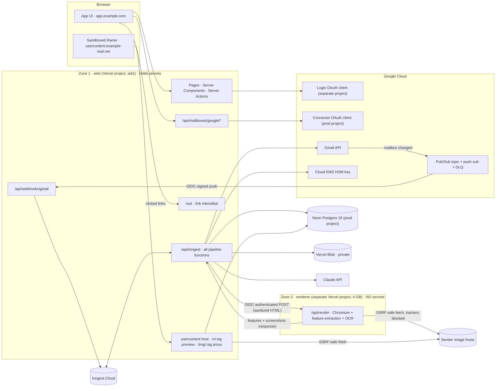
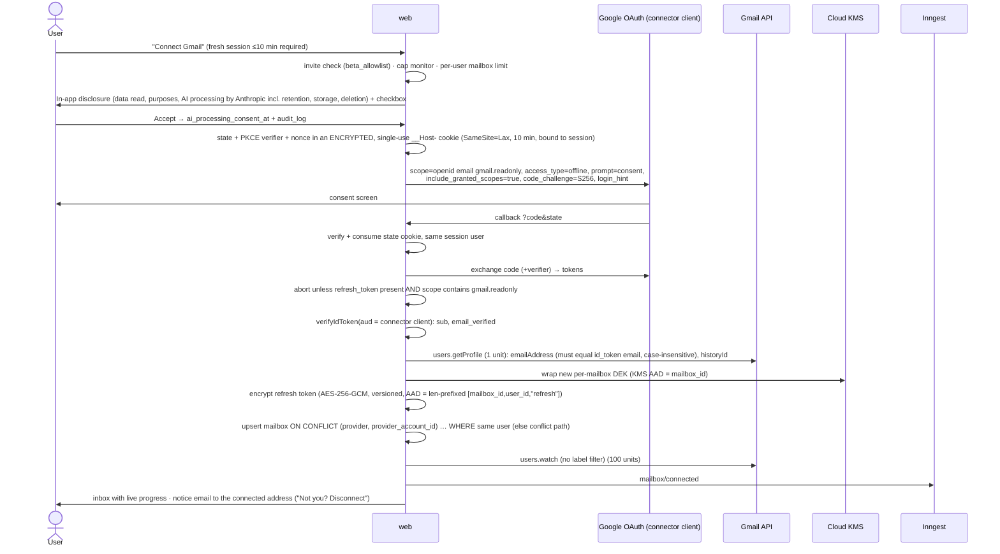
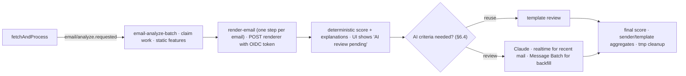

# Email Design Filter — System Design (v1.1)

> Working name: **Email Design Filter**. Date: 2026-09-27. Status: ready to build once the
> decisions in §18 are made.
>
> **v1.1** incorporates four independent adversarial reviews (security & compliance, sync &
> infrastructure, data model & product, scoring methodology). Together they reported 8
> critical and 38 high findings plus ~70 medium/low. Every accepted finding is fixed below;
> §19 lists what changed. The data model was re-verified by executing it on PostgreSQL 18.6.
>
> **Free-tier edition:** [`FREE-TIER.md`](./FREE-TIER.md) describes how this design runs on free plans
> (Vercel Hobby, Inngest Free, Neon Free; Claude Opus 5 is the only paid item). It's what we build **first**.
> This v1.1 document is the target architecture for when the app scales to the public.
>
> **Companion documents:**
> - [`DESIGN-SCORE.md`](./DESIGN-SCORE.md): the Email Design Score methodology.
> - [`DATA-MODEL.md`](./DATA-MODEL.md): schema, roles, RLS, retention, verification results.
> - [`RESEARCH-NOTES.md`](./RESEARCH-NOTES.md): the verified facts behind every limit and
>   decision, with sources, checked live on 2026-09-27.

---

## 0. TL;DR

| Topic | Decision |
|---|---|
| **What it does** | Connects to the user's Gmail read-only and pulls in the automated mail from sites and services they signed up for: newsletters, promotions, product updates, receipts, security alerts. It organises and classifies that mail, surfaces what matters, extracts deals, and gives every designed email an explainable **Design Score (0–100)**. |
| **Stack** | Next.js 16.3 (≥ 16.3.6; 16.3.7 on 2026-09-30) · React 19.3 · TypeScript 6.0 · Node 24 · Tailwind 4 + shadcn/ui · Better Auth 1.7 · Drizzle 0.45 · Neon Postgres 18 · **Inngest** · Vercel Blob (private) · Claude API · headless Chromium (`@sparticuz/chromium` 153 + `puppeteer-core` 25.11) |
| **Hosting** | Vercel **Pro**, region `iad1`. Three trust zones:<br>① **web**: the app plus workers. It holds the DB, KMS and Gmail access.<br>② **usercontent**: a separate registrable domain, cookie-free, that serves sanitized email previews and proxied images.<br>③ **renderer**: a separate Vercel project running Chromium that holds **no secrets**. |
| **Email access** | Gmail API `gmail.readonly` only. Time-sliced backfill (newest first, default 90 days). Near-real-time incremental sync: Gmail push → Pub/Sub → webhook → `history.list`. A **message ledger** means no message is lost when the cursor advances. A **shared per-mailbox quota bucket** keeps every call within Gmail's 2026 limits. Personal mail is never stored. |
| **Auth** | Better Auth for app login: Google basic scopes only, in a **separate Google Cloud project**. A separate first-party OAuth flow connects mailboxes. Refresh tokens are envelope-encrypted with a **Cloud KMS HSM key**, reached through Vercel OIDC → Workload Identity Federation (no static keys). An invite gate protects the unverified-app cap. |
| **Classification** | Header and structure rules, then a per-sender prior, then Claude for the ambiguous rest, cached per sender and template. 13 internal types shown as 8 filter groups. Importance with time-decaying boosts. Deals, tracking, trust and "suspicious" signals. |
| **Design Score** | 9 pillars and 62 checks. 86 points come from measurable checks (WCAG, RFCs, client data). **At most 14** come from an anchored Claude vision rubric. Hard caps mean broken emails can never be "Good". Explanations add up exactly to the score. |
| **Filters** | Scope (Subscriptions · Receipts & account · All) · Type · Importance · Design band + issues · Sender (new, frequency, unsubscribed-but-still-sending) · Engagement · Deals · Suspicious · Date · search · smart views · in-app triage (Done/Pin) |
| **Scale** | Stateless web tier. Inngest flow control plus a Postgres token bucket per mailbox. Keyset pagination. RLS-safe search via definer functions. Blob storage for heavy artifacts. |
| **Biggest external constraint** | `gmail.readonly` is **restricted**. A public launch needs Google brand + restricted-scope verification **and** a yearly CASA assessment: about 6+ weeks, roughly $675–$5,400/yr at an authorized lab. Until then the app is an **invite-only private beta**, capped at 100 users for the project's lifetime. **Start verification in week 1.** |

---

## 1. Goals, non-goals, constraints

**Goals**
1. See all mail from sites and services you signed up for in one place, without missing what
   matters: security alerts, failed payments, expiring deals, newsletters you actually read.
2. Practical, accurate classification and filtering.
3. An evidence-based, explainable design assessment of every designed email.
4. Security and privacy good enough to pass Google restricted-scope verification and CASA.
5. Scale to thousands of emails per user and many concurrent users, and be quick to build on
   Vercel.

**Non-goals (v1)**
- Sending, deleting or labelling mail in Gmail (that would need broader restricted scopes).
- Automatic unsubscribing. We act only on an explicit click; one-click POST is phase 5.
- Training any model on user mail, which Limited Use forbids.
- Outlook and IMAP. Outlook via Microsoft Graph is phase 5.

**Constraints that shape the design** (sources in RESEARCH-NOTES.md)

| Constraint | Consequence |
|---|---|
| `gmail.readonly` and `gmail.metadata` are both **restricted**. CASA applies to any server-side processing, and sending data to an AI provider counts as a third-party server. | Choose `gmail.readonly`. Budget for verification and CASA (spec v2.1.1, AL1/AL2 assigned by Google, lab-verified; self-scan is deprecated). |
| An unverified app has a **100-user lifetime cap** (not resettable). In Testing status, refresh tokens die after **7 days**. | Invite gate plus cap monitor. Separate dev and prod Google Cloud projects. Treat `invalid_grant` as "reconnect". |
| Gmail quotas for projects created on or after 2026-05-01: **6,000 units/min per user**, **1.2M units/min per project**, **80M/day** billing threshold. Unit costs: `messages.get` 20, `attachments.get` 20, `threads.get` 40, `messages.list` 5, `history.list` 2, `watch` 100. Inngest throttle limits run *starts*, not steps or retries. | One **shared quota bucket** that every Gmail call site reserves from. Backfill paced newest-first. Retries skip completed work. |
| Limited Use: user-facing features only; no humans reading, ads, selling or general-model training; AI transfer only with consent. Required controls: token encryption, HSM-grade keys, prompt-injection protection. | Disclosure before consent. KMS from the first real user. Prompt-injection controls. Team-owned calibration corpus. Consented, time-limited staff review only. |
| Vercel: 300s default / 800s max duration (Pro), 4.5 MB body limit, memory set **per project**, Fluid compute shares instances. Hobby prohibits commercial use. | Durable step jobs with IDs-only payloads. Renderer in its own project. Pro plan. |
| Vercel Workflows (GA) has no per-key concurrency or throttle yet. Queues is beta. | **Inngest** for orchestration. |

---

## 2. Technology stack

Versions were verified on 2026-09-27. Pin exact versions. pnpm is set to `minimumReleaseAge: 4320`
(3 days) for supply-chain safety.

| Layer | Choice | Why / notes |
|---|---|---|
| Runtime | **Node.js 24.x** | Vercel default. Node 20 is deprecated on Vercel from 2026-10-01. Several dependencies need ≥ 22. |
| Framework | **Next.js ≥ 16.3.6** (upgrade to 16.3.7 on release) + React 19.3 | Never deploy < 16.3.6: 2026 had several proxy auth-bypass and RCE advisories. Next vendors the RSC runtime, so patch by upgrading `next`. `proxy.ts` replaces `middleware.ts`. |
| Language | **TypeScript ~6.0.3** | TS 7 breaks the eslint toolchain. |
| UI | Tailwind 4.3 · shadcn/ui (Base UI) · TanStack Table v9 · TanStack Query v5 · nuqs 2.10 · Recharts 3 | Filters live in the URL **except free-text search**, which stays in POST or local state so terms don't leak into logs. |
| Validation | **Zod 4** | Shared across actions, env vars and LLM structured outputs. |
| App auth | **Better Auth 1.7** (Drizzle adapter) | Only the plugins we need (each plugin has had CVEs): Google provider, optional passkeys and 2FA. |
| Mailbox OAuth | **google-auth-library 11** | Own connector flow; also verifies the connector `id_token` and the Pub/Sub push JWT. |
| Gmail client | Thin typed `fetch` client with Zod | Quota reservation, retries and ledger integration. |
| Database | **Neon Postgres 18** · `pg` 8 + `attachDatabasePool()` | The app connects as `app_rw` (SQL-created, NOBYPASSRLS). Prod lives in its **own Neon project without preview branching**. |
| ORM | **Drizzle 0.45.x** + drizzle-kit 0.31 | Stable line. Hand-written SQL migrations for roles, RLS, definer functions and composite FKs. |
| Jobs | **Inngest** (TS SDK v4), **Pro plan from the first beta user** | Per-key concurrency, throttle, singleton, debounce, priority, cancelOn, cron. |
| Object storage | **Vercel Blob, private store** (≥ 2.3) | Accessed only by `web`. The renderer is **not** connected to it. |
| MIME / HTML | postal-mime **3.0.1** (pinned until 4.x has aged) · DOMPurify **3.4.16** + jsdom 30 · cheerio · css-tree · juice · culori · sharp (hardened) · chrono-node · eld · tldts · tesseract.js (OCR, Latin model) | |
| Outbound fetch | undici `Agent({ connect: { lookup } })` pinning validated IPs (or `node:https` + `request-filtering-agent` ≥ 3.2.1) · ipaddr.js 2.5 | SSRF-safe fetcher (§11.7). |
| Rendering | **@sparticuz/chromium 153.0.0 + puppeteer-core 25.11.x** (a matched pair) · axe-core 4.13 | Isolated, secret-free renderer project (§6.2). Patch SLA: redeploy within 7 days of each Chromium security release. |
| LLM | **Claude API** (`@anthropic-ai/sdk`, exact pin) · structured outputs · Message Batches · prompt caching | Stateless Messages API only: no Files API, no tools. Model per task is configurable (§13, §18). |
| Transactional email | Resend or Postmark (our domain) | Daily digest, reconnect and "mailbox connected" notices. Never sends from the user's mailbox. |
| Edge & rate limits | Vercel WAF (with exclusions, §11.2) · BotID on sign-up and connect · Postgres-backed per-user limits | |
| Observability | Sentry 11 (`dataCollection` restricted, Replay off, scrubbing) · `@vercel/otel` · Inngest dashboard · Vercel Log Drain (security logs kept 1 year) | |
| Testing | Vitest 5 · Playwright 1.63 · SQL tests for RLS | |

---

## 3. Architecture



| Component | Responsibility |
|---|---|
| **web** (`apps/web`) | UI and Server Actions (authorization checked in every action); the connector OAuth flow; the Pub/Sub webhook; the `/out` interstitial; **all** Inngest functions, including `render-email`, which *calls* the renderer. It also serves the **usercontent** host through host-based routing. That host is a separate registrable domain whose routes only serve signed previews and images, and it never sees app cookies. |
| **renderer** (`apps/renderer`) | A plain `POST /api/render`. It **verifies the caller's Vercel OIDC token** (`iss` = our team issuer, `sub` = `owner:<team>:project:web:environment:<env>`). It renders the sanitized HTML (5 passes), extracts features (shared `packages/core`), runs axe and OCR, and returns features plus screenshots in the response. It has no DB, KMS, Blob, Gmail, Anthropic or Inngest credentials. Deployment Protection is set to "All deployments", with only web's OIDC admitted as a Trusted Source. |
| `packages/core` | Pure TypeScript: parsing, classifiers, extractors, feature extraction, the scoring engine, explanations, AI schemas. |
| `packages/db` | Drizzle schema, SQL migrations (roles, RLS, definer functions), DAL `withUser()`. |
| `packages/gmail` | REST client, quota bucket, ledger helpers, Pub/Sub JWT verification, token lease and refresh. |
| `packages/crypto` | Envelope encryption with the Cloud KMS adapter. |
| `packages/fetch` | SSRF-safe fetcher, tracker rules, per-recipient-URL detection. |

---

## 4. Authentication & mailbox connection

### 4.1 App sign-in (Better Auth)

- **OAuth client.** Google sign-in uses the **default basic scopes only**, from a **dedicated
  "login" Google Cloud project**. Google's `/revoke` removes every grant in a *project*, so
  keeping login in its own project means a mailbox disconnect, or a policy action on the
  restricted-scope project, can't break sign-in, export or deletion.
- **Better Auth config:**
  - `includeGrantedScopes: false`; no offline access.
  - `account.encryptOAuthTokens: true` with versioned `secrets`.
  - `rateLimit.storage: "database"`; `advanced.ipAddress.ipAddressHeaders: ["x-real-ip"]`.
  - Don't persist raw IPs in sessions (`disableIpTracking`). Verify at build time that the
    rate limiter still works; otherwise disclose.
  - `nextCookies()` last.
- **Sessions:**
  - DB sessions: `expiresIn` 7 days, `updateAge` 1 day, **absolute 30-day cap** enforced in
    the DAL.
  - `freshAge` 10 min, required for export, delete, disconnect and adding a mailbox.
  - `__Secure-`/`__Host-` cookies, `HttpOnly`, `SameSite=Lax`.
  - Logout revokes the session and sends `Clear-Site-Data: "cookies","storage"`.
- **`proxy.ts` is not an auth boundary.** It does optimistic redirects only. Authorization
  lives in the DAL and in every Server Action and route handler.
  A signed-out request is redirected to `/sign-in?next=<path>` (the path only; the query is
  dropped; nothing for `/today` or `/out`). The sign-in page accepts `next` only as a same-origin
  app path (allowlisted top-level section, no `//`, backslash, encoded `/` or `\`, dot segments,
  scheme, query or fragment, ≤ 512 chars) and otherwise falls back to `/today`.

### 4.2 Why mailboxes are separate from Better Auth accounts

In Better Auth, any linked OAuth account becomes a login method. It also refreshes only 5s
before expiry, with no lock. A dedicated `mailbox` table with our own flow means:
- mailboxes aren't login credentials;
- a user can have several mailboxes, and Outlook fits later;
- each mailbox has its own lifecycle;
- workers control token refresh.

### 4.3 Connect flow



Rules:
- **Identity** is the verified `id_token.sub`. `getProfile.emailAddress` is stored as the push
  lookup key.
- **Conflict**: the mailbox is already bound to another app user. Fresh proof of control
  wins: after re-consent, the old binding is purged **without** calling `/revoke`, which
  would kill the new grant, and **both** accounts are notified. A mailbox in
  `disconnecting` state is rejected with "finishing disconnect — try again shortly".
- If the mailbox address differs from the login address, the session must be ≤ 5 minutes old.
- **`prompt=consent` only on first connect or reconnect.** Google keeps at most 100 refresh
  tokens per account per client.
- **Reconnect keeps the existing cursor** and tries `history.list`. Only a 404 triggers a gap
  backfill from `last_synced_at`. Reconnect never re-runs the full backfill.
- `returnTo` accepts relative paths only.

### 4.4 Token protection

- **Envelope encryption.**
  - One random 256-bit DEK per mailbox, wrapped by a **Cloud KMS HSM** key
    (`additionalAuthenticatedData = mailbox_id`, with `ciphertextCrc32c` verified).
  - The refresh token (and the cached access token) are AES-256-GCM with a random 96-bit
    nonce, a format version byte, and length-prefixed AAD `[mailbox_id, user_id, purpose]`.
  - An unwrapped DEK is cached only for the duration of one invocation, never across users.
- **KMS access.** Vercel OIDC → **Google Workload Identity Federation**, in team issuer mode:
  - Attribute condition
    `assertion.sub == "owner:<team>:project:web:environment:production"`.
  - `roles/cloudkms.cryptoKeyEncrypterDecrypter` is granted **on that single key** to that
    principal only.
  - Previews and dev use the dev project's key; the renderer has no binding at all.
  - Cloud KMS Data Access audit logs are on, with an alert when decrypt volume exceeds 3× the
    baseline.
  - Runbook note: renaming the Vercel team or project breaks the binding.
- **No env-var master key for real users.** Google's HSM-grade key requirement applies before
  verification too. `env:v1` is allowed for local development only.
- **Refresh:**
  - Take a **lease** (`refresh_lease_until`) with a conditional UPDATE, do the HTTP refresh
    outside any transaction, then re-read. No database lock is held across HTTP.
  - `invalid_grant` → `status='needs_reauth'`, only if `status='active'` (a conditional
    update), and email the user.
  - `invalid_client`, `unauthorized_client` or `deleted_client` → a **global incident**, not
    per-mailbox reauth.
- **RISC** (Cross-Account Protection) subscription, before verification: `tokens-revoked` and
  `account-disabled` events mark mailboxes `needs_reauth`.

---

## 5. Email retrieval & sync

### 5.1 Retrieval options

| Option | Verdict |
|---|---|
| **Gmail API, `gmail.readonly`** | **Chosen.** History, push, labels, deletions. |
| `gmail.metadata` | Also restricted; no bodies and no `q`. Rejected. |
| IMAP (`https://mail.google.com/`) | Broader scope, password-like credentials, no push, needs long-lived connections. Rejected. |
| **Forwarding / dedicated subscription address** | **Phase-5 companion channel.** Needs no Google scopes and works with any provider, but only covers future mail. It's also a scope-free fallback if verification stalls. |

### 5.2 Gmail call rules and the shared quota bucket

- **Every** Gmail call site reserves quota units first from the per-mailbox Postgres token
  bucket (`gmail_quota`):
  - background fetches, sync and watch calls;
  - on-view fetches in the viewer and on-demand re-renders;
  - `attachments.get`, `messages.list`.

  The reservation:
  ```sql
  UPDATE gmail_quota
     SET tokens = LEAST(5500, tokens + EXTRACT(EPOCH FROM now() - updated_at) * 5500/60) - $n, updated_at = now()
   WHERE mailbox_id = $1
     AND LEAST(5500, tokens + EXTRACT(EPOCH FROM now() - updated_at) * 5500/60) >= $n + $floor
  RETURNING tokens;
  ```
- **Floors:** `$floor = 1000` for background work, which keeps ~1,000 units/min in reserve so
  interactive viewing never gets 429s, and `0` for the viewer. If background work can't
  reserve, it throws `RetryAfterError(computed wait)`.
- Inngest throttles stay in place as secondary smoothing, but the bucket is the real guard.
  That matters because Inngest throttle doesn't cover steps or retries.
- **Formats.** `messages.get` costs 20 units whatever the format.
  - **Primary-tab mail** is fetched **headers-only** with
    `format=metadata&fields=id,threadId,labelIds,historyId,internalDate,sizeEstimate,payload/headers`
    (no snippet).
  - Automated mail is fetched with `format=full` and `fields=`.
  - A `text/html` part that arrives as `attachmentId` is fetched with `attachments.get`
    (reserved). `cid:` images: up to 10 per email, fetched only for emails ≤ 14 days old or on
    demand, and inlined as capped `data:` URIs. For older backfill emails they're
    placeholders, and the affected checks are `not_evaluated`.
- **Transport.** No Gmail batch HTTP (it doesn't save quota). ≤ 4 concurrent requests per
  mailbox via an undici `Agent({ allowH2: true })`. Epoch seconds in `q`.
- **Query safety.** Addresses interpolated into `q` (for example the personal-override check)
  are validated: reject `"`, whitespace, `{}` and `()`, and quote the address.

### 5.3 Message ledger (no lost mail)

`message_ledger (mailbox_id, provider_message_id)` records every id we learn about, with
`state ∈ {pending, pending_full, stored, skipped, failed}`.

- **Incremental sync** inserts ledger rows and advances the cursor in the **same transaction**.
  **Backfill list steps** write ledger rows and return only `{nextPageToken, count}`.
- **Fetch steps** skip ids that are already `stored` or `skipped`, so a retry only fetches
  what's left. Each message is processed in its own try/catch: a malformed message becomes
  `failed`, with a reason, and never fails the batch.
- **Re-drive cron** (every 10 min): re-enqueues `pending`/`pending_full` rows older than 15
  min. After 5 attempts a row becomes `failed`, which is visible in the Settings sync-health
  panel.
- **Progress counts** in the UI come from ledger states, so retries never double-count.
- **Re-evaluation:** a `skipped` row is deleted and re-fetched when `SPAM` is removed from the
  message, or when the classifier version changes (for personal/automated edge cases).

### 5.4 Backfill (initial import)

Trigger: `mailbox/connected`, or a manual re-import, which bumps `backfill_generation`.
`gmail-backfill` is configured with `singleton {key: "event.data.mailboxId", mode: "skip"}` and
`cancelOn: mailbox/disconnected`.

1. **Time slices, newest first**: last 2 days, then 7, then 30, then the window (default 90
   days, max 180 in beta). Within each slice the backfill lists:
   - **Q1** `{category:promotions category:updates category:social category:forums} -in:sent -in:drafts -in:chats after:<s> before:<e>`,
     which gets `full` fetches;
   - **Q2** `-category:promotions -category:updates -category:social -category:forums -in:sent -in:drafts -in:chats after:<s> before:<e>`,
     which gets `metadata` first, then `full` only if automated.

   So yesterday's receipts and security alerts arrive within about a minute.
2. **Pacing.** At most 2 outstanding fetch chunks per mailbox. Follow-up `full` ids are
   buffered until there are 50, or 60 seconds pass.
3. **Event ids**: `fetch:{mailboxId}:{mode}:{sha256(sortedIds)[:32]}:{generation}`. Inngest's
   24h dedup is global, so ids must be content-derived.
4. **New-sender check.** For each new sender: `messages.list q="from:<addr> before:<window_start>" maxResults=1`
   (5 units) sets `seen_before_window`, so "New senders" is correct right after backfill. It runs
   once the backfill rows are drained (senders exist only once their mail is stored).
5. **On completion**, emit `gmail/notification.received {source: post_backfill}`. It replays
   history from the cursor saved at connect time, and ledger filtering makes the replay cheap.

**Throughput.** Background work gets ~4,500 units/min (a 5,500 bucket minus the 1,000 floor).

| Typical 90-day mailbox | Count | Units |
|---|---|---|
| Automated via Q1 | ~2,900 | 20 each (full) |
| Automated via Q2 | ~720 | 40 each (metadata + full) |
| Personal via Q2 | ~900 | 20 each (metadata) |
| **Total** | | **≈ 105k units ≈ 25–35 min**, with the first two days visible almost immediately |

**Project-wide:** the 80M units/day threshold allows ≈ 750 such backfills per day.

### 5.5 Fetch functions

Two functions: `gmail-fetch-sync` (new mail) and `gmail-fetch-backfill`. Both call only the
shared `fetchAndProcess(batch)`.

```ts
// gmail-fetch-sync
{ id: "gmail-fetch-sync", triggers: { event: "gmail/messages.fetch.sync" },
  concurrency: [{ key: "event.data.mailboxId", limit: 1 }, { scope: "env", key: '"gmail"', limit: G }],
  throttle: { key: "event.data.mailboxId", limit: 2, period: "1m", burst: 2 },
  retries: 8, cancelOn: [{ event: "mailbox/disconnected", if: "async.data.mailboxId == event.data.mailboxId" }] }
// gmail-fetch-backfill: same, with throttle { limit: 3, period: "1m", burst: 0 }
// G = target_units_per_min / 1000 × avg_run_seconds / 60 — sized from measurement; scope "env" (not shared with preview/dev).
```

`fetchAndProcess` handles each message in its own try/catch and commits per message:

1. **Skip.** `SENT`, `DRAFT`, `CHAT`, `SPAM` and auto-replies → ledger `skipped` (with a reason).
2. **Parse and classify headers (§7.2).** Personal → `skipped` (reason `personal`); nothing
   is stored. Automated from a metadata fetch → ledger `pending_full`.
3. **Extract from raw HTML** before sanitizing: schema.org data, visible text, links, pixels,
   template simhash, and **declared fonts** (`fonts_static`, including Outlook conditional
   comments; §8.1).
4. **Classify** type, security-sensitivity, deals, language, ESP and trust.
5. **Upsert `email`, race-safe.** `ON CONFLICT … DO UPDATE … WHERE email.gmail_history_id <= EXCLUDED.gmail_history_id`.
   Any `pending_label_delta` held in the ledger is applied if it's newer.
6. **Sender and template.** Aggregates are incremented only on a real insert. Template
   matching runs under an advisory lock.
7. **Design-eligible emails** (automated, HTML, not security-sensitive): the sanitized
   analysis-profile HTML goes into **one** NDJSON.gz Blob object per batch
   (`u/{user}/m/{mailbox}/tmp/{batchHash}.ndjson.gz`, `allowOverwrite: true`).
8. **Enqueue analysis** after the step, via `step.sendEvent` with
   `id: analyze:{sha256(sortedEmailIds)}` and `source` carried through.

Errors:

| Error | Handling |
|---|---|
| 401 | Refresh the token (lease) |
| `invalid_grant` | `needs_reauth` + `NonRetriableError` |
| 403 `rateLimitExceeded`/`userRateLimitExceeded`, or 429 | `RetryAfterError` with backoff (1s → 64s, jitter) |
| 403 `dailyLimitExceeded` | Global pause + alert |
| 403 `domainPolicy`/`insufficientPermissions`, 400 `failedPrecondition` | `paused` + user message, non-retriable |
| 404 message | Ledger `skipped` (deleted) |
| 5xx | Retry |

### 5.6 Incremental sync

**Pub/Sub setup:**
- One topic per environment, in the connector's project.
- Grant `gmail-api-push@system.gserviceaccount.com` publish rights. Add an org-policy exception
  if Domain Restricted Sharing is on.
- Push subscription to `https://<app>/api/webhooks/gmail`:
  - OIDC auth (dedicated service account, explicit audience);
  - `ackDeadline` 30s;
  - `--expiration-period=never`;
  - a dead-letter topic after 10 attempts, and a retry policy.

**Webhook:**
1. Verify the JWT (`aud`, `iss`, `email` = our push service account, `email_verified`).
2. `lookup_mailbox_for_push(emailAddress)` (definer function).
3. `await inngest.send({ id: "gmail-push-" + messageId, name: "gmail/notification.received", data: { mailboxId, source: "push" } })`.
4. Return 204. On an enqueue failure return 500, so Pub/Sub retries. An unknown mailbox also
   gets 204.
5. Log only `sha256(emailAddress)`.

**`gmail-incremental-sync`** config:
```
debounce:    { key: "event.data.mailboxId", period: "20s", timeout: "45s" }
concurrency: [{ key: "event.data.mailboxId", limit: 1 }]
retries:     6
cancelOn:    mailbox/disconnected
```

The sync body is **one step**:
1. Check `status='active'` with `FOR SHARE`.
2. Read the cursor.
3. Page `history.list` with `historyTypes = [messageAdded, messageDeleted, labelAdded, labelRemoved]`.
4. **Pre-filter** using `labelIds` when history includes them. Drop
   `DRAFT`/`SENT`/`CHAT`/`SPAM` and ids deleted in the same batch. Route `CATEGORY_*` ids
   straight to `full`, and everything else to `metadata`.
5. **Apply label deltas race-safely.** `UNREAD`, `STARRED`, `IMPORTANT`, `TRASH`, `SPAM` and
   `CATEGORY_*` use `WHERE gmail_history_id < h`. For rows not stored yet, stash the delta on
   the ledger. `SPAM` removed → re-fetch.
6. `messagesDeleted` → hard delete, with `blob_gc` via trigger.
7. Insert ledger rows **and** do the cursor CAS
   (`history_id IS NULL OR history_id < $new`) **in one transaction**.
8. A following `step.sendEvent` enqueues the fetches (`source: sync`).
9. **Import storms**: more than 2,000 `messagesAdded` switches to a windowed
   `messages.list after:`.

**History 404:** set `resync_pending`. The event id is
`resync:{mailboxId}:{staleHistoryId}`, so it's deduplicated, and sync exits early while it's
pending. Resync takes a new cursor from `getProfile` **first**, then does a bounded
re-backfill over `max(14 d, now − last_synced_at)`, capped at the window.

### 5.7 Safety nets (Inngest cron, UTC; cross-tenant reads through definer functions, paginated)

| Job | Schedule | What it does |
|---|---|---|
| `gmail-watch-renew` | hourly | Mailboxes with `watch_expires_at < now() + 2 days` → `users.watch`, throttled and spread out, not all at once |
| `gmail-reconcile` | hourly | Mailboxes with no push for 2h → `notification.received {source: reconcile}`. In dev, which has no Pub/Sub, every 5 min. |
| `ledger-redrive` | every 10 min | See §5.3 |
| `token-health` | daily | Refresh tokens idle for more than 5 months |
| `importance-decay` | every 15 min | Re-score rows with `importance_expires_at < now()` |
| `retention` | daily | Screenshots → thumbnails; `tmp/` older than 24h; `blob_gc`; `sync_run` older than 30d; `skipped` ledger rows older than 400d; `needs_reauth` mailboxes older than 30d → purge |
| `sender-aggregates` | nightly | Recompute aggregates for active users; frequency-spike detection for Insights |
| `digest` | per user timezone | Daily digest of high-importance items (§9.5) |

### 5.8 Disconnect & deletion

`mailbox/disconnected` runs, in order:
1. `status='disconnecting'` (with `FOR UPDATE`). All writers check the status and exit quietly
   unless it's `active`.
2. **`users.stop`**, while the token is still valid.
3. **`/revoke`.** This happens only here and on account deletion; never on reconnect,
   transfer or partial consent.
4. `step.sleep("10m")`, so in-flight steps can finish or cancel.
5. Batch-delete emails (5,000 per transaction).
6. Delete the mailbox row (cascade).
7. Delete orphan senders and templates.
8. Delete Blob objects by prefix `u/{user}/m/{mailbox}/`.
9. Run a second sweep.
10. Write an audit entry.

**Account deletion** runs this for each mailbox, then deletes the user (cascade), then the
`u/{user}/` prefix.

### 5.9 Outlook later (phase 5)

Microsoft Graph with MSAL:
- `Mail.Read` + `offline_access`;
- delta queries per folder;
- subscriptions renewed before 10,080 min, with lifecycle notifications;
- serialized refresh-token rotation;
- publisher verification.

`mailbox.provider` and `packages/gmail` are shaped for this.

---

## 6. Analysis pipeline



### 6.1 Functions

**`email-analyze-batch`** (≤ 10 ids per event):
- `concurrency [{key: userId, limit: 2}]`, `priority { run: "event.data.source == 'sync' ? 600 : 0" }`.
- **Claims** work with `UPDATE email SET design_ai_state='queued' WHERE id = ANY($1) AND design_status IN ('pending','failed') RETURNING id`,
  so a retry never pays for rendering or Claude again.

**`render-email`**:
- `concurrency [{scope: "env", key: '"renderer"', limit: R}]`, the same priority.
- **One `step.run` per email**, with a 60s fetch timeout; `step.invoke` timeout 30m.
- It POSTs the batch's sanitized HTML for one email, plus inline `cid:` data and config, to the
  renderer, authenticated with web's OIDC token (`getVercelOidcToken()`).
- It uploads the returned screenshots to private Blob (`cacheControlMaxAge: 60`), stores
  `features`, and returns Blob keys only.

### 6.2 Renderer (zone ③)

- **Input caps:**
  - HTML ≤ 2 MB (larger → `too_large`; the check is scored from the first 102 KB).
  - DOM ≤ 20k nodes.
  - Per-page deadline 20s (`page.close()`); if the browser doesn't close within 5s, the
    process is killed.
- **Chromium hardening:**
  - Remove `--disable-web-security`, `--allow-running-insecure-content` and
    `--disable-site-isolation-trials` from the Sparticuz defaults.
  - Add `--disable-background-networking --dns-prefetch-disable --js-flags=--jitless --disk-cache-size=0`.
  - `setGraphicsMode = false`.
  - `browser.createBrowserContext()` per job, one job per context, at most 2 pages per
    instance (in-process semaphore).
- **Page setup:**
  - `setJavaScriptEnabled(false)` **before** loading. Content goes in through a
    request-intercepted navigation, which can attach a CSP response header
    (`script-src 'none'`).
  - A zero-specificity sentinel `<style>:where(html){font-family:"__default__"}</style>` is
    injected before the email's CSS, so unset text is detectable (§8.1).
  - axe is injected via CDP evaluation. `addScriptTag` is blocked when JS is off, so that
    path needs a week-1 spike.
- **Network:** every request is intercepted and handled by the renderer itself:
  - `data:` and inlined `cid:` → allow.
  - `http(s)` images → the SSRF-safe fetcher (§11.7), only if image loading is allowed (§6.3).
  - Everything else, including fonts, CSS imports and media, is aborted. Gmail doesn't load
    web fonts either, so this matches what most Gmail readers see. The exceptions are Roboto
    and Google Sans (in Gmail web) and Roboto (as Android's system font); Roboto is bundled so
    those render true to life.
- **Passes:** D, D0, M, M-nomq, M-off (DESIGN-SCORE §2), plus OCR on ≤ 4 large images.
- **Fonts:** metric-compatible fonts (Arimo, Tinos, Cousine, Gelasio; **Roboto**, which Gmail web
  and Android readers really see; Noto Sans / Noto Serif / Color Emoji / CJK subset) are **copied to `/tmp/fonts` at cold start** before launch. A smoke test renders
  "Arial/Georgia/😀/漢字" and checks glyph widths, because missing fonts fail silently.
- **Output:** the compact feature JSON plus WebP screenshots in the response:
  - desktop clipped at 8,000 CSS px;
  - mobile at 6,000 px at 2×;
  - images-off for the first two viewports;
  - total ≤ ~3 MB, under Vercel's 4.5 MB limit.

  sharp runs with `limitInputPixels: 25e6` and `failOn: 'error'`. AVIF, HEIF and SVG images
  are rejected.
- **Fallback** if Chromium on Vercel proves unstable: Vercel Sandbox (Firecracker, with an
  egress firewall), Trigger.dev machines or Browserless. Orchestration doesn't change.

### 6.3 Remote image policy for analysis

Loading a sender's images at ingest can tell the sender the address is live. So:

- **Never fetched:**
  - pixels and tracker hosts;
  - URLs containing the recipient's address, or its MD5/SHA-256;
  - URLs with long high-entropy per-recipient tokens (≥ 24 chars).

  These are rendered as neutral placeholders, and the affected image checks become
  `not_evaluated`.
- **No images at all** for `account_security`, `transactional` and suspicious (failed-auth)
  mail.
- **Privacy mode:** `user_settings.load_images_for_analysis = false` → images-off analysis
  only.
- Fetches come from our servers, so the user's IP is never exposed. This behaviour is
  disclosed in the privacy policy.

### 6.4 AI review economics

The AI criteria and their review rules follow DESIGN-SCORE §6:

- **L8 polish** is reviewed once per **template**: the *oldest* email of the template by Date
  header, so results are reproducible.
- **H7 hierarchy and I6 imagery** are reused from the template **unless** the email is recent
  (≤ 14 days) **and** its deterministic hierarchy proxies or image set differ materially from
  the reviewed exemplar. They're also reviewed on demand.
- **C4 copy** is reviewed for the template exemplar and on demand. Otherwise it's
  `not_evaluated`: its 2.5 points are renormalized and confidence reflects the gap.
- Reused content criteria count 0.5 toward confidence.
- **Backfill** reviews go through **Message Batches** (50% cheaper), with state kept in the DB
  and a poller emitting continuation events (not `waitForEvent`). Recent incremental mail can
  also be batched, since the deterministic score shows immediately.
- **Budget** comes from the per-user LLM reservation (§11.8).

Nothing is shared across users.

---

## 7. Classification

### 7.1 Three separate questions

| Field | Question |
|---|---|
| automated (implicit) | Did an organisation or system send it? Only automated mail is stored. |
| `is_subscription` | Is it list or bulk mail with an unsubscribe mechanism? Drives the **Subscriptions** scope and the footer checks. |
| `primary_type` (+ subtype, secondary tags) | What kind of message is it? |

### 7.2 Automated / subscription detection (headers only)

1. **Exclude** `SENT`/`DRAFT`/`CHAT`, mail from the user's own addresses, and
   `Auto-Submitted: auto-replied`.
2. **Personal override:** no `List-Unsubscribe`, `List-Id` or `Feedback-ID`, **and** the user
   has emailed that address before. This is checked only for ambiguous senders, with a quoted,
   validated `messages.list q='in:sent to:"<addr>"' maxResults=1` (5 units). Result:
   personal. The thread-reply signal was dropped because `threads.get` costs 40 units.
3. **Hard positive:** one-click `List-Unsubscribe-Post` + an https `List-Unsubscribe` +
   trusted `dkim=pass`.
4. **Weighted score:**
   - ≥ 45 → subscription;
   - 25–44 → ambiguous, resolved by the sender prior, then Claude;
   - < 25 → not a subscription.

   Positive signals:

   | Signal | Weight |
   |---|---|
   | `List-Unsubscribe` | +35 |
   | One-click POST | +15 |
   | `List-Id` | +20 |
   | `Feedback-ID` | +15 |
   | ESP/platform fingerprint | +15 |
   | `CATEGORY_PROMOTIONS` | +20 |
   | `CATEGORY_UPDATES`/`SOCIAL`/`FORUMS` | +10 |
   | `Precedence: bulk\|list` | +10 |
   | `Auto-Submitted: auto-generated` | +10 |
   | Unsubscribe link in the body | +10 |
   | Tracking pixel or `utm_medium=email` | +10 |
   | Sender template repeats | +10 |
   | `no-reply`-style local part | +5 |
   | Delivered by BCC | +5 |

   Negative signals:

   | Signal | Weight |
   |---|---|
   | Prior contact | −30 |
   | Free-mail sender domain without list headers | −15 |
   | `CATEGORY_PERSONAL` | −15 |

   The weights are starting points, calibrated on a team-labelled corpus of 500+ messages.

   A message is **automated** if the score is ≥ 25 or any hard signal is present (transactional
   schema.org markup, a transactional ESP, `Auto-Submitted`). A **"This is personal"** action
   hard-deletes the row and blocks that sender for the user.

### 7.3 Types, rules, LLM fallback

The 13 internal types, shown as **8 filter groups** with subtypes as drill-down:

| Filter group | Internal types (subtypes) |
|---|---|
| **Promotions** | promotional (sale, coupon, cart_reminder, product_launch, recommendation) |
| **Newsletters** | newsletter (editorial, digest) |
| **Updates** | product_update (feature, release_notes, announcement), lifecycle (welcome, onboarding, trial_ending, re_engagement), account_notice (terms, privacy, plan changes) |
| **Orders & receipts** | transactional (order, shipping, receipt, invoice, payment_failed, travel, ticket) |
| **Security** | account_security (verification_code, password_reset, login_alert, security_alert) |
| **Notifications** | notification (activity, mention, reminder), social, community (forum, mailing_list, group) |
| **Events** | event (invitation, webinar, event_reminder) |
| **Other** | survey, other |

**Rule cascade** (first confident match wins):
1. schema.org markup (Order, ParcelDelivery, Invoice, *Reservation, DiscountOffer,
   PromotionCard).
2. `text/calendar` part → event.
3. Security patterns (code/OTP/reset/new sign-in plus a 4–8 digit code or confirm link, with
   no promo tokens) → account_security, and `security_sensitive = true`.
4. Billing patterns plus an amount → transactional.
5. Shipping patterns plus a carrier or tracking number → transactional.
6. Travel patterns → transactional.
7. Social signals → social.
8. Forum or list signals → community.
9. Survey patterns → survey.
10. Promo tokens, `CATEGORY_PROMOTIONS`, or a Klaviyo `km*` selector → promotional.
11. Newsletter platform, or long editorial content → newsletter.
12. Lifecycle patterns → lifecycle.
13. "What's new" → product_update; terms/privacy changes → account_notice.
14. Auto-generated plus activity words → notification.
15. **Sender prior**: the user's `type_override`, or a majority type of ≥ 80% over ≥ 5 emails.
16. **Claude** (structured output) with a compact feature vector plus ≤ 1,500 chars of visible
    text as delimited data. Cached per `(sender, template)` in `email_template.classification`.
    `type_source='pending'` until it resolves.

Mixed messages follow the CAN-SPAM **primary-purpose** test: a receipt with a promo footer is
`transactional` with `secondary_tags: [promotional]`. User corrections become that user's
sender-level `type_override`.

**Guardrail against manipulation:** an **LLM-sourced** `account_security` or
`transactional.payment_failed` label raises importance only if the email passed DMARC.
Otherwise importance is capped at `normal`.

### 7.4 Security-sensitive mail (minimization)

This covers `account_security`, plus any message that matches OTP, password-reset or
magic-link patterns (`security_sensitive = true`).

- **Stored:** subject, sender and time only. `snippet = NULL`; the search index covers subject
  and sender only.
- **Never:** rendered, screenshotted, design-scored (`design_status='skipped'`) or sent to
  Claude.
- **Redacted:** 4–8 digit runs near code keywords, and token-bearing URLs, are removed from
  anything stored or displayed outside the live viewer.

### 7.5 Importance

`importance_score` runs 0–100 (high ≥ 60, low < 25), and its reasons are always stored.

| Signal | Points |
|---|---|
| **Base by type:** account_security (login/security alert) | 60 |
| verification_code / password_reset | 60 **for 1h**, then 15 (`importance_expires_at`) |
| payment_failed | 70 |
| shipping (for 14 days) | 40 |
| event | 35 |
| newsletter | 20 |
| promotional | 10 |
| others | 15–25 |
| Engagement: `read_rate_60d` × 25. Read = read in Gmail **or opened in the app**. | +0…25 |
| Gmail IMPORTANT label | +15 |
| Starred | +30 |
| Time-sensitive: deal or deadline within 48h, from a sender the user engages with (expiring boost) | +20 |
| Never-opened high-frequency sender | −20 |
| User bias (per sender) | ±15 per step |

Suspicious mail isn't boosted. It's routed to the **Suspicious** view (§7.8).

### 7.6 Tracking detection (badge and Insights, not a filter)

- **Pixels**: w×h ≤ 25, `max-width/height ≤ 1px`, hidden, path patterns, or tracker-exclusive
  hosts.
- **Click-tracker hosts.**
- **UTM parameters** read from visible hrefs. Redirects are never resolved.
- **Host list**: our own, seeded from Trocker (Apache-2.0). Not Disconnect or DuckDuckGo,
  which are licensed NC (non-commercial).

### 7.7 Deals

1. schema.org `DiscountOffer` from the raw `<head>`.
2. Regex over visible text: % off, amount off, BOGO, free shipping, plus a coupon-code pattern
   that must contain a letter, sit near "code", and not look like an order or tracking number.
3. Expiry via chrono-node, anchored to the Date header, plus a phrase table. **Undated deals
   expire 14 days after receipt** (low confidence).
4. Claude verifies ambiguous, high-value cases.

`deal_ends_at` is the **latest** expiry among an email's deals. Deals are stored with
replace-set semantics and a dedupe key. Codes stay private.

### 7.8 Trust and "Suspicious"

- The badge follows DESIGN-SCORE §9.
- **Suspicious** = DMARC `fail`, and From not aligned, and no `arc=pass` in Gmail's own
  `Authentication-Results`. Gmail already sends most DMARC failures to spam; what's left is
  mostly forwarded or mailing-list mail, which this definition excludes.
- Suspicious `account_security` or `transactional` mail goes to a **Suspicious** view with a
  warning, and links in the viewer are disabled. For other types, only the badge is shown.

---

## 8. Email Design Score (summary)

Full spec: **[DESIGN-SCORE.md](./DESIGN-SCORE.md)** (v1.1).

| Pillar | Pts | Examples |
|---|---|---|
| Accessibility | 20 | WCAG AA contrast, share of characters, monotonic scoring and a paint test for hidden text · alt quality with anti-stuffing · link purpose · lang · table roles · headings · 24px targets · reading order · images of text (OCR) |
| Mobile & Responsiveness | 15 | Fit factor k at 375px · fluid without media queries · column width · CTA touch size · image adaptation and sharpness · dark-mode simulation · side gutters |
| Readability & Typography | 15 | Effective mobile body size · desktop size · measured line pitch · line length (CJK-aware) · alignment · type system · caps · Flesch (English) |
| Visual Hierarchy & CTA | 15 | CTA presence and placement (bottom edge × k) · prominence · label clarity · focus by distinct labels · type-scale contrast · **AI hierarchy (6)** |
| Images & Media | 10 | Not image-dominated · key content as live text (OCR) · images load (link-rot aware) · images-off resilience · weight · **AI imagery (1.5)** |
| Layout, Color & Consistency | 10 | Container width · whitespace · clutter (top decile per type group) · alignment anchors · colour discipline · component consistency · brand coherence · **AI polish (4)** |
| Content & Structure | 5 | Subject line · Gmail snippet as preview · scannability · content length by type · **AI copy clarity (2.5)** |
| Technical Health | 5 | Gmail clipping (outcome-based) · client-compatibility risk · merge tags, link integrity and NXDOMAIN · 16 KB style budget with the @media cut-off |
| Footer & Unsubscribe UX | 5 | Visible unsubscribe (also matched via the List-Unsubscribe host) · legibility · preferences · "why you're receiving this". Subscriptions only. |

- **Caps:** image-only ≤ 49 · contrast ≤ 59 · broken images ≤ 59 · mobile-broken ≤ 64 ·
  CTA or content clipped ≤ 69 · merge tag ≤ 69.
- **Bands:** Excellent 85+ and Good 70–84 form **Good design**. Needs work is 50–69. Poor < 50
  is **Bad design**. (The gallery's stricter Good / Okay / Bad verdict — score < 60, any cap, an
  email that is just pictures (or whose pictures didn't load), a layout that shrinks body text
  under 12.5 px on phones, the unsubscribe link after Gmail's cut, or marketing mail with no
  unsubscribe link — is in DESIGN-SCORE.md §3.1.) Low-confidence scores, and scores near a band edge while the AI review is
  pending, are shown as **Provisional**.

Example output (illustrative):

```
Email Design Score: 81 / 100 · Good · confidence High · better than 72% of your subscription emails
Accessibility 16.9/21.2 · Mobile 13.4/15.9 · Typography 13.1/15.9 · Hierarchy & CTA 12.4/15.3 · Images 8.8/10.2
Layout 7.6/10.1 · Content 3.9/5.1 · Technical 4.6/5.3 · Footer 0.4/1.0 … (effective maxima sum to 100)

Good
 ✓ Primary button "Shop the sale" is in the first screen on mobile and 48px tall
 ✓ Body text is 16px on mobile with a measured line height of 1.5
 ✓ Fits a 375px phone without shrinking; single-column layout
 ✓ Headline and offer are live text — readable with images off
 ✓ One clear focal point; secondary products visually subordinate            [AI review]

Needs improvement
 ✗ Unsubscribe link is 10px light-grey text (contrast 2.1:1) — aim for ≥12px and ≥4.5:1
 ✗ 3 of 11 images have no alt text (incl. the hero banner)
 ✗ 18% of text fails WCAG AA contrast (grey #9A9A9A on white = 2.8:1)
 ✗ HTML is 94 KB — close to Gmail's ~102 KB clipping limit
Sender trust: DMARC pass · One-click unsubscribe ✓ · Postal address ✗ · 2 tracking pixels
```

### 8.1 Font profile: which fonts an email uses (informational, not scored)

For every designed email we extract **which font families it uses, where, and how much**,
plus **what readers likely see in each major email app**. Most apps ignore web fonts, and
classic Outlook has a well-known Times New Roman fallback bug.

**What the user sees** (a "Fonts" card on the email page):

```
Montserrat   headings · 23% of text · web font (Google Fonts) · weights 400, 700
Inter        body text · 74% of text · web font (Google Fonts) · weights 400, 600
Arial        backup font in both stacks
⚠ Gmail doesn't load web fonts — Gmail readers likely see Arial (Roboto on Android) instead of Montserrat and Inter.
⚠ Outlook for Windows (classic) likely shows Times New Roman — the web fonts are linked with no Outlook fallback
  (no mso-font-alt, no Outlook-safe wrapper).
  Apple Mail and iOS Mail show the web fonts.
Loaded but not used: Lato
At least 2 images contain text — fonts inside images can't be identified.
```

**1. Declared fonts, extracted at ingest from the raw HTML.** This happens in §5.5 step 3,
the only place the raw HTML still exists. The sanitizer removes `<link>`, `@import`,
`@font-face` and conditional comments, and Chromium never sees `<!--[if mso]>` blocks.
Ingest emits a compact `fonts_static` JSON (≤ 2 KB) into the email's line of the batch NDJSON
next to the sanitized HTML, and analysis merges it with the render data. It's never
re-derived from sanitized HTML. It records:

- **`@font-face` rules:** family name, and the provider from the `src` host
  (`fonts.gstatic.com` means Google Fonts; other hosts mean self-hosted, stored as the
  registrable domain only).
- **Font-service `<link>`/`@import` URLs:**
  - **Google Fonts** has two grammars:
    - css v1: `fonts.googleapis.com/css?family=Open+Sans:400,700i|Roboto`. Families are
      `|`-separated, with styles as weights plus optional `i`/`italic`, or `bold`,
      `bolditalic`, `b`, `i`, `bi`.
    - css2: `fonts.googleapis.com/css2?family=Montserrat:ital,wght@0,400;1,700&family=Inter`.
      `family=` repeats, axis tuples are supported, a range like `wght@100..900` is shown as
      "variable 100–900", and no axes means 400 normal.

    HTML entities (`&amp;`) are decoded first, and `+` and `%20` count as spaces.
    `fonts.googleapis.com/icon` and Material Icons/Symbols are icon fonts and are excluded.
  - **Bunny Fonts** (`fonts.bunny.net`) uses the same grammars. Its lowercase slugs
    (`open-sans`) are mapped to display names through the catalog.
  - **Adobe Fonts** (`use.typekit.net/<kit>.css`) and **Fonts.com/Monotype**
    (`fast.fonts.net/cssapi/<project>.css`): the URL has only a kit ID, so we record the
    **provider only**. Family names come from the CSS stacks; Adobe uses slugs like
    `proxima-nova`, displayed as "Proxima Nova". `p.typekit.net` is Adobe's page-view counter:
    it counts as provider evidence and is also reported as a tracker (§7.6).
  - Any other stylesheet link: provider = registrable domain only.
- **Outlook-specific signals,** read from conditional-comment bodies with parse5:
  - `mso-font-alt` / `mso-generic-font-family` inside `@font-face`;
  - whether each `@font-face`/`<link>`/`@import` is hidden from Outlook, either inside an
    `@media` block or inside `<!--[if !mso]><!-->…<!--<![endif]-->`;
  - any `font-family` set in `<!--[if mso]>` or `<!--[if gte mso 9]>` style blocks.
- **No network requests.** Only parse5, css-tree and `juice(html)` are used.
  `juice.juiceResources`, `juice.juiceFile` and web-resource-inliner are **banned by a lint
  rule**, and a CI test runs extraction with outbound network blocked. We store only provider
  names, family names and weights, never font or stylesheet URLs.

**2. Used fonts, from the render we already do** (pass D):
- **Capture.** The DOM snapshot's `computedStyles` whitelist includes `font-family`,
  `font-weight`, `font-style` and `font-size`. A text box takes its parent element's computed
  style, so inheritance, the `font` shorthand and legacy `<font face>` all resolve correctly.
  The computed `font-family` is the declared stack, not the font actually rendered, so the
  renderer's substitute fonts never leak into results.
- **"No font set" sentinel.** Before the email's CSS, the renderer injects
  `<style>:where(html){font-family:"__default__"}</style>`. It has zero specificity, so any
  author font wins, and rendering is unchanged. Text with no author font now reports
  `__default__` and is shown as **"No font set (each app's default)"** instead of Chromium's
  default Times New Roman. It's excluded from `font_families`, T6 and X2.
- **Counting:**
  - Only **rendered** runs count (DESIGN-SCORE §2.1; the preheader is excluded).
  - Characters are counted by summing TextBox `length`. Whitespace, U+00A0, U+034F,
    U+200B–U+200D, U+2060, U+FEFF and emoji (Extended_Pictographic) are skipped.
  - Han, Kana and Hangul characters count ×2.
  - A family is **used** if it covers ≥ 1% of counted characters or ≥ 20 characters. Smaller
    families appear only in the stacks view, so spacer cells and `©` symbols don't add fonts.
- **Share and role:**
  - Share = the family's characters ÷ all counted characters, footer included.
  - Each run gets **one role**, by the first matching rule: inside the footer region →
    footer; a button-like CTA label → button; in a navigation row → navigation; heading →
    heading; otherwise body. Links take their context's role.
  - A family lists the roles covering ≥ 20% of its characters, at most 2.
  - CJK characters are credited to the first CJK-capable family in the stack (per the
    catalog), else to the primary.
- **Weights** = computed values covering ≥ 5% of the family's characters. For declared web
  fonts, a used weight missing from the declared list is marked "synthesized".

**3. What each app likely shows.** This comes from a versioned client-support table keyed by
**(client, declaration method)**, built from caniemail data (MIT) with each row's test date,
plus a platform font list.

| Client | Result |
|---|---|
| **Gmail web** | First family installed on the reader's OS; web fonts never load. **Roboto and Google Sans do render**, because Gmail's own UI loads them. |
| **Gmail Android** | First family available on Android. Arial, Helvetica, Tahoma and Verdana → **Roboto**; Times, Times New Roman and Georgia → **Noto Serif**, via Android's font aliases. |
| **Gmail iOS** | First family installed on iOS; no web fonts, and Roboto/Google Sans are treated as unavailable. |
| **Outlook for Windows (classic, Word engine)** | If the stack's first family is a web font this email declares, and the declaration isn't hidden from Outlook: the `@font-face`'s `mso-font-alt` if set, else a `font-family` from an `[if mso]` block, else **Times New Roman** (the rest of the stack is ignored). Otherwise, the first family installed on Windows. |
| **New Outlook for Windows, Outlook.com, Outlook Mac (16.80+), Outlook iOS/Android, Windows Mail, Yahoo, AOL** | First family installed on the device; no web fonts. |
| **Apple Mail (macOS) / iOS Mail** | First family that's declared in this email (by any method) or installed on macOS/iOS. |
| **Samsung Email** | The web font only if it's declared with `@font-face` in `<style>` (not `<link>`/`@import`), and not for Microsoft accounts. Otherwise installed fonts. |

If no family in the stack is available, the result is "device default sans-serif/serif". Every
result is labelled **"likely"**: it depends on the device, and classic Outlook caches fonts.

**4. Normalization and family classes:**
- **Parsing.** Stacks are parsed with css-tree, which decodes escapes. A family is a string or
  a run of identifiers.
  - An **unquoted** name in {serif, sans-serif, monospace, cursive, fantasy, system-ui,
    ui-serif, ui-sans-serif, ui-monospace, ui-rounded, emoji, math, fangsong} is a
    **generic**.
  - A quoted generic name is shown as that generic, but it isn't a working fallback for X2.
- **Match key.** NFKC, then case-fold, then collapse whitespace.
- **Loose key** (lookup only). Spaces, hyphens and underscores are dropped, along with a
  trailing weight or style suffix (Thin, Light, Regular, Book, Medium, SemiBold, Bold,
  ExtraBold, Black, Italic, W1–W9). It's used only to look names up in a bundled **font
  catalog**, and only when it matches exactly one entry. The catalog covers platform fonts
  (including localized and full-width CJK names such as 微软雅黑 → Microsoft YaHei,
  ＭＳ Ｐゴシック → MS PGothic, メイリオ → Meiryo, 맑은 고딕 → Malgun Gothic), the Google
  Fonts family list, and the metric alias table.
- **Display name.** The catalog spelling if known, else the designer's spelling.
- **System UI.** A stack collapses to **"System UI"** only when its first non-emoji family is
  `system-ui`, `-apple-system`, `BlinkMacSystemFont` or a `ui-*` generic. A stack that merely
  starts with `Segoe UI` or `Roboto` keeps that name, since Roboto is also a web font.
- **Icon fonts** match a bundled list (Font Awesome\*, Material Icons\*/Symbols\*,
  Glyphicons\*, icomoon, Ionicons, Segoe MDL2 Assets, Segoe Fluent Icons, Webdings,
  Wingdings\*), or ≥ 80% of a run's characters fall in a Private Use Area. Those runs are
  excluded from all counts.
- **Emoji families** (Apple Color Emoji, Segoe UI Emoji/Symbol, Noto Color Emoji, Twemoji\*,
  EmojiOne\*) are removed from stacks before the primary family is chosen.
- **Classes:**

  | Class | Meaning |
  |---|---|
  | **web font** | declared in this email |
  | **likely web font** | not a platform or catalog font, while the email links an Adobe Fonts, Fonts.com or unknown stylesheet ("likely from Adobe Fonts") |
  | **system** | in the platform list |
  | **not loaded** | none of the above. Shown as "Montserrat isn't loaded by this email — readers see Arial unless it's installed". |

- **Declared but unused** families appear as a muted "Loaded but not used" line.

**5. Limits.**
- **Text inside images** can't be attributed to a font. OCR covers at most 4 large, fetched
  images with a Latin model, so the card says **"At least N images contain text"**.
- **QA only:** CDP `CSS.getPlatformFontsForNode` confirms the renderer's substitute fonts
  loaded. It needs `DOM.enable` then `CSS.enable`, and node ids converted from the snapshot's
  backend ids with `DOM.pushNodesByBackendIdsToFrontend`. It's called per text-containing
  element, and works with page JS disabled. Its results are never shown to users.

**6. No font profile** for security-sensitive mail (§7.4), plain-text mail or failed renders:
`font_families = '{}'`, `uses_web_fonts = false`, and no `features.fonts`. This keeps §7.4's
subject, sender and time-only rule.

**Where it's used:**
- the email page's **Fonts card**;
- a **Font family** filter, plus a "Uses web fonts" toggle (§9.1);
- a search suggestion, "Filter by font: Montserrat (41)", when a query matches a font name.
  Font names aren't indexed in full-text search, so a "Georgia" trip email doesn't match the
  Georgia font;
- the **sender profile**;
- **Insights** (most-used fonts; web vs system; how often Gmail and Outlook readers see a
  fallback, and how often classic Outlook likely shows Times New Roman).

It also feeds **T6** (the number of used families, merged by the metric alias table) and **X2**
(a font stack isn't a working fallback for classic Outlook when the Times New Roman condition
holds).

**Storage:**
- **`email_analysis.features.fonts`: raw facts only, ≤ 4 KB.** That's `fonts_static`, plus up
  to 20 stacks by character count, each with its parsed family list, characters per role and
  characters per computed weight (the rest summed into `other_chars`), plus `total_chars` and
  `image_text_count`.
- **Derived at read time.** Families, display names, classes, providers, shares and per-app
  results come from a pure `fontProfile(features.fonts, SCORING_VERSION)`. The client table,
  platform list and catalog versions are part of `SCORING_VERSION`, so a table update needs
  only a re-score, not a re-render.
- **`email.font_families`:** display-canonical names of the **used** primary families. One
  entry per case-folded name, top 12 by share (the writer truncates), excluding generics and
  "No font set".
- **`email.uses_web_fonts`:** true when a used family (share ≥ 1%) is declared as a web font
  in this email.
- **`sender.brand_profile.fonts`:** families with ≥ 10% share in ≥ 30% of the sender's designed
  emails over the last 90 days (minimum 5 emails). "Changed" means the top family differs from
  the previous 90-day window, each window having at least 5 emails. Information only.
- **Re-scores** refresh `font_families`, `uses_web_fonts` and `brand_profile.fonts`.

---

## 9. Filtering, search, views & screens

### 9.1 Facets (deliberately few)

| Facet | Values |
|---|---|
| **Scope** (top toggle) | Subscriptions · Receipts & account · All |
| **Type** | the 8 groups in §7.3, with subtypes as drill-down |
| **Importance** | High · Normal · Low (reasons shown) |
| **Design** | Good design · Needs work · Bad design · Provisional · Plain text; **issue chips** mapped 1:1 to caps: Image-only · Low contrast · Not mobile-friendly · Clipped in Gmail · Broken images |
| **Font family** | a searchable multi-select of the fonts used in your mailbox, with counts (e.g. "Montserrat (41)"). **"Uses web fonts"** is a separate toggle, ANDed with the family selection (§8.1). |
| **Sender** | search · New senders (first seen ≤ 14 days **and** not seen before the window) · frequency band · **Unsubscribed but still sending** (email received more than 3 days after the user's unsubscribe click; Gmail and Yahoo require honouring within 2 days) |
| **Engagement** | Unread · Not opened in app · Done / Not done · Pinned |
| **Deals** | Active · Ending ≤ 48h · Has code |
| **Suspicious** | toggle |
| **Date** | presets and a custom range |
| Mailbox / Language | shown only when there are 2 or more |

Deliberately **not filters**:
- "contains tracking" is shown as a badge and in Insights, since nearly all commercial mail has
  it;
- "one-click supported" is a Senders-page column;
- "expired deals";
- a vague "accessibility" chip.

AND across facets, OR within a facet. Counts come from one `GROUPING SETS` query, cached for
30s. Sort: newest, oldest, design score, importance, deal ending soonest.

### 9.2 Search

The `search_emails()` definer function runs a `websearch_to_tsquery('simple')` query with a
prefix on the last token, over subject, sender and a non-persisted excerpt (subject and sender
only for security-sensitive mail). Font names aren't indexed. If the query case-insensitively
prefix-matches a label in the Font family facet, a "Filter by font: <label> (n)" suggestion is
shown (§8.1). Sender search uses `search_senders()` (trigram). Search
terms never go into the URL.

### 9.3 In-app triage

Gmail stays read-only, so triage state lives in the app:
- **Open** sets `opened_in_app_at`, which counts toward engagement.
- **Done** removes the email from *Needs attention*.
- **Pin** keeps it on top.
- Snooze is out of v1.

### 9.4 Built-in smart views (defined in code)

| View | Definition |
|---|---|
| **Needs attention** | importance = high **and** not done **and** (unread & not opened in app, **or** received ≤ 14 days) |
| **Deals ending soon** | active deal ending within 48h |
| **Security & account** | account_security + account_notice |
| **Suspicious** | §7.8 |
| **Newsletters I read** | newsletters from senders with read rate ≥ 50% (Gmail read or app-opened) |
| **Best designed** | score ≥ 85, not provisional |
| **Bad design** | Poor, or capped (labelled as such) |
| **New senders** | per the facet definition |
| **Cleanup: never opened** | senders with ≥ 5 emails and read rate < 10% |
| **Unsubscribed but still sending** | per the facet definition |

### 9.5 Screens

| Screen | Content |
|---|---|
| **Inbox** | Scope toggle; views and facets; a virtualized list (sender, subject, type chip, importance dot, score badge including provisional, deal countdown); preview pane; Done/Pin actions. Responsive. |
| **Email detail** | Safe preview (§11.5); **Design Score panel** (pillars with effective maxima, checks, annotated screenshot, desktop/mobile/images-off toggle, "Run fresh AI review"); **Fonts card** (§8.1); trust badge; deal card; classification with "correct this" and "this is personal". |
| **Senders** | Volume, frequency, read rate, average design, one-click support, trust. Actions: mute, "open unsubscribe page" (records `unsubscribed_at`), importance bias. |
| **Sender profile** | Design trend, brand drift (information only), **fonts the brand uses over time**, templates, recent emails. |
| **Insights** | Volume by type; top senders; frequency spikes; design distribution; best and worst senders; **most-used fonts, and web vs system fonts**; tracking prevalence; cleanup candidates. |
| **Settings** | Mailboxes (status, sync health from ledger states, reconnect, disconnect); backfill window; screenshot retention; privacy mode (images off); link-check opt-in; digest; **export**; **delete account**. |
| **Public pages** | Home, **Privacy Policy**, Terms, **Security**, **How we score**, `/.well-known/security.txt`. |
| **Daily digest email** (phase 3) | High-importance items and deals ending soon. Only subjects and senders; no content from security-sensitive mail. |

---

## 10. Data model (summary)

Full DDL and verification: **[DATA-MODEL.md](./DATA-MODEL.md)**.

- **Core tables:** `mailbox`, `gmail_quota`, `message_ledger`, `sender`, `email_template`,
  `email` (narrow, `fillfactor` 85, in-app triage columns), `email_analysis`, `deal`.
- **Supporting tables:** `sync_run`, `saved_view`, `user_feedback`, `review_share`,
  `llm_usage`, `llm_budget`, `data_request`, `audit_log`, `blob_gc`, `beta_allowlist`.
- **Tenancy:**
  - `app_rw` (NOBYPASSRLS) runtime role.
  - `FORCE` RLS with a transaction-local `app.user_id`.
  - **Composite tenant FKs.**
  - `app_system`-owned `SECURITY DEFINER` functions for the push lookup, the sweeps, and
    RLS-safe search.
- **No email bodies stored.** The search index is derived from a non-persisted excerpt.
  Security-sensitive mail is kept minimal.

---

## 11. Security & privacy

### 11.1 Threat model (top risks → controls)

| # | Risk | Controls |
|---|---|---|
| 1 | Token theft (DB leak) | Envelope encryption, HSM-backed KMS, row-bound AAD, WIF pinned to the web production subject. No tokens in logs, the client, or Inngest payloads. |
| 2 | Cross-tenant access | Authorization in every action; a DAL; RLS enforced through `app_rw`; composite FKs; CI cross-tenant tests. |
| 3 | XSS / CSS attacks from email content | Separate **usercontent** registrable domain; sandboxed iframe (no scripts, no same-origin); strict CSP header including `sandbox`; DOMPurify with a strict forbid-list; **CSS rewriting** (every `url()` proxied or removed; `@import` and `@font-face` dropped). |
| 4 | SSRF via images or links | One hardened fetcher (§11.7). |
| 5 | Unintended actions or signals to senders | Never touch unsubscribe, confirm or token links. Link HTTP checks are opt-in; the default check is DNS-only. Pixels and per-recipient images are never fetched (§6.3). |
| 6 | Renderer compromise (hostile HTML → Chromium bug) | Secret-free renderer project; OIDC-authenticated calls; hardened flags; JS off; all network intercepted; resource caps; 7-day Chromium patch SLA. |
| 7 | Prompt injection | Untrusted-data framing; no tools; schema-constrained output; ≤ 14-point influence; injection handling that never skips the review; LLM-sourced high-importance labels need DMARC; evidence text stripped of URLs and emails and shown as quoted text. Documented for CASA as the "other prompt injection protection". |
| 8 | Webhook / job spoofing | Pub/Sub OIDC JWT verification; Inngest signing keys (plus a boot assertion: no dev mode in prod; a fallback key for rotation). |
| 9 | Account takeover / mailbox hijack | Google login; optional passkeys and 2FA; fresh-session requirement for sensitive actions; connect notice email; the proof-of-control conflict rule; rate limits; BotID. |
| 10 | Content leaks into telemetry | No bodies, subjects or addresses in logs (hashes only); Sentry restricted with Replay off; Inngest steps pass IDs and wrap errors; search terms kept out of URLs. |
| 11 | Staff reading mail | ≤ 2 named admins with hardware-key MFA on every vendor console; consented, per-message `review_share` (30 days) is the only staff view; break-glass access logged; quarterly access review. |
| 12 | Quota, LLM or compute abuse | Invite gate; per-user caps; atomic LLM budget; global kill switches (§11.8). |
| 13 | Framework CVEs | Next ≥ 16.3.6 (16.3.7 on release); patch within 48h; Renovate plus `pnpm audit`; `minimumReleaseAge`. |
| 14 | Production data in previews | Prod DB in its own Neon project with no preview branching; previews use the dev project with fixtures; CI uses schema-only branches; prod secrets scoped to Production. |

### 11.2 Web security baseline

**App CSP** (nonce-based, so app pages render dynamically; marketing pages avoid inline
scripts and stay static):

```
default-src 'self'; script-src 'nonce-{N}' 'strict-dynamic'; style-src 'self' 'unsafe-inline';
img-src 'self' data: blob: https://usercontent.example-mail.net; font-src 'self';
connect-src 'self' https://*.ingest.sentry.io; frame-src https://usercontent.example-mail.net;
object-src 'none'; base-uri 'none'; form-action 'self' https://accounts.google.com;
frame-ancestors 'none'; upgrade-insecure-requests
```

**Headers:**
- HSTS (2 years, preload)
- `X-Content-Type-Options: nosniff`
- `Referrer-Policy: strict-origin-when-cross-origin` (`no-referrer` on email routes)
- a restrictive `Permissions-Policy`
- **COOP** `same-origin`
- `poweredByHeader: false`

**Request checks:**
- **Route handlers** reject mutating requests unless `Origin === APP_ORIGIN` and
  `Sec-Fetch-Site === 'same-origin'`. Webhooks and Inngest are exempt; they're verified by
  signature.
- **Server Actions**: Zod-validated input, with authorization and ownership checked in each
  action.

**Edge exclusions.** `/api/inngest`, `/api/webhooks/gmail`, the usercontent routes and `/out`
are excluded from:
- WAF rate-limit rules, since Inngest and Pub/Sub come from shared IPs;
- BotID;
- the `proxy.ts` matcher.

"Protection Bypass for Automation" is enabled and entered in the Inngest integration.

### 11.3 Data protection & minimization

- **Encryption:** TLS everywhere. Provider encryption at rest (Neon, Blob), plus
  application-level KMS encryption for OAuth tokens.
- **What we keep:**
  - **No personal mail.** It may be briefly processed in memory to classify it, and is never
    stored.
  - **For automated mail:** headers, a snippet (except security-sensitive mail), a search
    index derived from a short excerpt, screenshots (full size 30 days, then a thumbnail) and
    derived scores.
  - **No email bodies.** The viewer fetches mail live from Gmail.
- **User controls:** export (JSON/CSV; Google API ToS §5d), disconnect-and-purge, delete
  account, "this is personal", privacy mode.

### 11.4 Google compliance workstream (week 1, parallel)

1. **Google Cloud projects:** `login` (basic scopes), `dev` (Testing status), `prod`
   (connector, Pub/Sub, KMS).
2. **App domain** verified in Search Console, plus a **separate usercontent domain**.
3. **Public pages.** Home, privacy policy (same domain), terms and security page. Both
   Limited Use statements, with links, go on the homepage (or a page linked from it) and in
   the policy:
   - *"The use of information received from Google Workspace scopes will adhere to the Google
     User Data Policy, including the Limited Use requirements."*
   - *"Email Design Filter's use and transfer of information received from Google APIs will
     adhere to the Google API Services User Data Policy, including the Limited Use
     requirements."*
   - Plus a commitment not to use Workspace data to develop, improve or train non-personalized
     AI/ML models.
4. **Privacy policy content:**
   - **Subprocessors:** Vercel, Neon, Google Cloud, Inngest, Anthropic, Sentry, and the email
     provider.
   - **Anthropic:** "Email content and screenshots are sent to Anthropic, PBC (USA) solely to
     generate your design review and classifications. Anthropic does not train on this data,
     deletes it within 30 days (29 days for batch jobs), and may retain content flagged for
     safety review for up to 2 years." Confirm the DPA. If ZDR is obtained, stop using Batch
     for user data, since Batch isn't ZDR-eligible.
   - Retention, including backups (PITR window) and AI-provider copies.
   - Human-access policy.
   - That our servers load sender images.
5. **In-app disclosure** immediately before consent, with an affirmative checkbox.
6. **Verification.** Brand verification, then restricted-scope verification: a demo video
   covering the consent flow, the client ID and each feature that uses the scope, plus a
   justification. Framing: *"enhances the email experience; reporting for the benefit of
   users"*.
7. **CASA spec v2.1.1** evidence map. Key items: logout invalidation; ≤ 24h stateless tokens
   (N/A, DB sessions); IDOR tests; CSRF; admin MFA; redirect interstitial; SSRF tests; Origin
   not used for authentication; subdomain-takeover scan; no credentials in logs; Clear-Site-Data;
   KMS. Before engaging the lab, run SAST/DAST (ZAP or Burp) and dependency scans.
8. **Incident response runbook:**
   - roles and a severity matrix;
   - mass token invalidation (delete tokens and stop watches; bulk `/revoke` only if
     intended);
   - rotate secrets after any critical framework CVE window;
   - GDPR 72-hour notification;
   - notify `security@google.com` **before** any public statement.

### 11.5 Safe email viewing (usercontent domain)

**Frame and response headers:**

```html
<iframe sandbox="allow-popups allow-popups-to-escape-sandbox" referrerpolicy="no-referrer"
        src="https://usercontent.example-mail.net/v/{kid}.{exp}.{sig}/{emailId}">
```

```
Content-Security-Policy: default-src 'none'; img-src https://usercontent.example-mail.net/img/ data:;
  style-src 'unsafe-inline'; font-src 'none'; form-action 'none'; base-uri 'none';
  frame-ancestors https://app.example.com; sandbox allow-popups allow-popups-to-escape-sandbox
Referrer-Policy: no-referrer · X-Content-Type-Options: nosniff · Cache-Control: private, max-age=<token's remaining life, ≤ 300 s> (error pages: private, no-store)
```

- **Signed URLs.** `HMAC(k_view_v, JSON["view/v1", userId, emailId, exp])`, valid ≤ 5 min.
  They carry no cookies. The route fetches the email live from Gmail (reserving quota),
  sanitizes it and serves it. The frame height comes from the renderer's measurement, since
  the frame can't run scripts to report it.
- **Viewer sanitizer profile.** DOMPurify 3.4.16 on jsdom 30:

  ```ts
  { WHOLE_DOCUMENT: true, USE_PROFILES: { html: true },
    FORBID_TAGS: ['form','input','button','select','option','textarea','video','audio','source','track','picture',
                  'iframe','frame','frameset','object','embed','base','link','meta','noscript','template','dialog',
                  'area','map','svg','math','portal','script'],
    FORBID_ATTR: ['srcset','action','formaction','ping','poster','usemap','xlink:href'], ALLOW_DATA_ATTR: false }
  ```

  An `afterSanitizeAttributes` hook then rewrites:
  - `img[src]` and `[background]`: `http(s)` → a signed image-proxy URL; `cid:` → the part
    proxy; `data:image/(png|gif|jpeg|webp)` ≤ 256 KB; anything else, **including relative
    URLs**, removed.
  - `a[href]`: `http(s)` or `mailto:` only → `/out?…`, with `target=_blank rel="noopener noreferrer nofollow"`.
  - **CSS**, via css-tree, in `<style>` and `style=`: every `url()` and `image-set()` goes
    through the proxy; `@import`, `@font-face`, `@namespace`, `behavior`, `-moz-binding` and
    `expression(` are dropped; CSS is capped at 64 KB.
- **Image proxy** (`/img/…`, usercontent domain):
  - The signature covers `JSON["img/v1", user, email, exp ≤ 24h, url]` with its own key.
  - It uses the SSRF-safe fetcher, blocks trackers (returning a 1×1), and runs the §6.3
    per-recipient rules.
  - Only PNG, JPEG, GIF and WebP are allowed. SVG, AVIF and HEIF are rejected, and sender
    images never go through `next/image` (the August 2026 AVIF RCE).
  - sharp runs with `limitInputPixels`; images are capped at 5 MB.
  - Response headers: `CSP: default-src 'none'; sandbox`, `nosniff`.
  - Per-user rate limit.
- **`/out` interstitial** (app domain):
  - The signature is bound to the user's session, and the route requires that session.
  - http(s) only; the real host is shown, including punycode.
  - Tracking redirects are flagged.
  - It needs a click, never auto-redirecting, and sends `Referrer-Policy: no-referrer`.
  - Links from suspicious mail are disabled.

### 11.6 What we never do automatically

- Visit unsubscribe, confirmation, login or token links.
- Fetch tracking pixels or per-recipient images.
- Send email **from the user's mailbox**.
- Modify the mailbox.
- Share anything derived from one user's mail with another.

### 11.7 SSRF-safe fetcher (`packages/fetch`)

- **Connection.** undici `Agent({ connect: { lookup } })` resolves once, validates **every**
  address, and connects to the pinned IP. The fallback is `node:https` with
  `request-filtering-agent` ≥ 3.2.1. Resolving first and then calling a plain `fetch()` isn't
  allowed, because undici re-resolves (a DNS-rebinding hole).
- **Redirects.** `redirect: 'manual'`, at most 3 hops, each re-validated. Only `http` and
  `https` on ports 80 and 443.
- **Address rules.** After `ipaddr.process()` (which unwraps v4-mapped addresses), deny
  anything not `unicast`:
  `0.0.0.0/8, 10/8, 100.64/10, 127/8, 169.254/16, 172.16/12, 192.0.0/24, 192.168/16, 198.18/15, 224/4, 240/4, ::/128, ::1, ::ffff:0:0/96, 64:ff9b::/96, 64:ff9b:1::/48, 2002::/16, fc00::/7, fe80::/10, ff00::/8`.
  Hostnames such as `metadata.google.internal` are also denied.
- **Environment.** `HTTP(S)_PROXY` variables are ignored.
- **Limits:**
  - 5 MB after decompression;
  - separate header and body timeouts (≤ 5s total);
  - content-type allowlist;
  - no cookies or auth, and a fixed user agent;
  - ≤ 16 concurrent requests per host (4 until 2026-10-07: a gallery page's images queued), and ≤ 60 images or 15 MB per email.
- **Sanitizer second layer:** strip `<link rel=dns-prefetch|preconnect|preload>`.

### 11.8 Abuse limits & budgets (beta values; admin-adjustable)

- **Mailboxes:** at most 2 per user.
- **Backfill:** ≤ 180 days and ≤ 20k messages.
- **Renders:** ≤ 5k per day per user.
- **LLM:** ≤ $0.50 per day and ≤ $10 per month per user. This is enforced by an **atomic
  reservation** before every call:
  `UPDATE llm_budget SET reserved_usd = reserved_usd + $est WHERE user_id=$1 AND day=$2 AND reserved_usd + $est <= $cap`.
  It's reconciled from actual usage afterwards.
- **Global kill switches** per pipeline stage, via env flag or config.
- **Invite gate.** A `beta_allowlist` is checked server-side before the connect redirect.
  Distinct connected Google `sub`s in prod are counted, with an alert at 70 and a hard stop at
  90. Team testers use the dev project.

### 11.9 Secrets & supply chain

- **Secrets inventory** (owner, rotation period, `kid` for every HMAC):
  - `BETTER_AUTH_SECRET(S)`
  - the view, image, out and state-cookie HMAC keys, each separate
  - both OAuth client secrets
  - Inngest keys (with a fallback key)
  - DB passwords (`app_rw` and owner)
  - the Anthropic key
  - the email-provider key
- **Storage.** Vercel "Secret" env vars, with "Separate Production Secret Values" turned on.
  The renderer holds no secrets.
- **Dependencies:**
  - exact pins, especially for 0.x SDKs;
  - `minimumReleaseAge` of 3 days;
  - Renovate, `pnpm audit --prod` and osv-scanner in CI.
- **Scanning.** A subdomain-takeover (dangling CNAME) scan.

---

## 12. Scalability & performance

| Concern | Approach | Capacity (to be confirmed by load test) |
|---|---|---|
| Web | Stateless Fluid compute; Server Components; keyset pagination; covering indexes | Auto-scales (up to 30k concurrency on Pro); the DB is the limit, and it's pooled |
| Per-mailbox Gmail quota | Shared token bucket (5,500/min, with a 1,000 floor reserved for interactive use) | ~25–35 min for a typical 90-day backfill; newest two days within ~1 min |
| Project Gmail quota | Env-scoped concurrency `G`, sized from measured run time; daily unit telemetry | 1.2M/min ≈ tens of simultaneous full-speed backfills (measure). 80M/day ≈ 750 backfills/day, or ~40k incremental-only mailboxes/day. Request a quota increase before growth. |
| New mail vs backfill | Separate sync and backfill fetch functions; priority 600 on analysis and render for `source=sync`; backfill paced at ≤ 2 outstanding chunks | New mail shouldn't wait behind backfills |
| Rendering | Isolated project; env-scoped concurrency `R`; ≤ 2 pages per instance; one step per email | ~4–8s per email; scale via `R` and memory |
| LLM | Rules resolve ~85% of classification; template reuse; batch for backfill; atomic per-user budgets | Degrades gracefully to "AI review pending" |
| DB | Narrow rows; `fillfactor` 85; covering indexes; definer-function search; no body text stored | ~10M emails on a single database; hash-partition by `user_id` later |

---

## 13. Cost model (estimates; measure with `llm_usage` and billing)

**Platform (production, small scale):**

| Item | Monthly |
|---|---|
| Vercel Pro | $20 + usage |
| Inngest Pro | $99. Includes 1M executions, which is ≈ 50–70 active users at ~15–20k executions per user per month (sync runs driven by label-change pushes plus analysis). Beyond that, overage is ≈ $0.3–1 per user per month. |
| Neon (Launch; separate prod and dev projects) | ~$20–70 |
| Google Cloud (Pub/Sub, KMS HSM key ≈ $1–2.5 per key version, Workload Identity Federation) | ~$5–15 |
| Transactional email | ~$0–20 |
| Sentry | Free or team plan |
| Domains (app + usercontent) | ~$30/yr |
| **CASA** | ~$675–5,400 per **year** (AL2 can reach ~$10k) |

**Claude, per active user.** Assumptions: 90-day backfill ≈ 3,600 automated emails and ≈ 200
templates; ongoing ≈ 1,200 new automated emails per month and ≈ 20 new templates; re-reviews
for ~10% of recent emails; C4 only for template exemplars and on demand.

| Model for the vision criteria | One-time backfill | Ongoing / month |
|---|---|---|
| `claude-opus-5` ($5/$25 per MTok), **default** | ≈ $7–10 | ≈ $3–5 |
| `claude-sonnet-5` ($2/$10) | ≈ $3–4 | ≈ $1.2–2 |
| `claude-haiku-4-5` ($1/$5) for text calls + Sonnet 5 for vision | ≈ $2.5–3.5 | ≈ $1–1.5 |

- Opus 5 runs adaptive thinking by default, billed as output. `effort: "low"` keeps that down,
  but the figures above must be confirmed by measurement.
- Without template reuse, costs would be **10–20× higher**.
- Model choice per task (`LLM_MODEL_DESIGN`, `LLM_MODEL_TEXT`) is **your decision (§18)**.
- Rendering compute is ≈ $0.0003 per email.

---

## 14. Observability & operations

- **Logs:** structured, IDs only (user, mailbox, email and run ids; `sha256` of addresses).
  They go to a Log Drain, with security events kept 1 year.
- **Security events logged:** authorization failures, RLS errors, OAuth callback failures,
  admin access, exports, deletions, connect and disconnect.
- **Metrics:** sync lag; quota bucket saturation; ledger `pending`/`failed` counts; backfill
  duration; analysis failures; render p95; AI cost per day; `needs_reauth` count; distinct
  prod `sub`s (the cap monitor).
- **Alerts:**
  - failed runs > 2%;
  - `invalid_client` (global incident);
  - Claude `enforced_spend_limit_reached`;
  - Pub/Sub DLQ depth > 0;
  - daily Gmail units > 70% of the 80M threshold;
  - KMS decrypt anomaly;
  - cap monitor ≥ 70.
- **Inngest deploy semantics.** Inngest runs **pick up new code as it's deployed**; they aren't
  pinned to the deployment that started them. After a Vercel **Instant Rollback**, Inngest
  keeps calling the synced URL. Either set `INNGEST_SERVE_ORIGIN` to the production domain, or
  manually "Resync" the app to the rolled-back deployment.
- **Runbooks:** re-drive the ledger; replay a run; rotate KMS or HMAC keys; history-404
  storm; mass token invalidation; rollback plus Inngest resync; Chromium patch rollout.

---

## 15. Repository layout

```
email-design-filter/
├─ apps/
│  ├─ web/                  # Next.js 16 (Vercel project "web"; domains: app.example.com + usercontent.example-mail.net)
│  │  ├─ app/(marketing)/   # home, privacy, terms, security, how-we-score, .well-known/security.txt
│  │  ├─ app/(app)/         # inbox, email/[id], senders, insights, settings
│  │  ├─ app/(usercontent)/ # /v/[sig]/[emailId], /img/[sig] — host-restricted routes
│  │  ├─ app/api/           # auth/[...all], mailboxes/google/{start,callback}, webhooks/gmail, inngest
│  │  ├─ inngest/           # backfill, fetch-sync, fetch-backfill, incremental, analyze, render, ai-batch, crons, purge
│  │  └─ proxy.ts           # host routing + optimistic session redirect only
│  └─ renderer/             # Vercel project "renderer": /api/render (OIDC-verified), no secrets
├─ packages/
│  ├─ core/                 # classifiers, extractors, feature extraction, scoring, explanations, AI schemas
│  ├─ db/                   # Drizzle schema, SQL migrations (roles/RLS/definer fns), DAL withUser(), rls tests
│  ├─ gmail/                # REST client, quota bucket, ledger, token lease, Pub/Sub JWT verify
│  ├─ crypto/               # envelope encryption + Cloud KMS adapter
│  ├─ fetch/                # SSRF-safe fetcher, tracker + per-recipient URL rules
│  └─ config/               # tsconfig, eslint, zod env schemas (+ boot assertions)
├─ fixtures/emails/         # team-owned golden emails (scoring + adversarial)
└─ docs/
```

pnpm workspaces and Turborepo. Local development uses Docker Postgres or a dev Neon branch, the
Inngest Dev Server, the dev Google project, and a local renderer.

---

## 16. Delivery plan

**Public launch is gated by Google verification, not code.**

| Phase | Scope | Exit criteria |
|---|---|---|
| **0 · Setup (day 1–2)** | Domains (app + usercontent); Google Cloud `login`/`dev`/`prod` projects and OAuth clients; Pub/Sub topic, DLQ and org-policy exception; Cloud KMS HSM key with WIF pinned to web production; Vercel Pro team with 2 projects (renderer: All-Deployments protection + Trusted Sources); Inngest (Pro) with the deployment-protection bypass; Neon prod and dev projects; `app_rw`/`app_system` roles; private Blob store; Anthropic key; Sentry (restricted); email provider. **Start brand verification.** | Hello-world on the custom domain; boot assertions pass |
| **1 · Ingest (week 1)** | Sign-in; disclosure + connect (invite gate, id_token binding, conflict rule); KMS tokens; ledger, quota bucket, time-sliced backfill, fetch functions, incremental push + reconcile; header classifier and type rules; security-sensitive minimization; inbox with scope, type, importance, sender and date filters; usercontent viewer + image proxy + `/out`; disconnect/purge; **export and delete account**; audit log; security headers and CSP; per-user limits. | A real mailbox syncs end to end; new mail appears within ~1 min; no personal mail stored; RLS CI tests green |
| **Beta gate** (before the first non-team user) | Sentry restricted (Replay off); CSP and headers; invite gate + cap monitor; KMS (no env key); `app_rw` role and definer functions tested; export and delete; audit log; budgets; the privacy policy matches actual behaviour (§11.3–11.4). **Renderer disabled for real users until §6.2 hardening is verified.** | Checklist signed off |
| **2 · Design analysis (week 2)** | Renderer (hardening, fonts, 5 passes, OCR, axe); deterministic scoring and explanations; Design panel; trust badge; tracking; deals; design facets; golden and adversarial fixtures. | Deterministic score within ~1 min of arrival for new mail |
| **3 · Intelligence (week 3)** | Claude AI review (template reuse, batch, budgets); LLM classification fallback; importance with decay; smart views; Senders and Insights; in-app triage; **daily digest**; settings (retention, privacy mode). | Feature-complete MVP |
| **4 · Verify & calibrate (weeks 3–8, parallel)** | Restricted-scope verification (video, justification); SAST/DAST, then the CASA lab; RISC; seed-corpus calibration (DESIGN-SCORE §8); "How we score" page. | Letter of Validation → invite gate lifted → public launch |
| **5 · Next** | Outlook (Graph); forwarding / dedicated subscription address; user-initiated one-click unsubscribe (RFC 8058 POST, with consent); GIF flash check. | — |

---

## 17. Risks & mitigations

| Risk | Likelihood | Mitigation |
|---|---|---|
| Google verification slow or rejected | Medium | Start in week 1; frame around approved use cases; minimal scope; accurate disclosures; scope-free forwarding channel as fallback |
| Gmail quota tightens, or overage billing starts | Medium | Shared bucket; metadata-first for Primary; bounded windows; telemetry; quota-increase request |
| Chromium instability or a zero-day | Medium | Isolated, secret-free renderer; hardening; patch SLA; fallback render hosts |
| LLM cost overrun | Medium | Template reuse; batch; atomic budgets; configurable models; deterministic score stands alone |
| Score credibility challenged | Medium | Public, versioned methodology; statistically sound calibration; "disagree" button (consented share, never training) |
| Prompt injection | Low–Medium | Bounded influence plus the controls in §11.1 #7 |
| Privacy incident | Low | Minimization; KMS; RLS; no content in telemetry; staff access controls; incident runbook |
| 100-user cap burned before verification | Medium without a gate → Low with one | Invite gate, cap monitor, dev project for testers |
| Vendor lock-in (Inngest) | Low | Plain TypeScript steps; migrate to Vercel Workflows once it ships concurrency and throttle |
| Next.js / React CVEs | Medium | Patch within 48h; stay on ≥ 16.3.6 |

---

## 18. Decisions needed from you

| # | Decision | Recommendation |
|---|---|---|
| 1 | **Launch mode:** invite-only private beta now; public after verification + CASA (~6+ weeks, ~$675–5,400/yr) | **Yes.** Build production-grade, beta by invite, verification from week 1. |
| 2 | **Claude models:** vision criteria and text calls (classification, copy) | Default `claude-opus-5` for both, which gives the highest quality. See §13 for costs if you prefer Sonnet 5 or Haiku 4.5. Your call. |
| 3 | **Vercel plan** | **Pro**. Hobby prohibits commercial use. |
| 4 | **Domains:** the app domain **plus** a separate registrable usercontent domain (e.g. `yourapp.com` + `yourapp-mail.net`) | Needed for Google verification and for safe email previews. |
| 5 | **Default backfill window** | 90 days (30/180 selectable; 180 max in beta). |
| 6 | **Providers at launch** | Gmail only; Outlook in phase 5. |
| 7 | **Image loading during analysis** | On by default, with the per-recipient/tracker protections and a privacy-mode toggle (§6.3). |

---

## 19. v1.1 change log (from adversarial reviews)

- **Critical fixes:**
  - RLS would have been bypassed by Neon's owner role → `app_rw`/`app_system` roles, definer
    functions and boot assertions.
  - The push lookup ignored case → fixed and verified.
  - The design score's footer rule, image-only cap, contrast monotonicity and AI bound →
    fixed in DESIGN-SCORE v1.1.
  - "Content length" wasn't scored → added.
- **Sync correctness:**
  - message ledger;
  - shared quota bucket (the Inngest throttle doesn't cover steps or retries);
  - sync and backfill fetch split, with priority on analysis and render;
  - race-safe label deltas via `gmail_history_id`;
  - content-hashed event ids;
  - disconnect order (stop → revoke → drain → purge);
  - reconnect keeps the cursor;
  - time-sliced backfill;
  - resync hardening;
  - Pub/Sub DLQ;
  - webhook returns 500 on enqueue failure;
  - hourly watch renewal.
- **Security:**
  - separate login Google Cloud project;
  - id_token identity binding and the conflict rule;
  - KMS mandatory, WIF pinned;
  - secret-free, OIDC-authenticated renderer;
  - usercontent domain with a CSP sandbox (srcdoc inherits the parent CSP);
  - DOMPurify forbid-lists plus CSS rewriting;
  - SVG/AVIF/HEIF rejected;
  - SSRF fetcher specification;
  - per-recipient image protection;
  - security-sensitive mail minimization;
  - invite gate;
  - abuse budgets;
  - staff-access controls;
  - Neon prod isolation from previews;
  - corrected Anthropic retention and ZDR statements;
  - corrected privacy claims;
  - CASA v2.1.1 mapping;
  - incident runbook.
- **Data model:**
  - composite tenant FKs;
  - FK indexes (account deletion 21s → 0.1s);
  - RLS-safe search;
  - no `search_text`;
  - in-app triage;
  - idempotency constraints;
  - purge completeness;
  - `blob_gc`.
- **Product:**
  - Subscriptions scope toggle;
  - 8 type groups;
  - "Needs attention" definition fixed;
  - OTP importance decay;
  - "Unsubscribed but still sending";
  - trimmed filters;
  - daily digest moved to phase 3.
- **Ops:** corrected the Inngest deploy/rollback semantics and the throughput and capacity
  numbers; the beta starts on Inngest Pro.
