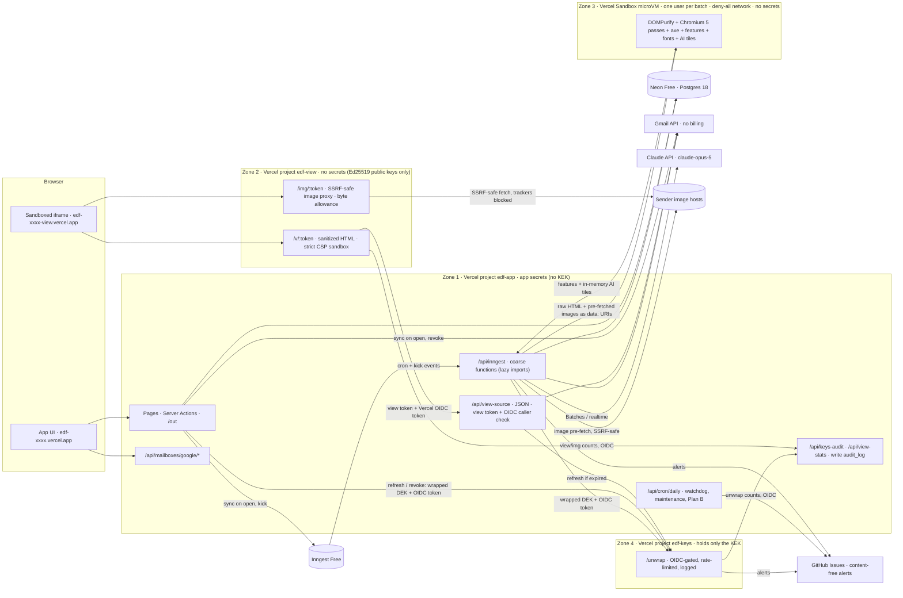

# Email Design Filter: Free-Tier Edition (v1.1-F)

> **Date:** 2026-09-27. **Status:** v1.1-F rev 2. Includes the fixes from two adversarial reviews (27 findings, §15) and the owner's own requirements (you and one friend now, scaling later, Opus 5, font profile).
> **What this is:** a set of changes to `DESIGN.md`, `DESIGN-SCORE.md` and `DATA-MODEL.md` v1.1. **Anything not mentioned here stays as v1.1 describes it.**
> **Goal:** run for $0 on free tiers. **The only paid item is Claude Opus 5 (`claude-opus-5`)**, which is prepaid and has a hard spending cap.
> **Where it comes from:** two independent drafts were compared: A ("simple") and B ("capable"). This edition is built on A, with B's best ideas added (§1.2).
> **About the numbers:** every vendor limit was re-checked live on 2026-09-27 (sources in §14). Usage figures marked **(est.)** are estimates. They get replaced by the week-1 measurements (§13) before the second person is invited.

---

## 0. Your questions, in plain words

**"I don't have Vercel Pro."** You don't need it.
- Vercel **Hobby** is free and needs no card.
- It is for personal, non-commercial use. An app for you plus a few invited friends qualifies, as long as there are no payments, no ads, no affiliate links, and nobody is paid to build it.
- The catch is that Hobby limits are **hard stops**. Going over costs no money. Instead Vercel **pauses your whole account**: the site shows a 503 "paused" page. Users report staying paused for 30 days or more, and support sometimes refuses to lift it.
- So this design measures its own usage and slows itself down long before any limit (§8).

**"I want Opus 5, and I have a paid API key."** Yes, every AI call uses `claude-opus-5`.
- The Claude API has no free plan, so this is the one thing you pay for, using your paid key.
- The key is stored **only** as a Secret environment variable in the `edf-app` production project on Vercel. It never goes in code, git or chat.
- You buy prepaid credits with auto-reload turned **off**.
- The app has its own budget. By default it stops at **$4.50 a month**, and the Anthropic Console has a **$5 a month** limit behind that.
- Expected spend is about $1.60–3.60 a month for you alone (§6).

**"Are you OK with an invite-only beta now and a public launch after Google verification?"** This is what that question meant.

Reading Gmail (`gmail.readonly`) is a *restricted* Google permission. Google allows two ways to use it:

| | **Personal use (what we choose)** | **Public app** |
|---|---|---|
| Who can sign in | You plus fewer than 100 people you know personally | Anyone |
| What Google requires | Nothing to submit. Google's user-data rules still apply (§9.4). | Brand review, restricted-scope review, **and a paid security audit every year** (CASA, about $675–5,400 a year) |
| What users see | A one-time "Google hasn't verified this app" screen. They click **Advanced → Go to edf-….vercel.app (unsafe)**. | A normal consent screen |
| Limit | **100 Google accounts, ever**, for the project. It never resets. | None |

- **Your plan:** the app is for you and your friend now, and you want it to scale later.
- **So we start in personal use.** It's free: no verification and no audit, and it covers you, your friend and more friends later, up to the free-tier ceiling in §7.
- **When you decide to open it to the public,** follow the upgrade path in §12 (steps D → E): Vercel Pro, Google's review plus the yearly CASA audit, custom domains, and a Cloud KMS key.
  - The code is **built to scale without a rewrite** (next bullet). Going public is mostly accounts, settings and paperwork.
  - This replaces v1.1 §18 decision 1. Verification and CASA move from "week 1" to "when you decide to go public".
- **Built to scale, no rewrite needed.** Every free part sits behind a replaceable module: the key service, the sync source, the job trigger, the renderer, file storage, notifications and the budget profile. The database schema is the same in every edition, so moving to the paid v1.1 setup is a configuration and infrastructure change.
- **One setting matters.** Publish the Google consent screen as **"In production"**. It stays unverified. Do **not** leave it in **"Testing"**: in Testing, Gmail access silently expires every 7 days.

**What you give up compared with v1.1:**
- New mail shows up within about 30–60 minutes, or right away when you open the app, instead of within about 1 minute.
- Not every email gets its own browser render. The rest are scored from a matching template, or show static checks only (§5.4).
- No stored screenshots. You see the email in a live, sandboxed viewer instead.
- No email digest. There is an in-app "Today" view.
- Gmail tokens are encrypted with a master key held by a tiny, separate key service (`edf-keys`, §9.2), not Google's paid key vault (Cloud KMS). That's weaker, but free. You can switch to KMS later for about $1 a month (§12 C).
- Enough room for you and your friend today, and up to about **15 active users**, or about 20 once week-1 measurements confirm the estimates.

**Cards:** only Anthropic by default. §12 lists the optional services that need a card and what each one would add.

---

## 1. What changes, and why

### 1.1 At a glance

| Area | v1.1 (paid) | Free edition |
|---|---|---|
| Hosting | Vercel Pro, `web` + `renderer` projects | **Vercel Hobby**, three projects in one Hobby team: `edf-app`, `edf-view` (email viewer) and `edf-keys` (a tiny key-unwrap service). The renderer project is gone. |
| Background jobs | Inngest Pro, many small functions (about 15–20k executions per user per month) | **Inngest Free**: 5 coarse functions, about 9–10k executions a month *in total* (est., §4.7). The Postgres message ledger is the durable queue. |
| Gmail sync | Push through Pub/Sub | **Polling** `history.list` every 30 min (60 min above 10 users), **plus a sync whenever the app is opened** |
| Rendering | Chromium in a Vercel function, for every email that can be designed | **Vercel Sandbox microVM**: its own free allowance, no network, no secrets, one user per VM. Renders template samples, on-demand requests, then recent mail while budget lasts. |
| Design Score | Own render for every email | Three coverage levels: **own render**, **scored from template**, **static checks only** (§5.4) |
| AI | Opus 5 with per-email re-reviews, $10 per user per month | Opus 5 through **Message Batches** (50% off) for template samples and classification. On-demand reviews run in real time. **Default hard cap $5 a month in total.** |
| Database | Neon Launch | **Neon Free**, Postgres 18, same schema. Compute pinned at 0.25 CU. |
| Object storage | Vercel Blob | **None** |
| Token key | Cloud KMS hardware key (HSM) | **AES-256-GCM envelope encryption. The master key (KEK) is a Vercel Secret-type env var held only by the separate `edf-keys` project**, which unwraps keys only for `edf-app`'s production functions (split trust). A documented accepted risk (§9.2). |
| Viewer domain | A purchased second domain | **A second Vercel project on its own `*.vercel.app` address**. `vercel.app` is on the Public Suffix List, so browsers treat it as a separate site. |
| Email, monitoring | Resend/Postmark, Sentry, Log Drain | In-app notices, an `app_error` table and a System page, **plus an out-of-band alert channel**: content-free GitHub Issues on your private repo, which GitHub emails to you (§8.5). Resend and Sentry are optional add-ons. |
| Google Cloud | Verification, CASA, Pub/Sub, KMS, RISC | **All removed. No billing account on any project.** |
| Monthly cost | about $150–250 plus CASA | **$0 plus Opus 5 usage, capped at $5 by default** |

### 1.2 Where the two drafts disagreed, and what we chose

| Question | A | B | **Decision and reason** |
|---|---|---|---|
| Database | Neon Free | Supabase Free (always on) | **Neon.** It keeps the verified Postgres 18 schema unchanged (Supabase is on Postgres 17 and needs a workaround plus re-verification). No card, a 6-hour restore window, one fewer vendor. What we give up is sub-hour polling (Supabase is listed as an option in §12). |
| Scheduler and queue | Inngest Free with coarse steps | Postgres job queue ticked every 60 s by pg_cron | **Inngest Free, coarse steps**, with the Postgres ledger as the real queue. Less custom code, and v1.1 was already built on Inngest. The 50k hard stop is ≈ 5× above expected use (§4.7), and Plan B covers a pause. B's plain-function job bodies are kept, so the ticker can be swapped. |
| Sync delay | 30–60 min plus sync on open | 1–2 min | **30 min plus sync on open** (60 min above 10 users). Neon Free suspends the database once its compute hours run out, and anything faster keeps it awake around the clock. For newsletters and promotions, opening the app gives instant freshness. |
| Where Chromium runs | Vercel Sandbox | Oracle Always Free VM (card), Sandbox as fallback | **Sandbox by default** (no card, nothing to patch, pausing it only pauses rendering). **Oracle is an optional upgrade that needs a card** (§12), for owners who want every email rendered. |
| Render capacity figure | ~450–650 a month (metered as vCPU × wall time) | not binding | **Plan with A's conservative figure, then recalibrate** from the Sandbox dashboard in week 1. The research estimate of ~6 CPU-s per email would give ~1,700–1,750 a month. |
| Screenshots | none | Neon Object Storage thumbnails | **None by default** (simplest, stores least). Thumbnails are an optional add-on with no card (§12). |
| Email digest / Sentry | none | Resend to owner / Sentry Developer | **In-app by default.** Both are optional add-ons, and neither service officially states whether it needs a card. |
| AI cap | $10 a month | $5 a month | **$5 a month by default** (the user asked for minimal spend), with a table showing what $10 or $20 buys (§6.4). |
| Viewer ↔ app authentication | forward the HMAC view token | Vercel OIDC token between projects | **Both.** The JSON endpoint requires the HMAC view token **and** a verified OIDC token from `edf-view` (§9.3). |
| Also taken from B | — | backfill admission tied to projected CPU; compacting stored features; automatic AI review only for templates seen at least twice; the ground rules; optional push, Oracle and Supabase paths | **Adopted** |
| Taken from A (unchanged or corrected) | template inheritance with a validity check; no screenshots; the image proxy never decodes images; governor with hysteresis; daily-cron Plan B | — | **Adopted, with two corrections:** a single calibration factor so CPU caps are consistent (§8.1), and a Sandbox batching rule so boot cost can't blow the budget (§5.1) |

### 1.3 Ground rules for every free tier

1. **The app always runs out first, never the vendor.** Each resource has a self-cap at about 60% of the vendor's hard limit (70% where a breach only pauses one feature), and a governor (§8) that slows the app down before the cap. **Outside traffic is capped too** (§8.4): the governor can't slow down strangers, so the WAF, database-free public routes and CDN caching have to.
2. **Windows match each vendor's rules.** Vercel and Sandbox count usage over a rolling 30 days, so budgets are checked daily with no reset on the 1st. Inngest, Neon and Anthropic count per month or per billing period.
3. **Degrade instead of stopping.** Every level shows a banner, and nothing fails silently.
4. **Don't multiply quotas.** No extra Hobby accounts and no splitting work across accounts; Vercel's fair-use rules forbid that. The three Vercel projects share one allowance.
5. **Non-commercial only.** No payments, ads or affiliate links, and nobody paid to build or host it. **On day 1, opt out of Vercel AI training** (Team Settings → Data Preferences). Hobby is opted in by default.
6. **Stay portable.** Vercel may shut down Hobby projects without notice. The database lives at Neon, the code in a personal GitHub repo, and the env vars are documented.
7. **No Vercel API tokens in any runtime environment.** A team-scoped token could redeploy or delete every project. The app never needs one: there are no Global Config writes (§4.2). A boot check enforces this.

---

## 2. Services and free limits

| Role | Service (plan) | Free limits relied on (checked 2026-09-27) | What happens at the limit | Card? | Self-cap |
|---|---|---|---|---|---|
| UI, API, sync, job endpoints | **Vercel Hobby**: one team with projects `edf-app` + `edf-view` + `edf-keys`, region `iad1`, Node 24.x, Fluid compute | Shared by all three projects, **rolling 30 days**: 1M invocations · **4 h Active CPU (14,400 CPU-s)** · 360 GB-h provisioned memory (memory is fixed at 2 GB, so that is 180 instance-hours) · 1M edge requests · **10 GB Fast Origin Transfer** · 100 GB Fast Data Transfer. Per function call: 300 s maximum, 2 GB / 1 vCPU, 4.5 MB request/response body. Cron jobs run at most once a day (±59 min). Runtime logs kept 1 h. WAF per project: 3 custom rules, 1 of them a rate-limit rule. **Attack Mode is free, and traffic it blocks doesn't count toward limits.** BotID Basic. Global Config: **not used**. | Nothing is billed. **The team or project is paused** (503 `DEPLOYMENT_PAUSED`) until rolling usage falls back under the limit. Reports describe 30+ days; there is a one-time self-serve 3× unblock. | No | 60% of each limit |
| Chromium rendering | **Vercel Sandbox** on Hobby, a separate allowance | 5 Sandbox CPU-h · 420 GB-h · 5,000 creations · 20 GB transfer · 15 GB snapshot storage ("lifetime") · 10 at once · 45-minute sessions · **egress firewall that can block everything** (on Hobby since 2026-08-05) | **Only creating sandboxes pauses**, for 30 days from first use. The app keeps running and scores fall back to template or static coverage (§5.4). | No | 70%: 12,600 CPU-s, 3,000 creations |
| Scheduling and retries | **Inngest Free** (cloud, TypeScript SDK v4) | 50,000 executions a month (each run counts 1, each step counts 1) · 5 steps running at once across the account · 500k events · 256 KiB per event · 500 MB span data a month (keep the SDK's extended OpenTelemetry tracing **off**) · 24 h traces · cron, singleton, throttle and retries included | **Every function pauses until the month ends.** A function that fails 20 times in a row is paused automatically. | No | 30,000 |
| Database | **Neon Free**, Postgres 18. `edf-prod` in `aws-us-east-1`, plus a separate `edf-dev` project. | Per project: **100 CU-hours a month** · **0.5 GB storage** · 5 GB public network transfer · scale-to-zero after 5 min (fixed on Free) · 6-hour restore window | Running out of CU-hours or transfer **suspends compute until the next billing period**, so the app is down (data is kept). At the storage limit, **inserts, updates and deletes all fail**. **Each connection resets the 5-minute scale-to-zero timer**, so a request every ≤ 5 min keeps the database awake around the clock. Usage has **no API on Free**: the consumption API is paid-only, and the Console lags up to 1 h. | No | CU-h: L1 50 · L2 60 · L3 80 (actual month-to-date) · storage 250 / 300 / 350 MB · transfer 3 GB |
| Gmail | Gmail API across 3 Google Cloud projects, **no billing account** | For projects created on or after 2026-05-01: 6,000 units/min per user, 1.2M units/min per project, 80M units/day billing threshold | Soft 429/403 rate-limit errors | No | per-mailbox bucket of 5,500 units/min (v1.1 §5.2) |
| AI | **Anthropic API, `claude-opus-5`** | Per million tokens: $5 input / $25 output · cache read $0.50 · cache write $6.25 (5-minute) or **$10 (1-hour)** · **Batch API 50% off** (stacks with caching) · minimum cacheable prompt 512 tokens | The prepaid balance runs out or the spend limit is hit, and calls fail | **Yes, the only card** | §6.5 |
| Code and CI | GitHub Free, **private repo on your personal account** (Hobby can't connect to repos owned by an organisation) | 2,000 Actions minutes a month, CI only | Blocked until the monthly reset. **Workaround:** a security patch can still ship from your laptop with `vercel --prod`. | No | Renovate grouped weekly (automerge patch only); CI uses `concurrency: cancel-in-progress`, path filters and pnpm/Docker caching; Actions minutes checked by hand monthly (Settings → Billing), because the alert token can't read billing |
| Monitoring | In-app: `app_error`, `audit_log`, System page, plus the usage emails Vercel, Neon and Anthropic send. **Out-of-band alerts:** a GitHub fine-grained token scoped to **Issues: write on the private repo only**. The app opens or updates one issue per alert code, codes and counts only; GitHub emails you (§8.5). *Optional:* Sentry Developer (1 user, 5k errors). | — | Sentry drops events over quota; no outage | Sentry: not stated | — |
| Notifications | In-app "Today" view. *Optional:* Resend Free for you only: from `onboarding@resend.dev` to your own Resend account address, 100 a day, no domain needed. | — | Sends are refused | Resend: not stated | ≤ 30 a month |
| Object storage | **None** | — | — | — | — |

**Which services need a card:** **only Anthropic** is required.
- Optional, card needed: Oracle Always Free (identity check), Google Cloud billing (Pub/Sub, KMS), Cloudflare R2.
- Optional, card status not officially stated: Sentry, Resend.

**Considered and not used**

| Option | Why not |
|---|---|
| Chromium inside Vercel functions | Shares the 4 CPU-hour pool with the whole app. One backfill could use it all up and pause everything. |
| Vercel Workflows / Queues | Hobby cron runs at most once a day. Workflows has no per-key locks yet (5.x is beta and the lock work isn't shipped). Queues is beta. Self-rescheduling message chains stay tied to old deployments. |
| Vercel Blob | Only 2,000 writes a month, and going over **locks you out for 30 days** |
| Gmail push (Pub/Sub), Cloud KMS, Secret Manager, Model Armor | All need a Google Cloud billing account, which means a card (optional in §12) |
| Supabase Free (always-on DB) | Postgres 17 only, no backups, read-only at 500 MB, extra hardening, more Vercel CPU from frequent ticks. Kept as an option in §12. |
| Oracle Always Free | Needs a card. You patch the VM yourself; idle VMs can be reclaimed; free capacity is often unavailable. Kept as an option in §12. |
| Cloud Run, AWS Lambda | Need a card and have **no hard spending cap** |
| Cloudflare Browser Run, Browserless, Trigger.dev | Each is another vendor that would see Gmail-derived content. Browser Run is the best no-card add-on if more renders are needed (§12). |
| Rendering in the user's own browser | Hostile HTML would have to run near the app's origin, a step backwards from v1.1 §11.5. Scores would also differ between devices. |
| GitHub Actions as renderer or scheduler | GitHub's terms forbid non-CI workloads, and scheduled runs can be dropped |

---

## 3. Architecture

| Zone | Holds | Must never hold |
|---|---|---|
| ① `edf-app` (Next.js per v1.1, ≥ 16.3.6) | `app_rw` database URL · both OAuth client secrets · view/out/state/invite HMAC keys · `ACCESS_TOKEN_KEYS` (for 1 h access tokens only) · the **Ed25519 private key** that signs image tokens · Inngest keys · Anthropic key · `CRON_SECRET` · GitHub alert token (Issues: write, one repo) | The KEK · database owner credentials (used only for migrations, from your laptop or CI) · **any Vercel API token** |
| ② `edf-view` (plain Node functions, no framework) | **No secrets.** Only the Ed25519 **public** keys that verify image tokens (`IMG_PUBKEYS`). It forwards view tokens it can't read. | Database, tokens, KEK, Gmail, Anthropic, any signing key |
| ④ `edf-keys` (plain Node function, only `jose` as a dependency) | The token master key (`TOKEN_KEKS`, a Secret-type env var) and its own alert token (`KEYS_ALERT_TOKEN`: Issues write on the private repo only) | Database, OAuth secrets, Gmail, Anthropic, anything else |
| ③ Sandbox VM | One user's batch of raw HTML with images inlined (or one multi-user nightly batch if snapshot storage is cumulative, §5.1) | Any secret or any network. Created with `persistent: false` and destroyed after the batch. |

**Repository changes:**
- `apps/renderer` is removed.
- `apps/view` is added: two functions plus rewrites.
- `packages/render-vm` is added: the in-VM script and the snapshot builder.
- `packages/budget` is added: the usage ledger and the governor.
- `apps/keys` is added: one `/unwrap` function (§9.2).
- `packages/crypto`: `KeyServiceWrapper` (calls `edf-keys`) replaces the KMS adapter, behind the same `KeyWrapper` interface, so KMS can be swapped back in (§12 C).
- `packages/gmail`: Pub/Sub and watch code are removed.

---

## 4. Gmail sync for free

### 4.1 Polling, not push

- **Gmail push needs Cloud Pub/Sub, and Pub/Sub needs a billing account**, which means a card, even when usage is $0.
- Polling also:
  - removes the public webhook, its dead-letter queue and the watch renewal;
  - stops waking the database on every read/unread change.
- Gmail quota is not a constraint. Polling 20 mailboxes every 30 minutes costs about 2k units a day against an 80M/day threshold.

| Option | Delay | Card | Verdict |
|---|---|---|---|
| Push through Pub/Sub | about 5–10 s | **Yes** | Optional (§4.11) |
| **Poll every 30 min (60 min above 10 users) + sync on open** | ≤ 30–60 min; about 10–60 s after opening the app | No | **Default** |
| Poll every 1–2 min | about 1–2 min | No | Needs a database that is always on (Supabase option, §12). On Neon Free it would burn about 182 CU-h a month and suspend the database mid-month. |

### 4.2 The tick (`pipeline-tick`)

**One function, two schedules, no runtime flag.** Changing the cadence is a deploy-time
setting, so no Vercel API token is ever needed. The earlier Global Config design required a
team-scoped token that could redeploy or delete every project.

`pipeline-tick` has these triggers:
- cron `TZ=UTC 0 * * * *`, always;
- cron `TZ=UTC 30 * * * *`, included **only** when the deploy-time env var `TICK_EVERY=30`.
  That's the default while there are ≤ 10 active users. To switch, set `TICK_EVERY=60` and
  redeploy. The governor recommends this on the System page and in an alert (§8.5);
- the event `pipeline/kick`.

Because it's **one** function, `singleton {key: '"global"', mode: "skip"}` covers every
trigger, so cron runs and kicks never overlap. `retries: 2`. Runs carry no gate step.

**Step `poll`:**
- Take `list_mailboxes_due_for_poll(50)` (a definer function, §10): mailboxes where
  `status='active' AND next_poll_at <= now()`, oldest first. Poll 4 at a time, parallel inside
  the step.
- For each mailbox:
  1. Take the row lease `sync_lease_until = now() + 4 min` with a conditional UPDATE.
  2. **Use the cached access token.** It's encrypted with an `edf-app` key
     (`ACCESS_TOKEN_KEYS`: AES-256-GCM, AAD `[mailbox_id, user_id, 'access']`), not with the
     mailbox key, so polls, views and renders never call `edf-keys`.
     - Only a **refresh** (under v1.1's `refresh_lease_until`) and `/revoke` unwrap the mailbox
       key through `edf-keys` (§9.2).
     - Deliberate change from v1.1 §4.4: a leak of `edf-app`'s environment plus the database
       exposes access tokens that expire within 1 h, never refresh tokens.
  3. Reserve 2 units per page from the bucket. Call `history.list` from the cursor with
     `historyTypes = messageAdded, messageDeleted, labelAdded, labelRemoved` and
     **`maxResults=500`**. Page until done, or until the step's time budget (60 s) runs out.
  4. **In one transaction:** insert ledger rows, apply label changes race-safely, hard-delete
     messages deleted in Gmail, and move the cursor forward with compare-and-set
     (`history_id IS NULL OR history_id < $new`). This is v1.1 §5.6 steps 4–7, minus the `blob_gc` trigger (no Blob).
  5. **Cursor rule (no lost mail).** If paging stopped early (a `nextPageToken` remains),
     `$new` = the **`id` of the last History record processed**, never the response's
     top-level `historyId`, which is the mailbox's current id. Set
     `mailbox.poll_incomplete = true`, and the next tick continues right away. When paging
     finishes, `$new` = the response `historyId`. A unit test covers this: 3 pages with a
     2-page cap must lose no message ids.
  6. **Label events.** For ids already stored, apply the change race-safely. For ids in the
     ledger but not stored yet, stash the change in `pending_label_delta` and apply it on
     insert (v1.1 §5.6 step 5). Only ids absent from the ledger are ignored.
  7. **Import storm.** More than 2,000 `messagesAdded` in one poll — or more than 500 in a poll
     that could not finish (the 2-page app-open sync, a budget-cut tick poll) — switches to a
     windowed `messages.list after:` listing, as in v1.1: the Q1/Q2 queries from the last
     complete sync minus one day (≤ 20 pages each) replace the added ids, so a bulk import of old
     mail (which keeps its old dates) is not fetched; deletes and label changes of the poll still
     apply (label changes only for ids the ledger or the email table knows). If the quota bucket
     refuses a listing page, nothing is applied and the next tick retries. The last poll of a
     storm, once it can finish, may leave a tail of ≤ 2,000 imported ids (≤ 500 for a poll cut
     short) that is ingested normally.
  8. Set `next_poll_at` (§4.3).
  9. **History 404.** Set `resync_pending` and take a fresh cursor from `getProfile`.
     - Re-list the gap window `max(7 d, now − last_synced_at)` (v1.1: 14 d minimum), capped
       at the user's `backfill_window_days` (v1.1 `user_settings`, ≤ 180). It's queued as backfill-class work under the §4.5
       admission rules.
     - **Deletion reconciliation:** page `messages.list` with `includeSpamTrash=true` over the
       gap window (5 units per 500 ids), and hard-delete stored `email` rows in that window
       whose ids are missing.
     - **Label reconciliation:** the gap's label changes are gone with the history, so four more
       id listings of the window (`is:unread`, `is:starred`, `in:trash`, `in:spam`) set those
       flags on stored emails in the window whose `gmail_history_id` is older than the fresh
       cursor (their `gmail_history_id` becomes the cursor, so later history still wins).
     - The System page shows "resync with gap N days".

**Steps `drain-1` … `drain-5`.** Each is `drain({budgetMs: 200_000, maxRows: 750})` (§4.6).
They run only while eligible rows exist.

**Step `ai`.** Runs only if a Claude batch is outstanding or classification work is waiting.
It collects batch results. It submits a classification batch when work is pending and the
oldest item is more than 20 minutes old. The queue (`list_pending_classification`) holds only
emails of active mailboxes, and users take turns in it (each user's oldest email, then each
user's second-oldest, …), so one user's backlog never crowds out the others. A user without
AI budget left is skipped before any Gmail fetch, and mail that can never be sent
(security-sensitive, skipped or ineligible on re-extraction) keeps its rule-based type.

**Continuation kick** (only when it helps). Send `pipeline/kick`, with id
`kick-cont-{runId}`, **only if** this run drained ≥ 1 row **and** eligible rows remain.
- Eligible means `state IN ('pending','pending_full') AND (next_attempt_at IS NULL OR next_attempt_at <= now())`
  on a mailbox with `status='active'`, excluding rows of queued backfills. New rows have no
  attempt time yet, and `NULL <= now()` is never true, hence the `IS NULL` branch. It's
  computed by the definer function `count_drain_eligible()` (§10), and the drain steps use the
  same predicate through `list_drain_batch()`.
- Continuation kicks are capped at **6 an hour** globally, counted in `system_state`.
- This closes the `singleton: skip` gap without a self-kicking loop. Such a loop would have
  used up the 50k Inngest quota in about a day and kept Neon awake.

**Fresh renders** (§5.3). The last step, after the heartbeat and the kick check, asks whether your
fresh batch is due (new mail without a score, stored by this tick's drain) and, if so, sends
`render/requested` with id `render-fresh-{runId}`. The check never fails the tick.

**Execution-rate tripwire.** If executions in the last hour exceed 3× the plan, kicks stop,
the governor raises L1, and an alert is sent.
'The plan' is the 30k self-cap spread evenly (≈ 42 an hour), so the wire trips above ≈ 125
executions in an hour. It is not the ≈ 9–10k expected month, because a normal busy hour (two
ticks and 6 continuation kicks at up to 8 executions each, plus an import) already goes past
that. The usage ledger is daily, so the governor keeps a sample of today's count at each run (the
last 3 h) and checks the executions since every sample against 3 × 42 × max(1, hours since it).
Kicks stay off for 1 h after it fires.

**Taken out of the tick (a change from v1.1):**
- Importance decay is computed **when mail is read**, from the stored base score and the
  email's age. An optional daily materialisation runs in maintenance.
- This avoids rewriting many rows every 30 minutes, which would bloat the database and use
  compute.

**No Inngest function ever throws on a known vendor outage.** This covers the tick, backfill,
render, maintenance and disconnect functions. On Neon suspended or unreachable, Gmail 5xx in
bulk, Sandbox "creation paused" or an Anthropic spend limit:
- return `{skipped: "<reason>"}` and write one `app_error` row;
- this keeps Inngest Free from auto-pausing a function after 20 failures in a row;
- the daily watchdog (§4.9) notices stale `last_tick_at`, `last_maintenance_at` or
  `last_render_batch_at`.

### 4.3 How often each mailbox is polled

| Mailbox state | Interval |
|---|---|
| User opened the app in the last 7 days | the tick interval: **30 min** (≤ 10 active users) or **60 min** (> 10) |
| Idle 7–30 days | 3 h |
| Idle more than 30 days | 24 h |
| Governor L1 / L2 | × 2 / every 6 h |
| **Always** | at least once every 24 h |

Polling at least once a day keeps the cursor inside Gmail's history window (at least about a week). It also keeps refresh tokens and the OAuth client in use; Google deletes them after 6 months unused.

### 4.4 Sync when the app is opened

When the inbox loads, the Server Action `syncNow(mailboxId)` runs if `last_synced_at < now() − 2 min`.
- It runs the same poll inline: `maxResults=500`, at most 2 pages, about 0.3–1 s. The §4.2
  cursor rule applies: an early stop saves the last processed History record id, never the
  top-level `historyId`, and sets `poll_incomplete`.
- **When `system_state.inngest_paused` is set** (§4.9), it also runs a bounded inline drain for that user
  (≤ 20 s), so the app keeps working.
- If new ledger rows appear, it sends `pipeline/kick` with id `kick-{userId}-{floor(now/10 min)}`, so repeat kicks are dropped for 10 minutes.
- The UI shows "Syncing…" and checks sync status every 10 s for up to 90 s. That check is off at governor L1.
- It is rate-limited in Postgres to once every 2 minutes per mailbox. At L2, friends are limited to once every 2 hours.
- **While the app stays open** (tab visible, used in the last 2 minutes), `syncNow` runs again every
  10 minutes in the background, once per kick window (no "Syncing…" flash; `apps/web/src/lib/live-poll.ts`).
  After a sync that found mail (and so kicked), the next one never comes before the next 10-minute kick
  window opens, so its own kick is never dropped. The server-side throttle above stays the authority (friends at L2, nothing at L3).
  Off at governor L1, like the status check: the app then syncs only when it's opened.

**The live gallery** (`components/gallery/live-updates.tsx`, `server/actions/gallery-live.ts`). While
the gallery is visible and in use it keeps itself current without a reload:
- A Server Action returns a compact **stamp** of what the gallery shows: the number of designs, the newest
  one's `created_at`, how many are scored or still wait for their type, the latest analysis save and the
  latest render-request change. One pass over the user's own designs, one index-only lookup
  (`email_analysis_compaction`) and a scan of `render_request` (no index on `(user_id, updated_at)`: the
  table stays small because finished rows are purged after 7 days — about 1,300 rows and 25 buffer hits
  today; add that index if it ever grows past ~50,000 rows); ≈ 3.5 ms and 163 buffer hits on the real
  625-design account. The page reads its stamp *before* it lists its designs, so a design stored while
  the page renders shows as new instead of being missed. Only when the stamp moved does it also count
  the page view's own new designs (its filters and search), so "3 new designs" is exact for the page on
  screen. Timestamps travel as Postgres text (microseconds), so the newest design never counts as new.
- **Timing:** every 60 s while the tab is visible and was used (pointer, keys, scroll, touch) in the last
  2 minutes; × 2 per unchanged check up to every 5 minutes; none while hidden, offline or idle; a check at
  once when shown again, back online or used again (never within 15 s of the last). The app's sync finding
  mail asks for a check at once instead of refreshing the page.
- **Never reshuffles under the viewer:** new designs show a pill "N new designs · Show" (applied by itself
  only on page 1 of Newest, scrolled to the top, nothing open, pointer and focus off the grid); scores of
  designs on screen update in place (the open design and the scroll stay); a change that could move cards
  (a view sorted or filtered by score, a design leaving the view) shows "Designs updated · Show".
- **Off at governor L1** (`syncStatusPollingOff`, as the status check): no timer at all; the gallery then
  behaves as before (new mail on the next visit or refresh). A page that was opened before L1 learns it
  from its next gallery check or background sync (both return the flag) and stops both timers.
- **Cost:** ≤ 1 Server Action a minute per active viewer (usually every 2–5 minutes), one invocation and
  ≈ 0.02 CPU-s each; the background `syncNow` adds ≤ 6 an hour of use (one `history.list`, 2 Gmail
  units, and a `pipeline/kick` only when it finds mail — at most one per 10-minute window, a tick of
  ≈ 0.25 CPU-s and ≈ 6 Inngest executions). Because checks stop after 2 idle minutes, a session keeps
  Neon awake at most ≈ 2 minutes longer than it already did (≈ 0.008 CU-h): ≈ 0.25 CU-h a month for
  you (30 sessions), ≈ 0.17 per friend. At 20 users that is ≈ 45–220 Vercel CPU-s and ≤ 3.4 CU-h a
  month (§7): the top of the 20-user Vercel CPU estimate stays under the L1 line, and L1 (50 CU-h of
  Neon) switches the checks and the background sync off before they can take Neon to L2. The first
  version (5-minute idle stop, sync every 5 minutes) cost up to ≈ 390 CPU-s and 8.5 CU-h at 20 users,
  enough to cross both lines at the top of the range (§7).

**The Filters panel's counts** (`server/actions/gallery-facets.ts`): while the panel is open, a change to
its draft asks, after a 300 ms pause, for the counts that draft would give (the page's own count queries,
≈ 15 ms on the real 625-design account), so "Show 6 designs" is what the button shows. Only on a change
the viewer makes, never on a timer: a few Server Actions per use of the panel.

### 4.5 First import (backfill)

- **Window:** you choose 30, 90 or 180 days (default 90; 180 only at L0 with ≤ 5 users). Friends get 30 days.
- **Admission:**
  - **only one backfill runs at a time** across the app, and the rest queue first-in first-out in the database;
  - **at most 5 new backfills per rolling 30 days**;
  - a backfill starts only if projected Vercel CPU plus a 500 CPU-s reserve stays under 75% of the self-cap.
- **Unchanged from v1.1 §5.4:**
  - time slices, newest first (2 d → 7 d → 30 d → rest);
  - the Q1/Q2 queries with `maxResults=500`;
  - the new-sender check, run **after the drain has stored the import** (sender rows are created
    when messages are stored, not when they are listed): the tick runs it once no backfill row of
    the mailbox is pending, for every sender first seen in the last 14 days whose
    `seen_before_window` is unknown, paging through all of them within the quota and resuming on a
    later tick if the bucket runs dry;
  - singleton per mailbox;
  - `cancelOn` disconnect;
  - replay from the cursor saved at connect time.
- **Pace** is set by the quota bucket: 4,500 units/min for background work, about 225 message fetches a minute.
  - A friend's 30 days (about 1,750 fetches) takes about 8 minutes.
  - Your 90 days (about 5,240 fetches) takes about 25–30 minutes.
  - Yesterday's mail appears within about a minute.

### 4.6 Draining the ledger

`drain(budgetMs, maxRows)` goes round-robin across mailboxes, **new-mail rows before backfill rows**. For each row it reserves quota units, then fetches, parses, classifies and commits, one message at a time as in v1.1 §5.5.

Changes from v1.1:
- **Ingest runs postal-mime, cheerio (parse5), css-tree and `juice(html)` only.** `juice` is used only for `fonts_static` (DESIGN.md §8.1), and nothing touches the network. That covers type, security, deals, trust, the template simhash, and the **static design features** (§5.4). Ingest writes an `email_analysis` row with these static features, including `features.fonts.fonts_static` (≤ 2 KB). Planned cost is about 0.1 CPU-s per automated email (est.).
- **No DOMPurify or jsdom at ingest, and no Blob working copy.** At render time, the orchestrator fetches the message from Gmail again (20 units), and sanitisation happens **inside the VM**. An email whose refetch (render or viewer) returns 404 is hard-deleted at once and its ledger row set to `skipped`. So mail deleted in Gmail during an outage is never shown, rendered or sent to AI.
- `email.design_source` is set to `template` if the email matches a rendered sample (§5.4); otherwise to `static`.
- Each message has its own try/catch.
  - On failure, `attempts += 1` and `next_attempt_at` is set with **exponential backoff**:
    1 m → 5 m → 30 m → 2 h → 6 h.
  - After 5 attempts the row becomes `failed`. `failed` rows are re-driven automatically once
    a day for 7 days before they become final, and show in Settings → Sync health.

### 4.7 The Inngest functions

| Function | Triggers | Flow control | Steps per run |
|---|---|---|---|
| `pipeline-tick` | cron `0 * * * *` always; cron `30 * * * *` only when `TICK_EVERY=30`; plus `pipeline/kick` | `singleton {key:'"global"', mode:"skip"}` across **all** triggers, `retries: 2` | poll (1) + drain (0–5, only if eligible) + ai (0–1, only if work) |
| `mailbox-backfill` | `mailbox/connected`, re-import | singleton per mailbox (skip), `cancelOn: mailbox/disconnected` | about 6–20 list steps, then a kick |
| `render-batch` | daily cron `TZ=UTC 30 4 * * *` + `render/requested` | singleton global (skip). Requests wait in `render_request`, and the running batch loops until that queue is empty or the budget is used up (10 planning rounds; it also stops after an on-demand round that picked nothing up). The tick re-sends `render/requested` while on-demand requests a run would take are still queued (an event sent during a run is dropped), except while renders are nightly-only or no renderer is set up (`RENDERER=off`, or the Sandbox without `SANDBOX_SNAPSHOT_ID`: nothing is planned then, and "Analyze" refuses with a plain message instead of queueing), and sends it (reason `fresh`, after its drain) when your fresh batch is due (§5.3); the on-demand trigger plans both. The 04:30 cron is dropped the same way while an on-demand run is active, so that run turns its next round into the nightly one (or adds one nightly round after its last plan). **`render-user` steps use `retries: 0`**: errors are caught inside the step, which returns `{failed_ids}` to requeue. | one `render-user-{u}` step per eligible user (§5.1) |
| `daily-maintenance` | cron `TZ=UTC 17 3 * * *` | — | token health · retention and compaction · usage roll-up and governor · sender aggregates · orphan senders (except those carrying the user's choices: muted, type override, importance bias, unsubscribed, feedback) · render requests left `running` by a killed step (also reaped when renders are planned, and an "Analyze" click requeues one; an interrupted request doesn't count toward the day's limit) · choosing template samples · Neon compute estimate (pool-based, §8.1) and storage size |
| `mailbox-disconnect` | `mailbox/disconnected` (emitted **after** the Server Action has already revoked the grant and nulled the tokens, §4.9) | — | `sleep 10m` → batch delete → orphan cleanup (senders carrying the user's choices stay while another of their mailboxes remains) → audit |

- The Inngest client uses `checkpointing.maxRuntime: "240s"`, and the route sets `maxDuration = 300`.
- Only production is synced to Inngest Cloud. Local development uses the Inngest Dev Server, because Free allows only 5 steps at once across the account.
- Payloads carry **IDs only**. Signing-key verification and the fallback key stay as in v1.1.

**Execution budget** (est., conservative, includes +20% for retries; recomputed by the reviewer):

| Users | Executions a month | Share of 50k |
|---|---|---|
| 1 | ≈ 9.0k | 18% |
| 5 | ≈ 10.4k | 21% |
| 20 (hourly ticks) | ≈ 10.1k | 20% |

- Executions = runs + steps. The recompute assumed each tick also ran a gate step and a
  re-check step. This version drops the gate step and skips empty steps, so real usage should
  come in slightly lower.
- The 50k hard stop is **≈ 5× above expected use**. Self-cap: 30k. L3 at 40k actual (§8.2).

### 4.8 Keeping each mailbox's work in order, and retries

- **No overlapping work:** Inngest singleton (global tick, per-mailbox backfill), plus the Postgres guards from v1.1:
  - the `sync_lease_until` row lease;
  - the cursor compare-and-set;
  - `UNIQUE(mailbox_id, provider_message_id)` on `email` and on the ledger;
  - the `(email_id, analysis_version)` constraint;
  - `pg_advisory_xact_lock` for template matching (transaction-scoped, so it works with Neon's pooler).
- **Rate limits:** the quota bucket is unchanged, with a 1,000-unit floor reserved for the viewer.
- **Waiting:** `RetryAfterError` uses the bucket's computed wait, or Gmail's backoff after a 429/403.
- **Not retried:** `NonRetriableError` for `invalid_grant` (→ `needs_reauth`), `admin_policy_enforced`, and 403 `domainPolicy`/`insufficientPermissions`.
- **Global incident:** `invalid_client` or `deleted_client`, as in v1.1.

### 4.9 Plan B if Inngest is paused or down

The job bodies are plain functions that the Inngest steps wrap: `tick`, `pollDueMailboxes`, `drain(budgetMs)`, `renderDue`, `aiSubmit`, `aiCollect`, `maintenance`.

The one **daily Vercel cron** `GET /api/cron/daily` checks `Authorization: Bearer CRON_SECRET` with a constant-time compare. Then:
The run has a **270 s budget** (Hobby stops functions at 300 s), spent in this order:
1. **Privacy work that must not wait for Inngest:** pending disconnect and `data_request`
   purges, then `maintenance()` (retention, the `needs_reauth` purge, compaction). Up to 120 s,
   resumable.
2. **Governor** recompute.
3. **Watchdog.** If `last_tick_at` is more than 3 h old, `last_maintenance_at` or
   `last_render_batch_at` is more than 36 h old, or `system_state.inngest_paused` is set, it
   raises a banner **and an out-of-band alert** (§8.5), then runs `pollDueMailboxes()` and
   `drain()` inline with the remaining budget.

`inngest_paused` is set when `inngest.send()` fails with a quota or paused error, or when
`last_tick_at` is more than 90 minutes old. The next successful tick clears it.

**Disconnect never depends on Inngest.** The disconnect Server Action (fresh session required):
1. calls `/revoke` synchronously (and `users.stop` only if the optional push mode, §4.11, is on);
2. nulls `refresh_token_enc`, `access_token_enc` and `dek_wrapped`;
3. sets `status='disconnecting'`;
4. only then emits `mailbox/disconnected` for the bulk delete.

The daily cron finishes any purge that Inngest couldn't.

**Recovery runbook** (after any Vercel, Neon or Inngest outage longer than a few hours):
1. Resume paused functions in the Inngest dashboard.
2. Check `last_tick_at` on the System page.
3. Run the gap resync (§4.2 step 9) for mailboxes whose gap is more than 7 days.

With sync-on-open, the app keeps working in "daily plus whenever opened" mode without adding a vendor. Backfills wait until Inngest is back.

*Optional extra ticker, not used by default:* an HMAC-signed `POST /api/jobs/tick` (timestamp ±90 s, nonce, rate-limited) driven by a Cloudflare Workers cron or Upstash QStash (both free, no card). Leases make double runs safe.

### 4.10 What users can expect

| Event | v1.1 | Free edition |
|---|---|---|
| New mail in the list | about 1 min | ≤ 30 min (≤ 10 users) or ≤ 60 min; about 10–60 s after opening the app; **while the app is open and in use, within about 5–10 min**, and the open gallery shows it without a reload (a "N new designs · Show" pill, or at once at the top of Newest) |
| Static checks and rule classification | on arrival | on arrival |
| Design score | about 1 min | right away if the template has a rendered sample; **your new mail: its own render within about 30 min (60 with hourly ticks) while you use the app and fill is allowed** (§5.3 "Fresh"); otherwise after the nightly batch (04:30 UTC) or on demand. Scores that land update the open gallery in place |
| What an unscored card says | — | the truth from the render queue: "Scoring now" (a render is running or an on-demand one is queued), "Scoring soon" (the next fresh batch takes it), "Gets its score around 10:15 AM" (the nightly batch, in your own time zone), "Trying again tomorrow around 10:15 AM" (its last render failed; the nightly batch retries it), "Waiting in line to be scored" (past the batch's room, or a friend's mail), "Scoring is paused for now" (free-tier limits), "Scoring is switched off" (the owner's switch, or no renderer set up), "Open it to get a score" (older than 14 days by the next nightly run), "Scoring didn't work" (failed, and too old to retry on its own), "Can't be scored" (rendered, but nothing to measure), "Reconnect Gmail to score it" |
| AI review | minutes | template samples through Batch, usually within an hour (up to 24 h); on demand in about 1–2 min |

### 4.11 Optional push mode (needs a card)

- **Needs:** a **paid** Google Cloud billing account on the **connector** project. A Free Trial account closes itself after 90 days and stops everything. The topic must live in the same project as the OAuth client.
- **Webhook:** verify the JWT (v1.1 rules), then send an Inngest `pipeline/kick` with `debounce` of 15 minutes per mailbox. It **does not touch the database**, so pushes can't keep Neon awake.
- **Watch filter:** `users.watch` with `labelIds` INCLUDE `CATEGORY_PROMOTIONS`, `CATEGORY_UPDATES`, `CATEGORY_SOCIAL`, `CATEGORY_FORUMS`. Renew daily. Polling stays on as the safety net.
- **Cost:** realistic volume is about 0.3 GiB a month, within the 10 GiB free tier. Google budgets only send alerts. The kill switch is a function on the budget topic that deletes the Gmail topic, after which the app falls back to polling.

---

## 5. How the Design Score works for free

### 5.1 Where Chromium runs: Vercel Sandbox

Each `render-user-{u}` step (in `edf-app`) handles one user and one VM. The step has a hard
wall-clock budget, because Vercel Hobby stops any function at 300 s and a timeout would make
Inngest retry and pay for the whole render again:
- `deadline = stepStart + 230 s`.
- Emails are added only while the **measured** time estimate (Gmail refetch + image pre-fetch +
  render) stays before the deadline.
- The step has `retries: 0`. Errors are caught, and `{failed_ids}` are requeued.
- Results are committed **per email**, so a later run skips emails already stored.

1. **Pick work** from that user's queue (`list_render_due`, §10): up to 25 emails, within the
   deadline (§5.3 priorities).
2. **For each email:**
   - fetch the raw message from Gmail again (20 units);
   - extract image URLs with cheerio and apply the v1.1 §6.3 image policy (no pixels or trackers, nothing addressed to the recipient, no images at all for security or transactional mail);
   - **pre-fetch allowed images with the SSRF-safe fetcher**, inlined as `data:` URIs (≤ 60 images, ≤ 5 MB each and ≤ 15 MB per email; every image not inlined is logged with its reason).
3. **Create the VM:** `Sandbox.create({ source: {type:"snapshot", snapshotId}, persistent: false, networkPolicy: "deny-all", vcpus: 2, timeout: (deadline − now) + 15 s })`, wrapped in `try { … } finally { await sandbox.stop() }`.
   - The SDK authenticates with the function's Vercel OIDC token.
   - **Hygiene assertions.** After creation, assert `sandbox.persistent === false` and the
     deny-all policy, and abort otherwise. SDK v2 sandboxes are persistent by default, and
     persistence would snapshot raw email into storage. Never use `name`, `getOrCreate` or
     `update({ persistent })` on render VMs. The only allowed `update` is
     `update({ networkPolicy: 'deny-all' })` at the end of an install-at-boot phase (below).
   - `render.js` prints only fixed status codes, and Chromium console forwarding is off, so no
     email content reaches logs.
   - The snapshot holds:
     - a pinned Chromium (Chrome for Testing matching puppeteer-core 25.11.x, or the matching
       Playwright build);
     - the fonts: Arimo, Tinos, Cousine, Gelasio, **Roboto** (Gmail web and Android readers
       really see Roboto), Noto Sans / Noto Serif / Color Emoji / CJK;
     - a pinned axe-core, sharp, DOMPurify with jsdom, and `packages/render-vm`.
4. **Run it:** `writeFiles` the bundle, then `node render.js`. Inside the VM, for each email:
   - **DOMPurify with the v1.1 analysis profile**;
   - the zero-specificity `__default__` font sentinel injected before the email's CSS, so text
     with no font set is detectable (DESIGN.md §8.1);
   - JS off before load; every request intercepted, only `data:` allowed;
   - 20 s deadline per page; the v1.1 §6.2 input caps and hardening;
   - Chromium's own sandbox **on**, if the week-1 check shows it starts in the VM;
   - the 5 passes (§5.2), feature extraction and pixel metrics;
   - AI tiles already downscaled.
5. **Read back `results.json`, stop the VM, and treat the results as untrusted:**
   - validate with Zod, bound every number, cap sizes;
   - AI tiles are checked by magic bytes and header dimensions only. **`edf-app` never decodes
     them**, the same rule as the image proxy.
6. **Store** features, checks and the **font data** (the used-font part of DESIGN.md §8.1),
   per email.
7. **Submit the AI batch idempotently.** For samples queued for AI:
   - first commit an `ai_batch` row (`state='submitting'`, `reserved_usd`, deterministic
     `custom_id`s). Each item's `ai_batch_item` row is written in the same transaction as its
     reservation, so no reservation exists without an item that settles it;
   - then call `batches.create` and save the `anthropic_batch_id`;
   - never create a second batch for an `ai_batch` row that's still `submitting`. With
     `retries: 0` this only happens after a crash;
   - a batch's `custom_id`s are visible only in its results. So the tick adopts a candidate from
     `GET /v1/messages/batches?limit=20` by `created_at` (within 10 minutes after the row) and
     a `request_counts` total equal to the row's item count. It stores the
     `anthropic_batch_id`, and confirms the match by `custom_id` when results arrive;
   - the same reconcile adopts any batch it doesn't know, and settles its cost per `custom_id`
     from the results;
   - if `batches.create` fails with a definite rejection (a 4xx other than 408), no batch exists:
     the items are released at once and the row is marked `failed`. A timeout, a dropped
     connection or a 5xx may come after Anthropic accepted the batch, so the row stays
     `submitting` with its reservations held, for the adoption above;
   - a `submitting` row still unmatched 30 minutes after its `created_at`, when the listing
     reaches back before the row (no further page, or a listed batch older than the row), has no
     batch: the tick releases its items (settled at 0) and marks it `failed`;
   - the daily cron releases reservations stuck in `submitting` for more than 24 h (the fallback
     when listing keeps failing): each unsettled item is settled at 0, then the row is marked
     `failed`.

   Tiles stay in memory: they never reach Inngest and are never written anywhere.

**Batching rule** (fixes a gap in draft A). Boot cost is per VM, so:
- your batch runs nightly;
- a friend's batch is created only when their queue has ≥ 10 emails or the oldest item is ≥ 48 h old;
- on-demand requests get their own VM immediately (each has a 1-minute memory minimum);
- **your fresh batches** (§5.3 "Fresh"): while you use the app, one VM for your new unscored mail at most
  every 15 minutes and at most 8 fill batches (the nightly one included) per rolling 24 h, within their
  own allowance of 2,520 Sandbox CPU-s per rolling 30 days (§5.5). Friends keep the rule above.

If week-1 measurements show VM boot costs more than 15 CPU-s, switch to **multi-user batches with a fresh BrowserContext per email**. That is the same isolation as v1.1's shared renderer, recorded as a decision.

**Metering:**
- Sandbox time is read from the **Sandbox API** (created and stopped timestamps per sandbox),
  not the orchestrator's clock. So a VM left behind by a failed step is still counted.
- Every tick lists running sandboxes and stops any **older than 250 s**. A render VM's own timeout is ≤ 245 s, so a live render is never killed.
- Until calibrated, count `vCPUs × wall-clock seconds`, a conservative upper bound.
- Then apply the weekly factor reconciled against the Sandbox Active CPU shown on the dashboard.
- The orchestrating step waits for the VM, which costs about 25 GB-h a month at 20 users (budgeted in §7). If the SDK's detached command mode works, submit in one tick and collect in the next.

**Snapshot storage is a day-1 blocking check.** Sandbox allows "15 GB snapshot storage
(lifetime)", and it's unclear whether that's a total at any one time or cumulative.
- **If it's a total at any one time:**
  - rebuild the snapshot within 7 days of each Chromium security release;
  - delete the old snapshot immediately;
  - use the small `vercel/sandbox` Ubuntu base image.
- **If it's cumulative:**
  - **do not** install Chromium at boot in per-user VMs, which would cost about 20–60 CPU-s
    per VM, or 56–167% of the render budget at 20 users;
  - instead, switch to **one multi-user nightly batch VM**, with a fresh BrowserContext per
    email (about 30 VMs a month, so a boot install costs ≤ 1,800 CPU-s a month);
  - rebuild the snapshot only for **High/Critical** Chromium releases that affect the renderer
    path (Blink, Skia, V8 even with JS off), within 7 days.
- **If an install-at-boot phase is ever used:**
  - start with a narrow allowlist;
  - pin installs by integrity hash;
  - then switch to `deny-all`, kill every process started before lockdown, and run a probe
    (a DNS lookup and TCP to an allowlisted host must both fail) **before** any email content
    is written.

### 5.2 Render passes

| Pass | v1.1 | Free edition |
|---|---|---|
| D desktop 800 | full screenshot + DOMSnapshot + axe | **kept** (screenshot clipped at 8,000 px) |
| D0 paint test | screenshot | **kept**: it is the defence against hidden text |
| M mobile 375 | 2× screenshot + DOMSnapshot | **kept at 1×** (layout identical; fewer pixels) |
| M-nomq | DOMSnapshot | **kept** |
| M-off, images off | DOMSnapshot + 2 screenshots | **DOMSnapshot only** (the images-off view comes from the live viewer) |
| OCR (tesseract) | ≤ 4 images | **off** (CPU-heavy). A13 and I2(c) become `not_evaluated`. On the optional Oracle path it is on. |
| Stored screenshots | Blob for 30 days, then thumbnails | **none** |

All passes share one page load. The real lever on cost is **how many emails** get rendered.

If a render measures more than 12 CPU-s per email, "fill" renders switch to a lite profile (D + D0 + M). That makes M2 and I4 (2.5 points) `not_evaluated`.

### 5.3 What gets rendered, in priority order

1. **On demand** ("Analyze this email" or "Run AI review"). You: ≤ 5 a day. Friends: ≤ 1 a day.
2. **New template samples**: templates with mail in the last 14 days and no sample render in the last 60 days. The sample is the **most recent** email at selection time, recorded in `email_template.exemplar_email_id`.
3. **Backfill template samples**: the largest templates by volume in the import window, newest first. Up to 100 for you and 30 per friend.
4. **Fill**: recent (≤ 14 days) designable emails without their own render, in an active mailbox, newest first. Fill runs only while Sandbox usage is under **55% of the hard limit**. That leaves room for priorities 1–3 up to the 70% self-cap.
   - **Fresh** (fill run early, `packages/pipeline/src/render-policy.ts`): your new mail that has no
     score at all (no own render, no template-level score: `design_source = 'static'`), received in the
     last 48 h, in an active mailbox and never requested before, gets its own render soon after it
     arrives instead of waiting for the night. The tick checks after its drain and sends
     `render/requested` (reason `fresh`); the render run plans it under the on-demand trigger (an event
     sent while a run is active is dropped; that run's next round and the next tick pick it up).
     - **Only while fill is allowed:** not at L1, the Sandbox soft cap or ≥ 55% of the hard limit
       (`fillRendersOff`), not with planned renders off (L2, Sandbox self-cap), not while renders are
       nightly-only (Inngest soft cap), never once renders stop. The render step re-checks all of it
       before creating the VM.
     - **Their own allowance:** 2,520 Sandbox CPU-s per rolling 30 days, about 120–260 renders
       (§5.5: they are extra renders, ≈ 450 a month uncapped). Each batch records its VM time
       (`usage_ledger` `render.fresh_cpu_s`); a batch starts only while a whole one (500 CPU-s) still
       fits, and the render step re-checks it. Used up: your new mail waits for the nightly batch.
     - **You only, while you use the app** (active in the last 30 minutes), ≥ 15 minutes after your
       last fill batch, ≤ 8 fill batches per rolling 24 h (the nightly one included). One VM per batch;
       it also takes your queued on-demand requests, never queued fill or template samples (they stay
       nightly), so a fresh batch that renders fill always inserts its own rows — the rate limit's
       record. None is asked for while no renderer is set up (`RENDERER=off`, or no Sandbox snapshot).
     - **Each email gets one fresh try**; a failed (or deferred) render goes back to the queue as fill,
       which only the nightly run picks — never the next fresh batch.
     - **No new request kind:** fresh work is `render_request.kind = 'fill'` (same priority, same
       switches, same requeue rules), so no migration is needed; `requested_at` of a batch's fill rows
       is the batch start, which the rate limit and the daily cap count.
     - **Friends keep the nightly batching rule** (§5.1): §5.5 gives a friend ≈ 20–105 own renders a
       month (conservative) or ≈ 60–300 (expected); an early VM a day each would add ≈ 30 boots a month
       per friend (≈ 450 CPU-s at 15 CPU-s a boot), ≈ 8,500 CPU-s at 20 users — two thirds of the budget.

**Never rendered:** security-sensitive and plain-text mail. Suspicious mail is rendered with images off.

**Fair share:**
- you have 30% of the batch budget reserved;
- friends split the rest equally over each rolling 30 days;
- unused share flows to fill.

### 5.4 Coverage levels, and how confidence reflects them

Checks are grouped by what they need. The weights come from DESIGN-SCORE and have been checked to add up to 86 deterministic + 14 AI points.

- **Static checks, 22.5 points, computed at ingest for every email:**
  - A2 3.5, A3 2.5, A4 1, A5 1, A9 0.25, A10 0.25, A11 0.5
  - C1 0.75, C2 0.75
  - X1 2, X2 1.5, X3 1, X4 0.5
  - U1 2, U3 0.5, U4 0.5
  - H1 1, H4 1
  - T7 1, T8 1
  - H1, T7 and A2(b) use static heuristics.
- **Render checks that stay stable across a template, 42.5 points:**
  - M1–M7 (15)
  - T1–T6 (13)
  - A6, A7, A8, A12 (4.5)
  - H3, H6 (4)
  - L1, L4–L7 (4)
  - U2 (2)
- **Render checks that depend on the content, 19.5 points:**
  - A1 (5)
  - I1–I5 (8.5)
  - H2, H5 (3)
  - C3, C5 (1)
  - L2, L3 (2)
- **A13 (1.5)** is `not_evaluated` because OCR is off. **AI checks** are worth 14 points (H7 6, L8 4, C4 2.5, I6 1.5).

| Level | When | What is shown | Confidence (bands: High ≥ 0.85, Medium 0.70–0.85, Low < 0.70) |
|---|---|---|---|
| **Own render** + AI | rendered emails | full score | 0.985 with fresh AI; about 0.915 with the template's AI reused (counts 0.5): **High** |
| **Own render**, AI pending | before the review | deterministic score, tagged "AI review pending" | 0.845: **Medium** |
| **From template** | the template has a rendered sample < 60 days old **and** the email closely matches it (simhash ≤ 3, same set of CTA labels, image count within ±20%, HTML size within ±25%) | score tagged "Scored from template (sample from {date})" | stable checks count 0.75, content checks 0.5, template AI 0.5 → about **0.71 (Medium)**; without AI 0.64 → **Low, Provisional** |
| **Static only** | no sample, or only a loose match | **no number**: "Design not analysed yet", the static issue chips (e.g. *Clipped in Gmail*, *merge tags in subject*, *no unsubscribe link*) and an **Analyze** button | 0.225 |

- The score stays the pure function `score(features, SCORING_VERSION)`.
- A template-level email's features are `{...sampleRenderFeatures, ...ownStaticFeatures}`, with the inherited ones flagged, so re-scoring never needs a new render.

**Font profile per coverage level** (DESIGN.md §8.1), tracked by the new column
`email.font_source`:

| Level | `font_source` | What the Fonts card shows |
|---|---|---|
| Own render | `render` | Full profile: used families, roles, shares, weights, and what each app likely shows |
| From template | `template` | The sample's used-font data, labelled "from template sample ({date})", plus this email's own declared web fonts. `font_families` is copied from the sample. |
| Static only | `static` | **"Fonts declared in the email code (not measured)"**: declared web fonts (`fonts_static`, extracted at ingest with parse5, css-tree and `juice(html)`, no network) plus the primary families of the `font-family` stacks found in CSS and inline styles. No shares or roles. `font_families` is filled from these static stacks. This is a deliberate change: v1.1 fills `font_families` only with used families, and the Font filter treats both alike. |
| Security-sensitive, plain text | `none` | No font profile |

**Feature compaction** (from B):
- full features are kept 30 days for you and 14 days for friends;
- after that they are compacted to a score summary of about 1.5–2 KB (score, caps, pillars and the top 5 problems and top 5 strengths, so the gallery's reason lines keep their root cause and most distinctive strength);
- **exempt:** each template's current exemplar (`email_template.exemplar_email_id`) keeps full
  features while its render is < 60 days old, because template-level scores and fonts inherit
  from it;
- the score summary also keeps a **font summary** (≤ 0.3 KB): up to 3 used families with share,
  role and class, plus the Gmail and classic-Outlook "likely shows" results. So the Fonts card
  still works after compaction, labelled "saved summary". `font_families` and
  `uses_web_fonts` stay on `email`, as in v1.1;
- and the render's **layout** (≈ 0.15 KB: desktop and phone document height, phone content width,
  main container), so the gallery keeps showing the email full length — its viewer iframe is
  script-free and can't measure the email itself (`score_summary.layout`, migration
  `0016_summary_layout`, which also backfilled rows scored before it; compaction saves it first);
- older emails keep their score and `scoring_version`, and re-scoring them needs a re-render (on demand).

### 5.5 Render budget per month

Planning costs:
- **Conservative:** 17 CPU-s per batched email (2 vCPU × about 8 s including amortised boot) and 45 CPU-s per on-demand render.
- **Expected:** about 7 and 15, based on the research estimate of ~6 CPU-s of real Active CPU per email.

The budget is 12,600 CPU-s per rolling 30 days in both cases.

| | 1 user (backfill month) | 5 users (all onboarding) | 20 users (steady + 5 new) |
|---|---|---|---|
| Designable emails arriving | 1,050 new + 3,150 backfill | 5,250 + 7,350 | 21,000 + 5,250 |
| **Own renders, conservative** | **≈ 710** | **≈ 680** | **≈ 580** |
| **Own renders, expected** | **≈ 1,750** | **≈ 1,750** | **≈ 1,700** |
| You get | conservative: 120 samples + 20 on-demand + ~570 fill (about 55% of new mail); expected: **all new mail** + 100 backfill samples + ~600 backfill fill | conservative ~250 / expected ~550 | conservative ~200 / expected ~500 |
| Each friend gets | — | conservative ~105 (50 samples, 4 on-demand, ~50 fill) / expected ~300 | conservative ~20 (new-template samples + on-demand; a new friend's backfill samples spread over 2 months) / expected ~60 |
| Sandboxes created (of 5,000) | ≈ 50 | ≈ 150 | ≈ 350 |
| Sandbox memory (of 420 GB-h) | ≈ 10 (2%) | ≈ 20 (5%) | ≈ 46 (11%) |

Everything not rendered is covered at template level where a close match exists, otherwise static-only. The template match rate isn't known yet; measure it in week 1.

**Fresh batches** (§5.3) are extra renders, not the nightly fill run early. The nightly batch
finishes about 20 of your emails a night (`RENDER_BATCH_CAPACITY`; one VM per user, one nightly round),
while about 35 designable emails arrive a day (§7), so most of what a fresh batch renders is mail the
nightly fill would never reach within its 14 days. Uncapped, that is ≈ 15 extra renders a day,
**≈ 450 a month: +3,150 Sandbox CPU-s (expected, 7 each) to +7,650 (conservative, 17 each)**, plus
their VM boots. That is up to 77% of the 9,900 CPU-s fill window (fill runs only below 55% of the
18,000 hard limit), which your nightly fill and your friends' share, so your fresh renders alone could
switch fill off for everyone early in the 30 days.

So fresh batches have **their own allowance: 2,520 Sandbox CPU-s per rolling 30 days**
(`FRESH_CPU_S_PER_30_DAYS`: 20% of the 12,600 self-cap, 14% of the hard limit, a quarter of the fill
window). Each fresh batch records its share of its VM's time as the Sandbox meter counts it
(2 vCPUs × the VM's wall time; when the same VM also took your on-demand requests, only the fresh
emails' share), in `usage_ledger` as `render.fresh_cpu_s`, read back × the `sandbox_cpu` calibration
factor like the governor's Sandbox CPU. A batch starts only while a whole batch still fits (500 CPU-s:
2 vCPUs × the 250 s after which every tick stops a VM), so the allowance is never overrun; the render
step re-checks it before taking any fresh mail. That is about **120 fresh renders a month** (≈ 4 a day;
conservative, ≈ 21 CPU-s each in batches of ~3 with their boot) **to 260** (≈ 9 a day; expected,
≈ 10 each). Once it is used up your new mail waits for the nightly batch, as before, and the gallery
says so ("Gets its score around …" instead of "Scoring soon"). Fresh batches also still stop with fill
(at 55% of the hard limit, the Sandbox soft cap, L1), so priorities 1–3 keep the 55–70% band.

**The budget with you plus 20 friends** (21 users, Sandbox CPU per rolling 30 days):

| | expected | conservative |
|---|---|---|
| On-demand renders: you 20, each friend 4 (100 × 15 / 45 CPU-s) | 1,500 | 4,500 |
| New-template samples: 20 per user (420 × 7 / 17) | 2,940 | 7,140 |
| Your fresh batches (their own allowance) | ≤ 2,520 | ≤ 2,520 |
| Nightly fill, yours and your friends' (newest first, below the 55% gate) | the rest of the 9,900 window: ≥ 2,940 (≥ 5,460 without fresh batches) | ≈ 0 with or without fresh batches (samples and on-demand alone need 11,640) |
| **Total** | **≤ 12,600 self-cap** (governor) | **≤ 12,600** |

The limits hold either way: the governor's Sandbox stages (fill off at 55% of the hard limit,
planned renders off at the 12,600 self-cap, nothing at 90%) count fresh renders like any other. What
the allowance bounds is their share: at most a quarter of the fill window (uncapped: up to three
quarters). In an expected month that leaves ≥ 2,940 CPU-s of fill for everyone's nightly batches. In
a conservative month at this size the window is full anyway (as §5.5 says, friends then get samples
and on-demand renders, little or no fill); fresh batches can move at most 2,520 CPU-s of what is
rendered below the 55% gate to your newest mail, and the 55–70% band stays with priorities 1–3
(fresh batches stop at 55%). Other resources: ≤ 240 Sandbox creations a month (≤ 8 fill batches a
day × 30, 7 of them fresh; 8% of the 3,000 self-cap, ≈ 590 in all at 21 users), ≤ 1.4 GB-h of memory
(2,520 CPU-s ÷ 2 vCPUs × 4 GB, 0.3% of 420), ≈ 6 Inngest executions per batch (≤ 1,440 a month, 3% of
50k), and per fresh render the same 20 Gmail units and 0.3 Vercel CPU-s as a nightly one (≤ 80 CPU-s
a month). Fresh batches start only while you use the app, so the database is awake anyway.

### 5.6 UI changes

- The Design panel shows the **live sandboxed viewer** with **Desktop 800 / Mobile 375** toggles and an **Images off** toggle (the proxy returns placeholders).
- Issue boxes are drawn as overlays on top of the viewer, from DOM boxes stored while features are kept. They are only approximate in your browser.
- Every score carries its coverage label: "Own render", "From template" or "Static checks".

### 5.7 Changes to DESIGN-SCORE.md that need your OK

1. OCR is off: A13 is `not_evaluated`, and I2 drops its OCR part.
2. The mobile screenshot is 1×, and M-off has no screenshot.
3. **Template inheritance** (§5.4), with confidence weights 0.75 and 0.5. **A new validity test goes into the calibration plan:** on 200+ same-template pairs, an inherited check keeps 0.75 only if the sample's result is within |Δs| ≤ 0.1 of the email's own result in ≥ 90% of pairs. Otherwise it counts 0.5, or `not_evaluated` if under 75%.
4. The AI sample is the template's **most recent** email (matching the render sample). The choice is recorded.
5. C4 is judged in the **same request** as H7, L8 and I6 for samples. It is still never reused across emails.
6. Automatic per-email H7/I6 re-reviews and L8's 60-day re-review are dropped. They happen on demand only; a redesign creates a new template anyway.
7. Automatic AI review runs only for templates **seen at least twice**. One-off templates are reviewed on demand.

---

## 6. Opus 5 with a hard spending cap

### 6.1 What the AI does

| Use | Mode | Default |
|---|---|---|
| Visual review of template samples (H7, L8, I6) plus copy (C4), in one request | **Message Batches**, sent in the render step with tiles in memory; results collected by the tick | ON, within the caps |
| Classifying mail the rules can't settle (about 4% of emails after rules, sender history and the per-template cache) | **Message Batches** from the tick. Meanwhile the email shows `type_source='pending'`. | ON, within the caps |
| "Run AI review" on one email (renders first if needed) | **Real time**, about 1–2 min | you ≤ 5 a day, friends ≤ 1 a day |
| Automatic per-email re-reviews, AI deal checks, real-time AI on new mail | — | **dropped** |

- Only automated mail is ever sent to Claude. Personal mail and security-sensitive mail never are.
- Reviews are **never shared between users**. That privacy rule stays even though sharing would save money.

### 6.2 Request settings

- **Model and effort:** `model: "claude-opus-5"` on every call, with `output_config: { effort: "low", format: <Zod-derived JSON schema> }`. Adaptive thinking stays on, which is the Opus 5 default.
  - `thinking: {type: "disabled"}` is allowed at effort ≤ high, but has known failure modes (leaked tags, tool calls written as text).
  - Low effort is the safer way to save money. Measure both options on classification.
- **Visual review input:**
  - a frozen rubric system prompt of about 2,000 tokens. Caching rules:
    - use `cache_control` with the **1-hour TTL** (`ttl: "1h"`) only for batches with ≥ 3
      requests, because Batch cache hits are best-effort;
    - **no cache write** for single real-time calls or for classification batches under 10
      items, since a cache write costs 1.25× (5-minute) or 2× (1-hour) and a single call never
      reads it back (Opus 5 caches prompts of 512 tokens or more);
  - **images before text**: 3 desktop tiles at 600×750 (≈ 594 tokens each) plus the mobile first viewport at 375×667 1× (≈ 336), about 2,118 image tokens instead of v1.1's ~4,428. Keep the smaller tiles only if calibration shows no loss of quality;
  - then subject, type, CTA box and ≤ 2,000 characters of visible text as delimited data;
  - `max_tokens: 2000`.
- **Classification input:** a system prompt of about 900 tokens (cached only in batches of ≥ 10) plus about 400 tokens of feature data, with `max_tokens: 400`. Don't go lower: a truncated JSON response costs a paid retry.
- **Refusals:** `stop_reason: "refusal"` makes the AI checks `not_evaluated`.
- **Server-side `fallbacks`: off** (beta). You asked for Opus 5, and a refused design review is rare and harmless. It can be turned on later; its cost goes through the same reservation.
- **Never:** fast mode ($10/$50), `inference_geo: "us"` (1.1×), or tools.
- **On-demand real-time calls** run in their own Inngest step with `retries: 0` and a 120 s client timeout. Anthropic charges a request even if the client disconnects, so retrying would double-pay.
- *FYI:* a newer, cheaper Opus 5.5 exists. You chose `claude-opus-5`, so that's what the app uses. Switching would be one setting if you ever want it.
- **Measuring:** log `usage` on every response. Price every reservation with the free `count_tokens` endpoint, which accepts images.

### 6.3 Cost per call (est., Opus 5 list prices; confirm with `usage` in week 1)

| Call | How the cost adds up | Typical | Worst case reserved |
|---|---|---|---|
| Template-sample review, **Batch** | about 3,018 uncached input tokens × $5 + 2,000 cached × $0.50 + about 600–1,000 output (including thinking) × $25, then halved | **≈ $0.016 with a cache hit, ≈ $0.025 with a miss** (1-hour write at 2×) | $0.043 |
| Same review, **real time** on demand | not halved; single calls rarely hit the cache | **≈ $0.043–0.053** | $0.078 |
| Classification, **Batch** | 900 cached + 400 input + 150–300 output, halved | **≈ $0.003–0.005** | $0.009 |

### 6.4 Monthly spend, and how much each cap covers

Assumptions:
- **You:** about 20–30 new-template samples, 60 classifications and 20 on-demand reviews a month. First month: up to 100 backfill samples.
- **A friend:** 20 samples, 50 classifications, 4 on-demand reviews. First month: 30 backfill samples.
- The "seen at least twice" rule (§5.7) will lower these numbers; that is headroom.

| | 1 user | 5 users | 20 users |
|---|---|---|---|
| Uncapped demand, steady month | **$1.6** | **$4.8** | **$16.6** |
| Uncapped demand, onboarding month | $2.6–3.6 | $8.2–9.2 | $19.6 |
| **$5 cap (default)** | 100% | steady ≈ 75%: you 100%; each friend ≈ $0.50 (classification and on-demand first; some samples stay "AI review pending"). Onboarding reviews spread over ~2 months. | You 100%. Friends ≈ $0.15 a month each: most of their classification, few or no sample reviews. They show "AI review pending" with the full deterministic score. |
| $10 cap | 100% | ≈ 100% (friend caps scale to $1) | You 100%. Friends ≈ $0.39: classification plus about 7 samples (about 35% of new templates). |
| $20 cap | 100% | 100% | ≈ 100% |

**Priority within the budget:**
1. your on-demand reviews;
2. classification;
3. new-template samples, yours first;
4. backfill samples;
5. friends' on-demand reviews within their own caps.

### 6.5 The hard cap, in five layers

1. **Prepaid credits, auto-reload OFF.** Buy $10: about 2 months at the default cap.
   - Credits expire after 1 year and aren't refundable. An empty balance stops every call.
   - The minimum purchase is $5, and local sales tax or VAT may be added.
   - **After the first purchase, open Billing and confirm auto-reload shows OFF.** Some reports say checkout enables it by default.
2. **Console workspace `edf-prod`:** monthly spend limit **G = $5**, email notice at $2.50. Set the organisation limit to ≤ G. The API key exists only in this workspace.
   - The Console limit is **soft for batches** ("batches may go slightly over"). So the app's own reservation and the credit balance are the true hard controls.
3. **Atomic reservations in the app**, through **one definer function** `reserve_llm` (§10):
   - in a single transaction it locks the `llm_budget_global` row for the month and updates the user's day and month rows, returning success or failure, so concurrent reservations can't overshoot;
   - before every call or batch, reserve the worst case: exact input from `count_tokens`, with the cached prefix priced as a cache write (2× for the 1-hour TTL), plus `max_tokens` × output price, with the batch discount where it applies;
   - batch items are tracked per user in `ai_batch_item`, with the day each was reserved;
   - settle from `usage` afterwards through `settle_llm`, which releases at most what the user still holds for that day and month. A batch item is settled exactly once, against its reservation day (a batch can end after midnight or in the next month), in the same transaction that saves its result;
   - caps: **global 0.9 × G = $4.50/month**; **you $3/month and $0.50/day** (while you're the only active user, your monthly cap is the global cap); **each friend $0.50/month and $0.10/day at G = $5, scaled by G/5**;
   - as the global cap gets close, the remaining budget is split equally among friends, after a $1.60 hold for you (your steady month in §6.4): each friend's month cap is at most (0.9 × G − the larger of your month's reservations and $1.60) ÷ active friends. That gives the per-friend figures in §6.4.
   - Because the app stops at 90% of G, the Console limit only fires if the app's own metering is wrong.
4. **Governor:** at 80% of the global cap, automatic reviews stop (on demand only). At 100%, all AI stops and scores show "AI review pending".
5. **Errors that pause AI globally and are never retried:**
   - HTTP 400 `invalid_request_error` "…specified … usage limits";
   - HTTP 429 with `error.details.error_code = "enforced_spend_limit_reached"` (no `retry-after`);
   - insufficient credits.

   Each sets `ai_paused = true` and raises an admin banner. The deterministic score stands on its own.

---

## 7. Monthly budget

**Assumptions** (est., ±2×; replace with week-1 measurements):

- **Mail per active user per month:**
  - 1,200 automated emails, of which about 1,050 can be designed;
  - 300 personal emails (ledger row only, never stored);
  - about 20 new templates.
- **Your usage:** 30 sessions, 750 page views, 450 email opens (about 10 proxied images each). **A friend's usage:** 20 sessions, 300 page views, 150 opens.
- **Backfill:** you 90 days (about 5,240 fetches), a friend 30 days (about 1,750).
- **Vercel CPU per unit:**

  | Unit | CPU-s |
  |---|---|
  | Automated email ingest | 0.10 |
  | Skipped ledger row | 0.01 |
  | Tick | 0.05 + 0.02 per mailbox |
  | Email open (live Gmail fetch + DOMPurify + CSS rewrite + images) | 0.25 |
  | Page view | 0.03 |
  | Render preparation and result checks, per rendered email | 0.3 |
  | Maintenance, per day | 1 |
  | Live gallery check (Server Action, §4.4) | 0.02 |
  | Background sync while the app is open (Server Action + one `history.list`, §4.4) | 0.05 |
  | Tick kicked by that sync when it found mail (0.05 + 0.02 per mailbox it polls; most of that polling only comes earlier, so an upper figure) | ≈ 0.25 |
  | **Cold-start init** (Next.js/Inngest bundle, about 1,500 cold runs a month × 0.3–1.0 CPU-s; reduced by lazy `await import()` of heavy modules inside steps) | **+450–1,500 per month** |

- **Neon:** each tick wake costs about 5.5 min (work plus the 5-minute idle tail) at 0.25 CU. A session adds about 11 min of unique awake time.
- **Live gallery and background sync** (§4.4), per session of ≈ 10 minutes of use (the upper end:
  11 awake minutes include the 5-minute tail): 3 gallery checks if nothing changes (at 1, 3 and
  7 minutes) to 12 if something changes every minute; ≤ 1 background sync (every 10 minutes); ≤ 1
  kicked tick (only when that sync found mail; one per 10-minute window): 0.11–0.54 CPU-s and ≤ 2
  extra awake minutes (checks stop 2 idle minutes after the last input). Sessions a month: 30 (you),
  110 (5 users), 410 (20 users).
- **Fresh batches** (§5.5), you only: ≤ 2,520 Sandbox CPU-s (their own allowance, inside the Sandbox
  budget), ≤ 240 Sandbox creations, ≤ 1,440 Inngest executions, ≤ 80 Vercel CPU-s a month.
- **Stored email:** about 2 KB each including indexes, plus 6 KB of features until compaction.

**Scenarios:**
- **1 user** = you alone, in the backfill month.
- **5 users** = you plus 4 friends, all importing in the same month.
- **20 users** = you plus 19 friends, 5 of them importing; ticks hourly; friends' history kept 60 days.

| Resource (hard limit · window) | Self-cap | 1 user | 5 users | 20 users |
|---|---|---|---|---|
| **Vercel Active CPU** (14,400 CPU-s · rolling 30 d; includes cold starts, the live gallery and fresh batches) | 8,640 (L1 at 6,912) | ≈ 1,400–2,900 (10–20%) | ≈ 2,700–4,250 (19–30%) | **≈ 5,150–6,800 (36–47%)** |
| Vercel invocations (1M) | 600k | ≈ 15k (2%) | ≈ 26k (3%) | ≈ 70k (7%) |
| Vercel provisioned memory (360 GB-h) | 216 | ≈ 11 (3%) | ≈ 16 (4%) | ≈ 37 (10%) |
| Vercel edge requests (1M) | 600k | ≈ 15k | ≈ 26k | ≈ 70k (7%) |
| **Vercel Fast Origin Transfer** (10 GB) | 6 GB | ≈ 0.3 GB (3%) | ≈ 0.8 GB (8%) | **≈ 2.4 GB (24%)**; ≈ 5 GB if friends open as much as you. *Excludes gallery browsing:* ≈ 11 MB metered per page of 30 cards shown on first view (≈ 0.3 MB of images really served per card, as planned; measured ≈ 0.21 MB with the 20-image card cap and the split by displayed size, 2026-10-01, was ≈ 0.11 MB at 1 MB per card image; plus its HTML twice; ≈ 14 MB as the governor counts it with the 1.25 `vercel_fot` factor); a revisit meters only the HTML again (§8.4 "Gallery sizing") |
| Vercel Fast Data Transfer (100 GB) | 60 GB | < 1 GB | ≈ 2 GB | ≈ 6 GB (6%) |
| Vercel cron jobs (daily only on Hobby) | — | 1 | 1 | 1 |
| Vercel Blob · Queues · Workflows | — | 0 | 0 | 0 |
| **Sandbox CPU** (18,000 CPU-s · a 30-day window like other Hobby allotments, metered here as rolling 30 d, the conservative reading; creation pauses until 30 days after first use if exceeded) | 12,600 | ≤ 12,600 (fills to the cap by design) | same | same |
| Sandbox creations (5,000) | 3,000 | ≈ 50 + ≤ 240 fresh | ≈ 150 + ≤ 240 | ≈ 350 + ≤ 240 (≤ 590, 12%) |
| Own renders | — | ≈ 710 conservative / ≈ 1,750 expected | ≈ 680 / ≈ 1,750 | ≈ 580 / ≈ 1,700 |
| **Inngest executions** (50k · calendar month) | 30k (L3 at 40k actual) | ≤ 10.6k (21%; 9.0k + fresh ≤ 1.44k + kicks ≤ 0.2k) | ≤ 12.5k (25%) | ≤ 14.0k (28%; 10.1k + fresh ≤ 1.44k + kicks ≤ 2.5k) |
| **Neon compute** (100 CU-h · billing period; **no API on Free**, app-side estimate from the pool's awake intervals, reconciled with the Console twice a week) | L1 50 · L2 60 · L3 80 (actual) | ≈ 36 (36%) | ≈ 42 (42%) | **≈ 40–58 (40–58%)**, *only if nothing unauthenticated wakes the DB (§8.4)* |
| **Neon storage** (0.5 GB) | L1 250 · L2 300 · ingest pause 350 MB | ≈ 45 MB in month 1, → ≈ 75 MB at 12 months | ≈ 125 MB (25%) | **≈ 240 MB (48%)** |
| Neon transfer (5 GB) | 3 GB | ≈ 0.1 GB | ≈ 0.3 GB | ≈ 0.8 GB (16%) |
| Gmail units (80M/day per project; 6,000/min per user) | bucket 5,500/min | ≈ 160k/month; peak day ≈ 110k (0.14%) | ≈ 420k; peak ≈ 250k (0.3%) | ≈ 0.8M; peak ≈ 0.2M (0.25%) |
| **Opus 5 spend** | app cap $4.50, Console limit $5 | $1.6–3.6 | ≈ $4.50 (cap binds in onboarding month) | $4.50 (capped; friends partly pending) |
| Google OAuth accounts (100, ever) | invites stop at 90 | 1 | 5 | 20 |
| Emails sent | — | 0 | 0 | 0 |

**The live gallery and fresh batches at 20 users** (added 2026-10-01). The live gallery and the
background sync add ≈ 45–220 Vercel CPU-s and ≤ 3.4 CU-h of Neon a month (410 sessions × the per-session
figures above); fresh batches ≤ 80 CPU-s. So the 20-user Vercel CPU estimate is ≈ 5,150–6,800, just
under L1's 6,912, and Neon ≈ 40–58 CU-h. The top of that Neon range reaches L1 (50) with or without
the live gallery, as before; L1 then turns the gallery checks and the background sync off (and doubles
the poll intervals), so they add at most what they used before that (≤ 3 CU-h), and the month ends
under L2 (60). Before this budget was checked the timers were every 5 minutes for the sync and a
5-minute idle stop: ≈ 95–390 CPU-s and ≤ 8.5 CU-h (≤ 3 syncs, ≤ 2 kicks and ≤ 5 tail minutes per
session), which took the top of the 20-user range past the L1 line (≈ 6,970–7,050 CPU-s with fresh
batches) and Neon to ≈ 62 by month end (L2). Hence the 2-minute idle stop and the 10-minute sync
(`apps/web/src/lib/live-poll.ts`, §4.4).

**Maximum users.** What binds first:
- **Neon compute:** about 20–25 users with hourly ticks.
- **Fast Origin Transfer:** about 20 users if friends use the app like you; about 40 if they use it lightly.
- **Neon storage:** about 20 users with friends kept 60 days.
- **Vercel CPU:** about 20–25 users at the estimates including cold starts, the live gallery and fresh batches (the top of the 20-user range sits just under the L1 line). About 12–15 if per-unit costs come in 2× higher.
- **Google's 100-account cap** never binds.

**Planned ceiling: 15 active users until week-1 measurements confirm the estimates, then up to about 20.** Past that, AI and renders spread thin (quality, not a stop). Beyond that, scale by upgrading (§12 D/E).

**Rollout:**
1. **Now:** you plus your friend.
2. Add more friends a few at a time, up to 5, after a week of measurements.
3. Go to 10, then 15 (then 20), only if the previous step stays at ≤ 45% of Vercel CPU and ≤ 45 CU-h of Neon compute.

---

## 8. Self-imposed caps and graceful degradation

### 8.1 How usage is measured (`packages/budget`)

**What writes to `usage_ledger(day, resource, amount)`:**
- a `withMeter()` wrapper around Inngest steps, route handlers and Server Actions: `process.cpuUsage()` deltas, wall time × 2 GB and invocation counts, flushed once per step, or every 60 s per instance for UI traffic;
- the Sandbox orchestrator: vCPU × wall time from the Sandbox API's created and stopped timestamps (so orphaned VMs count too), and creations;
- Inngest middleware: +1 per run, +1 per step;
- each Anthropic response's `usage`, priced from a table;
- quota bucket reservations;
- Fast Origin Transfer (`vercel.fot_mb`), from two writers and never both for the same bytes:
  - **view HTML**: `/api/view-source` meters the HTML it returns, twice (to `edf-view`, then in `edf-view`'s `/v` page), in the same request; export pages likewise;
  - **image-proxy bytes, exactly as served**: `edf-view` counts the bytes of every `/img` response its function sends (`img_bytes_served`; gallery-card images, whose tokens carry the budget id `<emailId>_<exp36>_c`, also apart as `img_card_bytes_served`, a diagnostic subset never added on top) and reports them to `/api/view-stats`, which adds them to `vercel.fot_mb` in the report's own transaction. The image tokens' signed allowances (≤ 15 MB per image, every image alike; the email's 40 MB held on served bytes by `edf-view`'s ledger) only cap what `edf-view` may serve; they are **not metered** (as a meter they ran ~5× over the real bytes: ≈ 1.5 MB minted, under the earlier card cap, against ≈ 0.3 MB served per card). CDN cache hits never reach the function and are Fast Data Transfer, not Origin, so revisits cost nothing here;
  - **bounded loss**: the counts sit in `edf-view`'s memory until reported, so `edf-view` reports in the background (`waitUntil`) once 60 s have passed since its last report, or as soon as 4 MB of served image bytes are pending, never twice within 10 s per instance. Those reports ride on requests, and a few users often send none after a gallery burst, so while served image bytes are pending `edf-view` also schedules **one delayed report 12 s later** under that request's `waitUntil` (it stands down if a report goes out first; the instance stays alive ≈ 12 s after its last image, < 2% of the provisioned-memory allowance). Counts are lost only when a report fails and no later image request reaches the instance, or the instance dies mid-`waitUntil`; the default `vercel_fot` calibration factor of **1.25** covers that, and the week-1 check against the dashboard must confirm it (packages/budget/DECISIONS.md, "Fast Origin Transfer");
  - reconciled weekly with the dashboard's Fast Origin Transfer; `edf-view`'s other `/v` and `/img` counts arrive through the same reports (§9.2).

**Neon:** there is **no usage API on Free**: `consumption_history` returns 403 below Launch.
- Compute is therefore estimated from the **database pool itself**. Every connection checkout
  records `{ts, route_class: job | authed | signin}` in an in-memory buffer, flushed while the
  database is already awake.
- Awake time = the union of the intervals [first query, last query + 5 min] × 0.25 CU.
- You reconcile with the Console twice a week and record Neon's billing-period start date in
  `app_setting.neon_period_start`.
- Storage comes from `pg_database_size()`.
- Route classes are `job`, `authed` and `signin`. `signin` is only the Google sign-in callback, which must check `beta_allowlist` and create the session. A CI test fails if any other route without a session opens a connection.

**Calibration** (a single factor per resource, fixing draft A's inconsistency):
- governor usage = metered value × calibration factor;
- the Vercel CPU factor starts at **1.5**, because `process.cpuUsage` misses framework overhead and it is unknown whether child-process CPU counts; the Sandbox factor starts at 1.0 on the vCPU × wall figure; the Fast Origin Transfer factor (`vercel_fot`) starts at **1.25**, for image bytes an `edf-view` instance never reports (a failed report with no later image request, or an instance that dies mid-report) and the small responses nobody meters;
- a factor missing from `app_setting.calibration` falls back to these defaults;
- every week the owner reconciles against the vendor dashboards ("Last 30 days") and updates the factor;
- the budget table in §7 shows *estimated real* usage, which is what the dashboards will show.

**Governor:**
- It runs in every tick and in the daily cron. State lives in `app_setting` (database). The tick cadence is the deploy-time `TICK_EVERY`, which only you change; the governor recommends it (§4.2).
- **Projection:**
  - Vercel and Sandbox use rolling 30-day usage × factor ÷ hard limit.
  - Inngest and Anthropic use projected = month-to-date + days remaining × trailing 7-day
    daily average. This is used only once ≥ 7 days of the period have passed. Before that, a
    fixed daily budget applies (cap ÷ 30 × 1.5 per day).
  - **Neon compute uses actual month-to-date only**, against fixed thresholds: L1 50, L2 60,
    L3 80 CU-h.
  - **A projection can only trigger L1.** L2 and L3 trigger only on *actual* usage, so an
    early-month burst can't freeze the app.
- **Hysteresis:** a level steps down only after 24 h below 80% of the threshold that triggered it.

### 8.2 Global levels (triggered by the shared resources: Vercel, Neon compute and transfer, Inngest)

| Level | Trigger | Behaviour |
|---|---|---|
| **L0 Normal** | everything < 80% of its self-cap | as described above |
| **L1 Saver** | any shared resource ≥ 80% of its self-cap (actual or projected), or Neon compute ≥ 50 CU-h | poll intervals × 2 · alert: "set `TICK_EVERY=60` and redeploy" · fill renders off (fresh batches too) · new backfills queued · friends' images click-to-load · UI sync-status polling off (the live gallery's checks and the background sync too, §4.4) · classification through Batch only |
| **L2 Essentials** | any shared resource ≥ its self-cap (Neon compute: 60 CU-h, actual) | background polling every 6 h · sync-on-open for you always, friends at most every 2 h · planned renders off (your on-demand only) · automatic AI off · images click-to-load for everyone |
| **L3 Frozen** | **actual** usage of: Vercel CPU, invocations, memory or Fast Origin Transfer ≥ 70% of the hard limit (rolling 30 d), **or** Neon CU-h month-to-date ≥ 80, **or** Inngest month-to-date ≥ 40k (should never happen) | all background work and on-demand features off. Stored data stays readable; export, delete and disconnect still work. Banner plus alert. |

**Sandbox, Anthropic and Neon storage never trigger global levels.** They only have their own actions (§8.3). So Sandbox filling to its cap by design doesn't freeze the app.

### 8.3 Actions per resource

| Resource | Soft (80% of self-cap) | At the self-cap |
|---|---|---|
| Vercel CPU, invocations, memory, edge requests | global L1 | global L2 |
| Vercel Fast Origin Transfer | friends' images click-to-load | images click-to-load for everyone |
| Inngest executions | disable the `:30` cron (alert: set `TICK_EVERY=60`); renders only in the nightly run; continuation kicks off | **Plan B** (§4.9); no backfills |
| Neon CU-hours (actual) | at 50 CU-h: global L1 (poll intervals × 2; alert to set `TICK_EVERY=60`); maintenance aligned with a tick | at 60 CU-h: global L2 (§8.2) |
| Neon storage | at 250 MB: retention shortened by 30 days (minimum 30), features compacted after 7 days | at 300 MB: new emails stored without analysis rows or search text. At **350 MB** ingest **pauses**, so deletes keep working (Neon rejects even deletes at 500 MB). |
| Sandbox CPU / creations | fill off; friends' batches need ≥ 10 emails | samples off; your on-demand only; then static-only (only rendering stops, never the app) |
| Anthropic $ | automatic reviews off | AI off: "AI review pending" |
| Gmail per-user rate | bucket floor protects the viewer | `RetryAfterError` |
| Google lifetime accounts | alert at 70 | invites off at 90 |

**What users see:** a banner such as *"Saver mode: new mail every 60 min; design renders paused until {date}"*.

**Your System page shows:**
- each resource against its self-cap and its hard limit;
- the current level and `last_tick_at`;
- failing mailboxes;
- AI spend and render usage.

### 8.4 External load (traffic the governor can't slow down)

Strangers, bots, and hostile newsletters can't be throttled by our own budgets, so they're
capped at the edge and by design:

1. **One WAF rate-limit rule per project** (Hobby allows 3 custom rules per project, only one of
   them a rate-limit rule):
   - `edf-app`: **all paths except `/api/inngest`, `/api/cron/*` and the machine-to-machine
     endpoints** (`/api/view-source`, `/api/view-stats`, `/api/keys-audit`). 120 requests/min per
     IP, with a persistent block. The machine-to-machine endpoints are left out because all
     their traffic comes from the other projects' few Vercel egress IPs. They're protected by
     the OIDC caller check, the HMAC view token and the per-user limits in Postgres;
   - `edf-view`: **all requests, with no path condition**, 2,000 per 60 s per IP, action Deny
     (429), sized for the gallery (below; it was 600, which a brisk skim of the gallery trips).
     With no path condition, no encoding trick can get round it, and nothing legitimate
     is lost: `edf-view` only serves `/v/*`, `/img/*`, `/health.gif` and `/robots.txt`. A second
     custom rule, **Deny: request path starts with `/api/`**, blocks direct `/api/v` and
     `/api/img` calls at the edge with no function invocation. The firewall matches the incoming
     path before the `vercel.json` rewrites, so `/v/*` and `/img/*` still reach the functions
     (the code refuses direct calls too, but each would still cost an invocation). Optional third
     rule: **Deny: path contains `%2e`, `%2E`, `%2f`, `%2F`, `%5c`, `%5C` or `//`**. Vercel's docs
     don't say whether WAF conditions see the raw or the normalized path, and `edf-view`'s code
     only ever sees the normalized one. Before forwarding a view token, `edf-view` drops any
     whose `exp` is past or more than 5 minutes ahead (no secret needed), so garbage URLs never
     reach `edf-app`;
   - **Gallery sizing for the `edf-view` rule** (30 cards per page, `GALLERY_PAGE_SIZE`; each a
     live `edf-view` frame in **card mode**):
     - *Card mode.* Gallery cards get a `card` view token (`{kid}.{exp}.card.{sig}`, HMAC-bound
       like `img`/`noimg`, so it can't be swapped for a full view). `/api/view-source` then signs
       only the **first 20 distinct images** (`CARD_MAX_IMAGES`, document order, CSS backgrounds
       included), **6 MB in all, ≤ 5 MB each** (`CARD_BUDGET_BYTES`, a constant that does not grow
       with the cap; 5 MB is a full view's per-image cap, whose total is 15 MB). The 6 MB is
       shared by displayed size (`cardImageAllowances`, since 2026-10-01): every image a floor of
       min(128 KB, 1.5 MB ÷ n) (75 KB each at 20), the rest in proportion to the width × height its
       element declares times a slot weight (1 for the first four images, then 4 ÷ slot: a card
       shows only the top), ≤ 5 MB each. A one-picture mailer's lone 3–5 MB hero shows (5 MB); a
       600 px hero gets ≈ 4.4–4.8 MB beside a logo and small images; three large GIFs ≈ 1.25–1.8 MB
       each; 20 alike images 534 KB for the first four down to 168 KB. The opened design shares its
       15 MB the same way (`fullViewImageAllowances`) and never gives an image less than its card
       does. An image over its allowance, or that can't be shown for any other reason, gets
       edf-view's "Picture unavailable" image (a soft tile with a small picture icon) instead of a
       grey box (packages/budget DECISIONS.md "Card image allowance by displayed size", "Card image
       cap"). Images past the 20 keep no src, and a card paints nothing for
       them (no alt text, no broken-image icon; their box stays). Why 20: a 2026-09-30 audit loading all 618 real emails as cards found 177 cards
       whose visible part (the top ~1,300–1,600 px of the 800 px layout) had images left out by the
       old cap of 6; at 20 the deepest visible image needed slot 20 on 4 cards and none is left
       out by the cap. The opened design and the full analysis still use `img` (every image).
       Expired LinkedIn image URLs (a signed `e` in the past) are not proxied at all: they can only
       fail, so they show the static placeholder (`/img/unavailable`, cached) with no token. Why it matters: the viewer marks every
       image `loading="lazy"`, **but browsers ignore `lazy` in a frame without scripting** (an
       HTML-spec anti-tracking rule; checked in headless Chrome: a script-free sandboxed frame
       fetched 20 of 20 lazy images), so without card mode every image of every card loads.
     - *The governor's image switch applies to the gallery too* (§8.3): while images are
       click-to-load for the caller's role, cards are minted `noimg` and the opened design shows a
       "Load images" button (one `img` URL for that one design), exactly like the email page. So
       once Fast Origin Transfer reaches its soft level (friends) or self-cap (everyone), gallery
       browsing only costs HTML (≈ 2.4 MB a page, ≈ 3 MB as the governor counts it) and can't
       push the meter on to L3.
     - *Per card, first view:* 1 `/v` + at most 20 `/img` (measured on all 618 real cards,
       2026-09-30: 6.5 `/img` on average, median 5, 90th percentile 17; it was 3.6 at the old cap
       of 6). A card whose view fails transiently adds ≤ 3 `/v` retries (§9.3).
     - *Per page of 30 cards:* ≈ 30 × (1 + 6.5) ≈ **225 requests** typically, at most
       30 × (1 + 20) = **630** (a page of image-heavy digests). Opening a design adds 1 `/v` + its
       N images (N ≈ 20 typical, ≤ 60).
     - *Per minute:* skimming one page every 30 s is 2 pages/min → ≈ **450/min** typically,
       ≤ 1,260 in the worst case. **2,000/60 s** covers ≈ 9 typical pages a minute (3 worst-case
       ones), or four people on one home IP each skimming a page every 30 s (≈ 1,800 typically;
       only a run of all-digest pages would pass the limit, and the WAF's answer is a 429 for the
       rest of that minute). Without card mode a page of 30 image-heavy cards was 30 × 41 = 1,230
       and two of them a minute (2,460) went over the limit.
     - *Revisits are free:* a served email is kept in the viewer's own browser cache until its
       view token expires (`Cache-Control: private, max-age` = the token's remaining life,
       ≤ 240 s; never a shared cache), and the app reuses a card's URL for 200 s, so a card that
       scrolls away and back makes no request at all (measured: 0 new requests after scrolling
       back up). Images get a browser `max-age` of the image token's remaining life (≤ 1 day,
       next to the CDN's `s-maxage=86400`), and image URLs stay the same all UTC day, so
       re-opening an email re-uses its images. Only the first view of an email per UTC day costs
       requests.
     - *What raising the cap costs:* one IP flooding `edf-view` at the cap reaches 1M requests in
       1M ÷ 2,000 ≈ 500 min ≈ 8.3 h (≈ 28 h at 600/min). The per-IP rule was never what protects
       the monthly allowance (a garbage token is refused cheaply but is still an invocation); the
       Attack Mode alert and runbook (item 5) are.
     - *Monthly check for gallery browsing* (first views; ~40 KB of HTML per view, unmeasured):
       a page is ≈ 225 edge requests (≤ 630), ≈ 195 `/img` invocations (≤ 600; each image token
       is new per user, email and day, so a first view is a CDN miss) + 30 `/v` + 30
       `/api/view-source` invocations (and 30 Gmail `messages.get`); invocations allow
       600k ÷ 255 ≈ 2,350 typical pages (≈ 900 worst case) and edge requests 600k ÷ 225 ≈ 2,650
       (≈ 950).
       **Fast Origin Transfer, as the budget meter counts it** (§8.1: the image bytes `edf-view`
       really served, from its reports, plus each card's HTML twice): planned at ≈ **0.3 MB** of
       images per card; measured on all 630 real cards (2026-10-01, with the 20-image cap and the
       split by displayed size), a card serves ≈ 0.21 MB on average (median 22 KB, 90th
       percentile 0.49 MB, 99th 3.9 MB, largest 4.6 MB: a one-picture mailer's hero); it was
       0.12 MB with 1 MB per card image (2026-09-30: 0.11 MB on 618 cards), the extra being the
       heroes and product shots that used to be grey. A sender filter on such mailers is the
       heavy case: ≈ 36 MB of images for that sender's 14 cards on its first view a day. The
       minted allowance, ≤ 6 MB per card (≤ 180 MB a page), is the worst case and is not
       metered. So
       30 × (0.3 MB + 2 × 40 KB) ≈ **11.4 MB per page of 30 cards shown** on first view, ≈ 14 MB
       as the governor counts it (× 1.25, the `vercel_fot` factor that covers image bytes an
       `edf-view` instance never manages to report). A **revisit** after the cards' URLs
       went stale (200 s) meters only their HTML again (≈ 2.4 MB a page): the images come from the
       browser or CDN cache and never reach the function. Only cards that come near the screen
       are shown (a phone shows a few, not the page). Against the levels (summed over all users,
       rolling 30 days, first-view pages): friends' images click-to-load at the soft level
       (4,800 MB) ≈ 335 pages; everyone's at the self-cap (6,000 MB) ≈ 420; and because the
       gallery then mints `noimg` cards, the last 1,000 MB to **L3** (7,000 MB, app-wide freeze)
       takes another ≈ 330 image-free pages (3 MB each as counted) — ≈ 750 pages before gallery
       browsing alone could freeze the app (it was ≈ 121 to the self-cap and ≈ 536 to L3 when
       every card was metered at its 1.5 MB allowance, and ≈ 58 to L3 at a full view's 4 MB).
       Stored thumbnails for cards (§12 A2: one screenshot per email, a signed ``, no `/v`,
       `/img` or Gmail call) remain the long-term step. The alert floors (item 5) are sized for
       this.
   - `edf-keys`: **all requests, with no path condition**, about 30 requests/min per IP, deny.
     That's about 2× the expected refresh-plus-revoke rate (§9.2). `edf-keys` serves only
     `/unwrap`, so nothing legitimate is lost, and a direct call to the function path
     (`/api/unwrap`) can't sidestep the cap the way it could a rule on `/unwrap` alone. A second
     custom rule, **Deny: request path starts with `/api/`**, blocks those direct calls at the
     edge with no function invocation (the code refuses them too, but each would still cost an
     invocation).

   The two remaining custom rules in `edf-app` block scanner paths (`/wp-*`, `/.env`, `*.php`,
   `/xmlrpc`). There are no passwords (Google sign-in only), so Better Auth's own limiter can
   use `storage: "memory"`, with the WAF as the real control.
2. **Public routes never touch the database**, so bots can't wake Neon:
   - the landing, privacy, help and 404 pages are **static**;
   - `proxy.ts` matches only authenticated app paths;
   - Better Auth uses `account.storeStateStrategy: "cookie"` and
     `session.cookieCache: { enabled: true, maxAge: 300 }`, and the client's refetch-on-focus is
     off;
   - **invite links are HMAC-signed tokens** (`inv/v1|email|exp`), checked without the
     database. `beta_allowlist` is looked up only after Google sign-in;
   - **the Google callback is checked without the database first:** its state cookie must
     decrypt under our secrets, be unexpired and match the `state` parameter (the checks
     Better Auth's cookie state strategy makes), so a forged callback is a 400 that never wakes
     Neon. The development-only email sign-in paths answer 404 in production;
   - **breaker:** if more than 10 database wakes a day come from `signin` requests, sign-in
     returns 503 "sign-in temporarily unavailable" until the next day, and an alert is sent.
     Once tripped, each instance remembers it until the database's next midnight, so further
     requests get the 503 without waking the database.
     To lift it early, set `system_state.signin_wake_count = 0` **and redeploy**: warm
     instances keep their remembered trip until midnight, and a redeploy replaces them. A
     script that runs the whole Google start (`/api/auth/sign-in/social`, then the callback)
     carries a genuine state cookie and still counts as a wake, so it can trip the breaker for
     the day; that is the breaker's fail-closed trade-off (existing sessions keep working).
3. **Image proxy is bounded and cached:**
   - image tokens are **Ed25519-signed** by `edf-app`; `edf-view` holds only public keys;
   - each token carries a **signed byte allowance**: since 2026-10-04 **every image gets the
     whole per-image 15 MB** (`viewImageAllowances`), ≤ 60 tokens minted per email, and gallery
     cards mint exactly what the full view does (since 2026-10-03). The email's total is held on
     the bytes **really served**: `edf-view`'s per-email ledger (40 MB) answers the placeholder past
     it, and `edf-view` enforces each token's allowance while streaming. **Why (2026-10-04):**
     the email's budget used to be shared out from declared sizes before anything was fetched, and
     the guess starved the big pictures — Canva's 3.9 MB GIF got 2.9 MB beside PNGs of 20–270 KB,
     SKIMS' 4.9 MB hero photo got 2.3 MB, shops' 5–15 MB animated GIFs never fit at a 5 MB cap:
     "Picture unavailable" where Gmail showed them. Big pictures also get 15 s to download (5 s
     before; timeouts seen). Only the bytes really served are metered;
   - each token's `max_bytes` is ≤ 15 MB (`IMAGE_TOKEN_MAX_BYTES`, mirrored by `edf-view`, so
     `edf-view` is deployed first, as docs/SETUP.md step 9 already orders; 5 MB until 2026-10-04).
     An image over 15 MB, over 25 megapixels, or past the email's 40 MB served, gets the
     placeholder. The 5 MB
     per-response cap (`MAX_IMAGE_RESPONSE_BYTES`) equals the v1.1 §11.7 fetcher's own 5 MB limit,
     lowered on this path to the token's `max_bytes`. **Why 5 MB (2026-09-30, was 2 MB):** a visual
     audit of 625 real emails found one-picture mailers (one sender, 14 emails) whose only image, a
     3.2–7.9 MB PNG, showed as a grey box in the opened design; at 5 MB 9 of those 14 show (3.2–4.8
     MB), the 5 over 5 MB stay grey, and so does a 5000 × 6250 PNG (31 megapixels). The audit found no
     other image over 2 MB. Gallery cards share their 6 MB by displayed size, ≤ 5 MB per image
     (item 1, "Card mode"), so a lone hero shows there too (since 2026-10-01). **Over
     Vercel's 4.5 MB body limit:** that limit binds only functions that don't stream; Vercel's
     Node.js functions stream by default (Hobby since 2024-07-08), a streamed response has no size
     limit (Vercel KB "How do I bypass the 4.5MB body size limit"), and the CDN caches streamed
     function responses up to 20 MB. *Week-1 check:* open an email whose image is 4.5–5 MB in
     production: it must show, and a second open must answer `x-vercel-cache: HIT`. If it is a
     500 `FUNCTION_RESPONSE_PAYLOAD_TOO_LARGE` instead, set `MAX_IMAGE_RESPONSE_BYTES` and
     `IMAGE_TOKEN_MAX_BYTES` back to 4 MB (images of 4–5 MB go back to the placeholder).
     **Fast Origin Transfer:** the worst case per first view of an email is the per-email
     allowance (15 MB until 2026-10-04, now 40 MB — only an email with eight or more pictures of
     ≥ 5 MB reaches it; the governor makes images click-to-load near the limit). Measured
     on the owner's 625 emails (91 days): the engine's full views load ≈ 0.155 MB of images per
     email on average; the 9 newly shown heroes (37.8 MB in all) add ≈ 0.06 MB per email, so
     ≈ 0.215 MB per opened email, still under the ≈ 0.4 MB (about 10 images) §7 plans with. A month
     at §7's usage: you (450 opens) ≈ 97 MB of images (was ≈ 70 MB; ≈ 121 MB as the governor counts
     it), a friend (150 opens) ≈ 32 MB; you plus 19 friends ≈ 0.7 GB (≈ 0.9 GB counted) against the
     4,800 MB soft level. Heavy-mail worst case, every open a 5 MB one-picture mailer: you alone
     450 × 5 MB ≈ 2.25 GB (≈ 2.8 GB counted, under the soft level); you plus 4 such friends
     ≈ 5.25 GB, which the governor stops as before (friends' images click-to-load at 4,800 MB,
     everyone's at 6,000 MB, packages/budget DECISIONS.md "Full-view image cap");
   - responses are served with `Cache-Control: public, max-age=<token's remaining life, ≤ 1
     day>, s-maxage=86400, immutable`, so replays and repeat opens come from the browser or the
     CDN (Fast Data Transfer, 100 GB) and not from the function (Fast Origin Transfer, 10 GB). This is acceptable because tokens are unguessable and only
     non-tracker, non-per-recipient public sender images are proxied.
4. **Cold-start CPU.** `/api/inngest` has its own route file with a minimal import graph. The
   Gmail, Anthropic, cheerio, css-tree and Sandbox modules load with `await import()` inside
   the steps that need them.
5. **Attack Mode runbook.** It's free on all plans, and traffic it blocks doesn't count toward
   usage.
   - **Trigger.** The app can't read Vercel's usage counters (it holds no API token, §1.3), so
     it uses what it can see: `edf-app`'s metered invocations, the metered Fast Origin Transfer
     (the image bytes `edf-view` reports serving plus view HTML), and the `/v` and `/img` counts
     `edf-view` reports (§9.2). If any exceeds 3× its 7-day
     baseline in a day, an alert (§8.5) tells you to turn on Attack Mode for all three
     projects. The baseline has a daily floor so a quiet week doesn't make an ordinary day an
     alert: 2,000 invocations, 1,000 MB of (metered) Fast Origin Transfer, 1,000 `/v` requests,
     4,000 `/img` requests (`SPIKE_WATCH`; re-sized for gallery browsing: 3× the floor is ≈ 100
     first-view gallery pages of `/v`, ≈ 60 of `/img` at the measured ≈ 195 `/img` per page (≈ 20 pages of image-heavy digests at the 20-image card cap's worst case, 600 per page) or, at ≈ 11.4 MB of metered transfer per
     first-view page (≈ 0.3 MB of images really served per card plus its HTML twice; the alert
     compares metered, uncalibrated amounts), ≈ 260 pages of transfer in one day — more than the
     owner and a few friends browse, far less than a flood). The alert is re-sent at most every 6 h while a spike lasts. Spikes the app can't
     see arrive through Vercel's usage emails.
   - **Week-1 check.** Under Attack Mode these must still pass: Inngest → `/api/inngest`,
     Vercel cron → `/api/cron/daily`, `edf-view` → `/api/view-source` and `/api/view-stats`,
     and `edf-app` → `edf-keys /unwrap` and back to `/api/keys-audit`. If one fails, merge the
     two scanner-block rules into one rule (OR conditions) to free the third custom-rule slot,
     and use it for a bypass rule on those paths.

### 8.5 Out-of-band alerts

Banners inside an app nobody opens, or one Vercel has paused, aren't a control. So alerts
**also** go out of band, with no new vendor and no card:
- **Channel:** a GitHub **fine-grained token** scoped to *Issues: write* on the private repo
  only. The app opens or updates **one issue per alert code**, and GitHub emails you.
- **Content:** codes and counts only, never addresses, subjects or other content.
- **Senders:** the tick, and the daily cron, so a stalled Inngest is still reported.
- **Alert codes:**
  - governor level changes, and "set `TICK_EVERY=60`";
  - Inngest paused, or a stale `last_tick_at`, `last_maintenance_at` or `last_render_batch_at`;
  - `ai_paused`;
  - L3;
  - `edf-keys` unwrap anomalies (§9.2);
  - the unauthenticated-wake breaker;
  - external-load spikes (§8.4);
  - 70 lifetime Google accounts.
- **Also:** subscribe to the usage emails from Vercel, Neon, Inngest and Anthropic.

---

## 9. Security

### 9.1 v1.1 controls kept as they are

- **Sign-in and connect** (v1.1 §4.1–4.4):
  - a separate login Google project; Better Auth with database sessions and `__Host-` cookies;
  - fresh-session gates; `proxy.ts` is not an auth boundary;
  - invite check before the redirect; disclosure with a checkbox;
  - encrypted single-use state cookie, PKCE, nonce;
  - `id_token.sub` binding and the `getProfile` email match; the conflict rule;
  - `prompt=consent` only on first connect or reconnect;
  - refresh leases; `invalid_grant` → `needs_reauth`;
  - no tokens in logs, the browser or Inngest payloads.
- **Tenant isolation:** `app_rw` with no RLS bypass, forced RLS, composite tenant foreign keys, `app_system` definer functions, boot assertions (not a `neon_superuser` member), and CI tests across tenants.
- **Web baseline** (v1.1 §11.2): nonce CSP, HSTS, `nosniff`, COOP, Origin/`Sec-Fetch-Site` checks, Zod plus an ownership check in every Server Action.
- **Data minimisation:**
  - no personal mail and no email bodies stored;
  - security-sensitive mail kept minimal, never rendered, never sent to AI;
  - export, delete, disconnect-and-purge.
- **Safe viewing** (v1.1 §11.5):
  - DOMPurify profiles and CSS rewriting;
  - iframe `sandbox="allow-popups allow-popups-to-escape-sandbox"` with no scripts and no same-origin access;
  - view URLs signed for ≤ 5 min;
  - no SVG, AVIF or HEIF, and never `next/image` for sender images;
  - the session-bound `/out` interstitial; links disabled in suspicious mail.
- **Also kept:** v1.1 §11.6 (what we never do automatically), the v1.1 §11.7 **SSRF-safe fetcher**, and the v1.1 §6.3 image policy.
- **Prompt-injection controls** (DESIGN-SCORE §6): untrusted-data framing, no tools, schema-constrained output, the 14-point cap on AI influence, URLs and emails stripped from evidence, and a DMARC requirement before an AI label can raise importance. These count as the "other prompt injection protection" Google's policy accepts; Model Armor would need billing.
- **Supply chain** (v1.1 §11.9): exact version pins, `minimumReleaseAge` of 3 days, Renovate, `pnpm audit`, osv-scanner, a 48 h patch window for Next.js, separate secrets per environment.
- **Inngest** signing-key verification with a fallback key.
- **Admin access, stated honestly:** you are the only admin, with hardware-key or passkey MFA on GitHub, Vercel, Neon, Inngest, Google and Anthropic.
  - As the owner you **have technical access**: the database owner credentials, and through Vercel the ability to deploy code. So the promise is a **commitment**: you won't read friends' data except through a `review_share` they grant.
  - Migrations use owner credentials that aren't stored on a daily-use machine.
  - Any break-glass owner query is recorded by hand in `audit_log`.
  - This wording goes into the invite text and the privacy page.
- **Deliberate deviations from v1.1 §4.1**, so public routes stay database-free (§8.4):
  - Better Auth rate-limit storage is `memory`, with the WAF as the real limiter;
  - `account.storeStateStrategy: "cookie"`;
  - `session.cookieCache` 300 s. A revoked session can live up to 5 minutes.

### 9.2 Controls that change

| v1.1 | Free edition | Why this is acceptable, and what compensates |
|---|---|---|
| **Cloud KMS HSM key** wraps each mailbox's key | Each mailbox still has its own random 256-bit key: AES-256-GCM, random 96-bit nonce, version byte, AAD `[mailbox_id, user_id, purpose]`. That key is wrapped by a 256-bit master key (KEK) that **only a separate, minimal Vercel project `edf-keys` holds**, as a **Secret-type** env var with separate production values (`TOKEN_KEKS`; `mailbox.kek_version` records the version). `edf-keys` has no framework and only `jose` as a dependency. Its single `/unwrap` endpoint returns a mailbox's key only for a request carrying an `edf-app` **function** OIDC token: `iss=https://oidc.vercel.com/<team>`, `sub=owner:<team>:project:edf-xxxx:environment:production`, a custom `aud`, and **`exp − iat == 7200`**, which rejects 1-hour build tokens. The AAD binds `mailbox_id` and `kek_version`. `edf-keys` has no database, so its controls are stateless. Its WAF rule (§8.4) caps `/unwrap` at about 2× the expected refresh-plus-revoke rate. It opens or updates the GitHub issue `KEYS_UNWRAP_ANOMALY` **itself**, with its own `KEYS_ALERT_TOKEN` (fine-grained, Issues: write on the private repo only), when unwraps or refusals in 10 minutes pass a threshold. Once a minute it POSTs content-free unwrap and refusal counts to `edf-app` `/api/keys-audit`, authenticated with its own Vercel OIDC token, and `edf-app` writes the `audit_log` rows. Because cached access tokens use `edf-app`'s `ACCESS_TOKEN_KEYS` (§4.2), unwraps happen only on refresh and revoke. | KMS needs a Google Cloud billing account, which means a card. Google asks for key management "such as" an HSM "or equivalent strength". **A software key doesn't meet that bar, so this is a documented accepted risk** for a personal app with < 100 known users. **Split trust:** a dump of the database plus `edf-app`'s environment is no longer enough to decrypt tokens offline. The attacker also needs `edf-keys`' environment, or must keep calling `/unwrap` as `edf-app` production, which is rate-limited and alerted. **True residual risk:** control of the Vercel team (account or token), or code execution in `edf-app` production, can still unwrap keys online within the rate limit. Compromising `edf-keys` itself, for example through a build-time dependency, plus database access, allows offline decryption. **Hardening:** pnpm `onlyBuiltDependencies` allowlist (no lifecycle scripts from other packages); the "Separate Production Secret Values" policy; `edf-keys` has one pinned dependency; yearly KEK rotation, with mailbox keys re-wrapped lazily on their next refresh. After any dependency or Next.js CVE incident, rotate the KEK, `ACCESS_TOKEN_KEYS` and the `app_rw` password, then revoke every grant and ask everyone to reconnect, because the old tokens must be treated as exposed. **Upgrade:** §12 step C swaps `edf-keys` for Cloud KMS behind the same `KeyWrapper` interface. |
| Pub/Sub push, OIDC webhook, DLQ, watch renewal | **Polling** | Less public attack surface; latency is the only cost |
| Renderer as a Vercel function project (Chromium `--no-sandbox`, network intercepted) | **Sandbox Firecracker microVM, `deny-all` egress (DNS too)**, no env vars or secrets, **one user per VM**, destroyed after the batch, with `persistent: false` and deny-all **asserted** after creation (or one multi-user nightly VM with a fresh BrowserContext per email if snapshot storage turns out to be cumulative, §5.1). Chromium's own sandbox is on if the spike passes. Results are validated as untrusted, and tiles are never decoded in `edf-app`. Images are pre-fetched by the SSRF-safe fetcher in `edf-app`. | **An improvement.** A Chromium exploit can reach neither the network, nor a secret, nor another user's mail. Hardening, JS off, request interception, caps and the 7-day patch rule are all kept. |
| Viewer domain served by `web` (which held every secret) | **A separate project `edf-view` holding no secrets at all**: only the Ed25519 public keys for image tokens. `/api/view-source` needs **both** the HMAC view token **and** `edf-view`'s Vercel OIDC token (§9.3). | Same site isolation. A compromised `edf-view` can't mint image tokens or pull JSON, and a leaked view token alone can't pull JSON either. |
| Image proxy decodes images with sharp | Magic bytes checked against PNG/JPEG/GIF/WebP; dimensions read from the header (reject > 25 megapixels); **15 MB per-response cap** (5 MB until 2026-10-04, 4 MB before that, under Vercel's 4.5 MB limit for functions that don't stream; edf-view's stream, §8.4 item 3; the CDN caches up to 20 MB) and the signed per-image (≤ 15 MB) allowance and per-email (40 MB served) ledger (§8.4); bytes passed through. **The server never decodes an image.** Tokens are Ed25519-signed. | Removes a server-side decoder from the attack surface. The browser decodes inside the script-free sandboxed frame. |
| Screenshots in private Blob | **Not stored**; AI tiles live only in memory | Stores less |
| Log Drain, security logs 1 year | `audit_log` (1 year) + `app_error` (30 days, codes and hashes only). Inngest traces 24 h; Vercel runtime logs 1 h. **Machine-to-machine authentication failures are recorded too:** rate-limited, content-free `audit_log` rows (endpoint, reason code, hashed IP, count per 10 min) for OIDC or HMAC failures on `/api/view-source`, a bad `CRON_SECRET`, bad Inngest signatures, and `edf-keys` unwraps and refusals (reported by `edf-keys` to `/api/keys-audit`; see the key row). Those endpoints answer anonymous requests, so a failure never wakes Neon (§8.4): its row waits in the instance's memory and is written only while the database is awake anyway, when an authenticated machine caller is about to use it, or by the daily cron (a row is lost if the instance is reaped first). `edf-view` counts `/v` and `/img` requests, signature failures and served image bytes (all, and gallery-card images apart: `img_card_bytes_served`, a diagnostic subset) in memory and POSTs them to `edf-app` `/api/view-stats` in the background (`waitUntil`) once a minute, or as soon as 4 MB of served image bytes are pending, never twice within 10 s per instance, plus one delayed report 12 s after image bytes that nothing else reports; `edf-app` meters the served image bytes as Fast Origin Transfer (§8.1). It authenticates with its Vercel OIDC token (the same checks as `/api/view-source`), since it holds no signing key. | Enough to reconstruct an incident for the Google report |
| Sentry | Optional, with v1.1's restrictions (errors only, Replay off, scrubber) | One vendor fewer holding telemetry |
| "Mailbox connected" email | In-app notice + `audit_log` | Connecting needs consent on that Google account |
| RISC (Cross-Account Protection) | Dropped | A revoked grant is caught at the next refresh (`invalid_grant`), within one poll interval |
| WAF | Hobby allows one rate-limit rule per project. `edf-app`: **all paths except `/api/inngest`, `/api/cron/*`, the machine-to-machine endpoints and the static files (`/_next/static/*`, `/icon.svg`, `/favicon.ico`)** at 300/min per IP with a persistent block. `edf-view`: all paths at 2,000/min per IP (gallery sizing, §8.4), `/api/*` denied (optionally encoded dot/slash paths too). `edf-keys`: all paths at about 30/min per IP, `/api/*` denied. 2 block rules for scanners. BotID Basic on sign-in and connect. Attack Mode runbook (§8.4). | Per-user limits in Postgres are unchanged |
| Kill switches in env vars | `app_setting` rows (instant). The tick cadence is the deploy-time `TICK_EVERY` (owner redeploy). **No Vercel API token anywhere.** | No redeploy needed for kill switches |
| 7-day point-in-time restore (Neon Launch) | Neon Free's 6-hour restore window | Everything besides user-created settings can be rebuilt from Gmail |
| Verification, CASA, SAST/DAST | Dropped (personal use) | `pnpm audit`, osv-scanner, RLS and cross-tenant tests still run in CI |
| **New:** Vercel AI training | **Opt out on day 1** | Hobby is opted in by default |
| **New:** Hobby may be shut down without notice | Database at Neon, code in git, env vars documented | Can be redeployed elsewhere |

### 9.3 Keeping email content on a separate site, for free

- `vercel.app` is on the Public Suffix List. So `edf-xxxx.vercel.app` and `edf-xxxx-view.vercel.app` are different registrable domains, different sites and different origins.
  - Browsers reject `Domain=vercel.app` cookies.
  - Every other Vercel customer's site is cross-site to ours.
- Use distinctive project names (names are first come, first served). Pin `APP_ORIGIN` and `VIEW_ORIGIN`. Under Standard Protection, production domains stay public. Never call `VERCEL_URL` from inside the app: it returns 401 under protection.

**Viewer flow:**
1. The app embeds `https://edf-xxxx-view.vercel.app/v/{kid}.{exp}.{sig}/{emailId}`. The signature is `HMAC(k_view, ["view/v1", userId, emailId, exp ≤ 5 min])`.
2. `edf-view` calls `GET {APP_ORIGIN}/api/view-source/{token}` with its own Vercel OIDC token, `getVercelOidcToken({ audience: 'https://edf-xxxx.vercel.app/api/view-source' })` from `@vercel/oidc`.
3. `edf-app` checks:
   - the HMAC token;
   - the OIDC JWT with jose `jwtVerify`:
     - the `jwks_uri` is resolved from `https://oidc.vercel.com/<team>/.well-known/openid-configuration`, not hard-coded;
     - pinned claims: `iss=https://oidc.vercel.com/<team>`, the custom `aud` above, and `sub = owner:<team>:project:edf-xxxx-view:environment:production`;
     - tokens with `exp − iat ≠ 7200` are rejected, since build tokens last 1 h;
   - a setup and boot check confirms every project is in **Team issuer mode**.

   Then it reserves quota, fetches the message from Gmail, runs the **v1.1 viewer sanitiser and CSS rewrite**, and mints the `/img` tokens.
   - The JSON `{html, height}` is sent with `Content-Type: application/json`, `CSP: default-src 'none'; sandbox`, `nosniff`, `Cache-Control: private, no-store` and `Cross-Origin-Resource-Policy: same-origin`.
4. `edf-view` returns the HTML with v1.1's headers, changed only in their origins:
   - `CSP: default-src 'none'; img-src https://edf-xxxx-view.vercel.app/img/ data:; style-src 'unsafe-inline'; font-src 'none'; form-action 'none'; base-uri 'none'; frame-ancestors https://edf-xxxx.vercel.app; sandbox allow-popups allow-popups-to-escape-sandbox`
   - plus `Referrer-Policy: no-referrer`, `nosniff` and, on a served email, `Cache-Control: private, max-age=<the view token's remaining life, ≤ 300 s>` (browser only, never a shared cache; error pages keep `private, no-store`; §8.4 gallery sizing).

**What the frame shows, as Gmail web does** (a 2026-09-30 visual audit of the viewer against
Gmail):
- *Gmail's default font:* text the email sets no font on shows in Arial, not the browser's Times
  New Roman. `/api/view-source` puts ``
  first in the head (`VIEWER_DEFAULT_FONT_CSS`): zero specificity and before the email's CSS, so
  any font the email sets wins. It is the renderer's "No font set" sentinel (same selector, same
  place) with Gmail's stack, so the text the analysis reports as "No font set" is the text shown
  in Arial.
- *The light version:* a frame's `prefers-color-scheme` follows its `<iframe>` element's
  `color-scheme` in the embedding page, which inherited the app's dark theme, so an email's
  dark-mode CSS switched on whenever the app was dark. The app now sets `iframe { color-scheme:
  light }` (apps/web `globals.css`). Nothing inside the frame's document could do it: an email's
  own `<meta name="color-scheme" content="light">` or `"only light"` changes nothing (checked in
  Chrome 148 with the real CSP and sandbox). A `/v` page opened on its own, outside the app, still
  follows the system setting.

**Live fetch limits and retries** (a gallery screen loads many cards at once, and each card view
is one live `messages.get`; a 2026-09-30 audit loading 618 real cards ~8 at a time got 233 × 503
from Gmail's per-user rate limit, which at card size looked like blank cards):
- *Per mailbox, per instance:* `/api/view-source` keeps at most **3 Gmail fetches in flight per
  mailbox** (a process-wide semaphore; each view builds its own Gmail client, so the client's own
  limit never spanned views). A view waits up to 8 s for a slot, then answers 503 `busy`.
- *Retries inside one view:* a transient Gmail failure (`rate_limited`, `server`, `network`) is
  retried at most twice, after the wait Gmail asked for (its Retry-After, or the client's
  1 s → 2 s backoff) plus ≤ 250 ms of jitter; no attempt starts later than 8 s into the fetch and
  each attempt times out after 12 s, so the fetch ends within 20 s, inside `edf-view`'s 25 s
  upstream timeout (the gallery hands a card's load slot on after 15 s). Every attempt reserves
  the viewer's 20 quota units again (each is a request Gmail counts; erring high only makes
  background work yield sooner). Permanent failures (`not_found`, `policy`, `daily_limit`, …) are
  never retried.
- *Card retries in `edf-view`:* a **gallery card** (`card` token) whose view fails transiently
  (upstream 429, a 503 whose JSON `error` is `busy`, `token_busy`, `gmail_rate_limited`,
  `gmail_server` or `gmail_network`, or an upstream timeout / network error) gets a neutral
  loading skeleton instead of the error page, with an HTTP **`Refresh: <n>; url=/v/<same
  token>/<emailId>?r=<attempt>`** header: 3 retries after 2 s, 4 s and 8 s (+0–1 s per email id).
  A `<meta http-equiv="refresh">` would not work: the card's frame is sandboxed without
  `allow-scripts`, and the HTML spec skips a meta refresh under that ("sandboxed automatic
  features"), but not the header (checked in Chrome 148 with the real sandbox and CSP). No script,
  the same CSP, sandbox and `private, no-store`; the same signed token, re-checked by the gate and by
  `edf-app` on every retry; a retry is only offered while the token stays valid ≥ 5 s past the
  refresh, so it never outlives the token. Other failures, and the opened design (`img`/`noimg`,
  which has "Try again"), keep the error page. Cost: ≤ 3 extra `/v` requests per failing card
  (`view_card_retry` counts them). Engines that ignore `Refresh` on a sandboxed frame simply keep
  today's error page.

**Deploy order when the token format changes** (e.g. the `card` mode): `edf-view` checks the view
token's shape itself (`VIEW_TOKEN_RE`), so an older `edf-view` answers `403` to a mode it doesn't
know. **Deploy `edf-view` first, then `edf-app`**: the new viewer accepts both old and new tokens,
while the new app mints the new ones from its first request. Deployed the other way round, every
gallery card shows "Preview unavailable" until `edf-view` catches up. The same holds for image
tokens, budget ids (`_c` card budgets) and the image allowance ceiling (`IMAGE_TOKEN_MAX_BYTES`,
5 MB since 2026-09-30; an older `edf-view` refuses a larger `max_bytes` as a bad signature):
`edf-view` first. In local development `next dev` must
be restarted after a change to `@edf/crypto`'s token formats if its route handlers don't pick the
change up (a stale `/api/view-source` answers `bad_view_token` for the new mode).

**Image proxy** (`/img/:token`):
- The token is an **Ed25519 signature** by `edf-app` over `["img/v1", user, email, exp, url, max_bytes, email_budget_id]`. `edf-view` verifies it with public keys only.
- Expiry is rounded to the next UTC midnight + 24 h: a deliberate trade-off for caching, so tokens can live up to 48 h.
- Responses carry `Cache-Control: public, max-age=<the image token's remaining life, ≤ 86400>, s-maxage=86400, immutable`, so repeat opens and replays are served by the browser or the CDN, not the function (§8.4).
- It uses the SSRF-safe fetcher and the tracker list; trackers get a 1×1 image.
- An image it can't show (gone at the source, over its byte allowance or 5 MB, over 25 megapixels, not an image, a timeout, the email's budget used up, a bad token) gets its "Picture unavailable" image: a constant `image/svg+xml` written in `edf-view` (a soft tile, a small picture icon and, where it fits, the words), never email content, with no script or external reference, the same CSP and `nosniff`, and the old grey GIF's 1×1 intrinsic size, so the layout doesn't move. Its caching is unchanged (deterministic failures for the token's life, transient ones 5 minutes at the CDN, budget-limited ones `no-store`). `GET /img/unavailable` serves it with no token (public, a day): `edf-app` points an `` it already knows can't load at it (an expired signed URL, an unsignable one, one past a full view's 60-image cap); a CSS background in those cases is dropped instead, so the email's own background colour shows. Images blocked for privacy keep no src. Deploy `edf-view` first: an older one answers `/img/unavailable` as a bad token (its grey GIF).
- Responses carry `CSP: default-src 'none'; sandbox` and `nosniff`.

**App CSP:** `frame-src` and `img-src` are set to `VIEW_ORIGIN`. The view HTML's CSP (step 4) limits `img-src` to the proxy, so the public caching of `/img` responses never exposes anything a token holder couldn't already fetch.

**Phishing caveat:** the unverified consent screen shows only the app's domain. Invites state the exact address and include a screenshot of the warning.

### 9.4 Google obligations that still apply to a personal app

Being exempt from verification is **not** being exempt from policy. We keep:
- the Google API Services User Data Policy and Limited Use rules (no ads, no selling data, no human reading mail);
- the in-app disclosure **immediately before** the Google redirect, naming Claude processing, with an active checkbox;
- a home page and privacy page on the app domain with the Limited Use statement word for word (the **Publish** button reportedly stays disabled without them);
- a help page on disconnecting and deleting data; export; `/revoke` on disconnect;
- tokens encrypted at rest; prompt-injection protection;
- incident reports to `security@google.com`.

The privacy page lists sub-processors: Vercel, Neon, Inngest (IDs only), Google and Anthropic, plus any optional add-on you turn on.

---

## 10. Data-model changes (`DATA-MODEL.md`, Postgres 18 unchanged)

- **Kept but unused in this edition.** These stay nullable, so the schema is identical in every
  edition and upgrading needs no migration:
  - `mailbox.watch_expires_at`, `last_push_at`, `kms_key_name`, and the `mailbox_watch_due`
    index;
  - `lookup_mailbox_for_push()` and `list_mailboxes_due_for_watch()`, never called;
  - the `blob_gc` table and trigger, which never fire;
  - `email_analysis.screenshot_keys`, `screenshots_full_until` and
    `data_request.result_blob_key`, always NULL.
- **`mailbox`:** adds `kek_version text NOT NULL DEFAULT 'keys:v1'` (values `keys:vN` now, `kms:N` after §12 C), `next_poll_at`, `sync_lease_until` and `poll_incomplete boolean NOT NULL DEFAULT false`. It uses v1.1's `last_synced_at`, and the backfill window stays on v1.1's `user_settings.backfill_window_days`. `dek_wrapped` holds the key wrapped by the `edf-keys` master key, and `access_token_enc` is encrypted with `edf-app`'s `ACCESS_TOKEN_KEYS` (§4.2).
- **`email`:** adds `design_source text NOT NULL DEFAULT 'none' CHECK (design_source IN ('none','static','template','render'))` with the index `(user_id, design_source)`, and **`font_source text NOT NULL DEFAULT 'none' CHECK (font_source IN ('none','static','template','render'))`** (§5.4). It keeps v1.1's `font_families` and `uses_web_fonts` (DESIGN.md §8.1).
- **`email_analysis`:** adds `render_ref_email_id`, `renderer_host`, `chromium_version`, `score_summary jsonb` and `features_compacted_at`. `features` becomes nullable after compaction.
- **`email_template`:** adds `exemplar_email_id`, `exemplar_rendered_at`, `ai_reviewed_at` and `seen_count`.
- **New tables:**
  - `render_request(id, user_id, email_id, kind CHECK in ('on_demand','exemplar','fill'), state, requested_at)`, tenant-scoped with RLS. Fresh batches (§5.3) use `kind = 'fill'`: no new kind;
  - `ai_batch(id, anthropic_batch_id, purpose, state CHECK in ('submitting','submitted','ended','failed'), reserved_usd, submitted_at, ended_at)`: the `submitting` row is committed **before** `batches.create` (§5.1 step 7);
  - `llm_budget` gains monthly per-user rows;
  - **`llm_budget_global(period date PRIMARY KEY, reserved_usd numeric, cap_usd numeric)`**, owned by `app_system`, with no tenant data;
  - **`reserve_llm(p_user, p_usd, p_day, p_global_cap, p_month_cap, p_day_cap)`**, a `SECURITY DEFINER` function owned by `app_system` (the app computes the caps, §6.5). In one transaction it locks the global row and updates the user's day and month rows with explicit predicates, returning success or failure. `app_rw` may only EXECUTE it. Its partner **`settle_llm(p_user, p_reserved, p_actual, p_day)`** releases at most what the user still holds for that day and month, and **`llm_owner_month_reserved(p_day)`** returns only the owner's month total, for the friends' split;
  - **`ai_batch_item(batch_id, custom_id PRIMARY KEY, user_id, email_id, reserved_usd, reserved_day, settled_usd, injection_hit)`**, a tenant table with a composite FK to `email (id, user_id)` that sets `email_id` to NULL when the email is deleted (migration 0011), so an item whose email is deleted while its batch runs is still settled (its result is not applied). Batch results are written under `withUser(user_id)`, looked up by the opaque `custom_id`. An item is settled once (`settled_usd IS NULL` guard), against `reserved_day`;
  - `usage_ledger(day, resource, amount)`, `app_setting(key, value jsonb, updated_at)` (including `neon_period_start`), `app_error(id, at, job, code, mailbox_hash, detail_code)` and `system_state` (`last_tick_at`, `last_maintenance_at`, `last_render_batch_at`, the active-backfill lease, and continuation-kick and unauthenticated-wake counters). These are owned by the migration role like every other table (v1.1 DATA-MODEL §4.1: `app_system` owns only functions) and hold no tenant data.
  - `app_rw` gets **SELECT and INSERT, no UPDATE or DELETE** on `usage_ledger` and `app_error`, **SELECT and UPDATE** on `system_state` and `app_setting`, and **SELECT, INSERT and UPDATE** on `ai_batch`. Retention of these tables runs through the definer function `purge_system_rows()`.
- **New definer functions** (owned by `app_system`, `SET search_path = pg_catalog, pg_temp`, EXECUTE granted to `app_rw` only, with column grants for the new columns):
  - `list_mailboxes_due_for_poll(lim)`: returns `(mailbox_id, user_id)` for `status='active' AND next_poll_at <= now()`;
  - `list_render_due(lim)`: returns `(user_id, queued_count, oldest_at)` from `render_request`;
  - `count_drain_eligible()` and `list_drain_batch(lim)`: the continuation-kick check and the drain round-robin. They extend v1.1's `list_ledger_redrive` with the `mailbox.status='active'` join, the queued-backfill exclusion and `(next_attempt_at IS NULL OR next_attempt_at <= now())`. Each returned row is then processed under `withUser(user_id)`;
  - `lookup_email_owner(email_id)`: used by `/api/view-source`, which has no session. It runs after the OIDC caller check. The HMAC covers `userId`, which isn't in the URL, so the owner is looked up first and the HMAC is verified against it; the result is used only if the HMAC verifies;
  - `reserve_llm(...)`, `settle_llm(...)` and `llm_owner_month_reserved(...)` (above).

  The v1.1 push functions are dropped. The DATA-MODEL §8 CI RLS tests are extended to cover each new function and table.
- **Retention:**
  - email metadata: you 365 days (180 at 20 users); friends 90 days (60 above 10 users, 30 at storage L2);
  - features: 30 days (you) / 14 days (friends), then a summary;
  - `skipped` ledger rows: **30 days** (was 400);
  - `app_error`: 30 days; `usage_ledger`: 400 days; `audit_log`: 1 year.
- **Export:** built on request as gzipped JSONL pages of ≤ 4 MB, which the browser downloads one after another. No Blob.

---

## 11. Setup steps (all free; only Anthropic needs a card)

1. **GitHub:** a private repo on your *personal* account.
   - Create a **fine-grained token** with only *Issues: write* on this repo, for alerts (§8.5).
   - Renovate is grouped weekly (automerge patch releases only).
   - CI uses `concurrency: cancel-in-progress`, path filters and pnpm/Docker caching, to stay under 2,000 minutes a month.
2. **Vercel Hobby** (sign in with GitHub, no card):
   - Team Settings → Data Preferences → **opt out of AI training**.
   - Create three projects:
     - `edf-xxxx` (root `apps/web`);
     - `edf-xxxx-view` (root `apps/view`);
     - `edf-xxxx-keys` (root `apps/keys`).

     For all three: Node 24.x (Node 20 is deprecated from 2026-10-01), region `iad1`, Fluid on, Standard Deployment Protection, and **Team issuer mode** for OIDC (Settings → Security).
   - **No Global Config store, and no Vercel API tokens.**
   - In `edf-xxxx`, Settings → Environment Variables: **"Automatically expose System Environment
     Variables" stays on** (the default; redeploy after changing it). The app meters its own Vercel
     usage in any production build whose database isn't local, `VERCEL` or not, so the governor
     can't be switched off by this setting, but the boot checks refuse to start without `VERCEL`
     and name the setting (packages/budget/DECISIONS.md, "Local development").
   - Add the WAF rules from §8.4 (for `edf-xxxx-view` and `edf-xxxx-keys`: the rate-limit rule with no path condition and "Deny /api/*") and BotID Basic. Leave Web Analytics and Speed Insights off.
   - Environment variables are the **Secret** type (Vercel replaced the "Sensitive" toggle on 2026-08-24), with the **"Separate Production Secret Values"** policy on.
   - In the repo, set pnpm `onlyBuiltDependencies` (a lifecycle-script allowlist).
3. **Neon Free**, directly at neon.com (no card):
   - Project `edf-prod`: Postgres 18, `aws-us-east-1`, compute **min = max = 0.25 CU**, no preview branching.
   - Project `edf-dev` for previews and local development.
   - Run migrations from your laptop or CI with the owner connection string (roles `app_rw`/`app_system`, RLS, definer functions, the DATA-MODEL §8 checks). They also give `app_rw` a 25 s `statement_timeout` as its default in this database (migration 0009). It is never a connection startup parameter, which Neon's pooler drops or rejects; the app also sets it per transaction.
   - Put only the pooled `app_rw` URL into Vercel.
4. **Inngest Free** (no card):
   - Create the app and connect the Vercel integration for **production of `edf-xxxx` only**.
   - Set `INNGEST_SIGNING_KEY`, `INNGEST_SIGNING_KEY_FALLBACK` and `INNGEST_EVENT_KEY`.
   - **Let Inngest through Standard Deployment Protection.** Protection answers 401 on every generated deployment URL (only production domains stay public), and by default Inngest syncs and calls the generated URL. Without both of these it can never reach the app, so no ticks, imports, renders or AI run:
     - in `edf-xxxx`, Settings → Deployment Protection → **Protection Bypass for Automation**: create the secret and enter it in the Inngest Vercel integration's settings;
     - set `INNGEST_SERVE_ORIGIN` (production) to the same value as `APP_ORIGIN`, so Inngest always calls the public production domain. This also keeps runs on the production domain after an Instant Rollback. The app refuses to start in production without it (boot check).
   - After the first deploy, confirm the app shows as synced in the Inngest dashboard.
5. **Google Cloud: 3 projects, no billing account on any:**
   - `edf-login`: External, **In production**, scopes `openid email profile`; a web client for Better Auth.
   - `edf-connector`:
     - enable the Gmail API;
     - External; home page and privacy URLs; authorised domain `edf-xxxx.vercel.app` (verify it in Search Console, free); scope `gmail.readonly` only;
     - **Publish app → In production**;
     - a web client with redirect `https://edf-xxxx.vercel.app/api/mailboxes/google/callback`.
   - `edf-dev`: Testing; you as the only test user; localhost redirects.
   - **Never test on the connector project**: every account that grants access counts toward the 100.
   - Keep each project's contact email monitored: Google deletes OAuth clients after 6 months inactive, with a 30-day warning.
6. **Anthropic Console** (card; you already have a paid key):
   - Buy **$10** of credits (the minimum is $5; tax or VAT may apply). Then **open Billing and confirm auto-reload shows OFF**.
   - Create workspace `edf-prod` with a **$5/month** spend limit and a notice at $2.50. Set the organisation limit to ≤ $5.
   - Create the API key inside `edf-prod` (same paid account and billing). Don't reuse a key from another workspace: the $5 limit applies only to keys in `edf-prod`.
   - Optional: a `edf-dev` workspace with a $1 limit.
7. **Sandbox snapshot. Day-1 blocking check first:** find out whether the "15 GB lifetime" snapshot storage means a total at any one time or cumulative (§5.1), and choose per-user VMs or the multi-user nightly VM accordingly.

   Then build the bundle and the snapshot locally from the repo root: `pnpm --filter @edf/render build && pnpm --filter @edf/render render-vm:snapshot` (the script reads `packages/render/dist/render.js`, which only the build creates, and uses the `edf-xxxx` project's OIDC token from `vercel env pull`; exact commands in `docs/SETUP.md` §2 step 7). It snapshots with `expiration: 0` on the small `vercel/sandbox` Ubuntu base and prints `SANDBOX_SNAPSHOT_ID` last: record it (step 8). Without it the app never renders an email: every render is skipped and design scores stay on the static checks. The script runs:
   - the font smoke test (Arial / Georgia / Roboto / 😀 / 漢字, plus a page with no font set that must report `__default__`); it stops the build if this fails;
   - a test proving `deny-all` blocks the network; it stops the build if this fails;
   - a test that Chromium's own sandbox starts: check that it prints `chromium-sandbox:on` (`unavailable` means renders would run without Chromium's sandbox).
8. **Environment variables:**

   | Project and environment | Variables |
   |---|---|
   | `edf-xxxx`, Production (all Secret type) | `DATABASE_URL` (app_rw, pooled), `BETTER_AUTH_SECRETS`, `BETTER_AUTH_URL`, `GOOGLE_LOGIN_CLIENT_ID/SECRET`, `GOOGLE_CONNECTOR_CLIENT_ID/SECRET`, `KEYS_ORIGIN` + `KEYS_AUD` (the `edf-keys` service), `VIEW_KEYS`, `IMG_SIGNING_KEYS` (Ed25519 private), `OUT_KEYS`, `STATE_KEYS`, `INVITE_KEYS`, the 3 Inngest keys, `ANTHROPIC_API_KEY` (the `edf-prod` workspace key), `ACCESS_TOKEN_KEYS`, `CRON_SECRET`, `APP_ORIGIN`, `VIEW_ORIGIN`, `INNGEST_SERVE_ORIGIN` (= `APP_ORIGIN`, step 4), `OIDC_ISSUER` (`https://oidc.vercel.com/<team-slug>`), `VIEW_OIDC_SUB` and `KEYS_OIDC_SUB` (`owner:<team>:project:<edf-xxxx-view or edf-xxxx-keys>:environment:production`), `VIEW_SOURCE_AUD`, `VIEW_STATS_AUD` and `KEYS_AUDIT_AUD` (each `https://vercel.com/<team-slug>`), `TICK_EVERY` (`30` or `60`), `SANDBOX_SNAPSHOT_ID`, `GITHUB_ALERT_TOKEN` (fine-grained: Issues write on this repo only), `GITHUB_ALERT_REPO` |
   | `edf-xxxx-view`, Production | `IMG_PUBKEYS` (Ed25519 **public** keys only), `APP_ORIGIN`, `VIEW_ORIGIN`, `APP_VIEW_SOURCE_AUD` |
   | `edf-xxxx-keys`, Production (Secret type) | `TOKEN_KEKS` (`{"v1":"<base64 32 bytes>"}`), `TOKEN_KEK_ACTIVE`, `KEYS_ALERT_TOKEN`, `GITHUB_ALERT_REPO`, `APP_ORIGIN`, `APP_OIDC_SUB` (`owner:<team>:project:edf-xxxx:environment:production`), `KEYS_AUD`, `OIDC_ISSUER` |
   | Preview (all projects) | dev database, dev Google project, different keys, **no production Anthropic key and no production KEK** |

9. **Deploy.** The boot checks must pass:
   - `app_rw` has no RLS bypass and isn't a `neon_superuser` member;
   - Inngest dev mode is off;
   - `edf-keys` answers and holds an active KEK (`edf-app` has none);
   - the origins are set;
   - Team issuer mode is on;
   - **no Vercel API token is present in any runtime env**;
   - the CI test proves routes without a session open no database connection, except the sign-in callback.

   On each new `edf-xxxx-view` preview deploy, open `/v/test/test`: a 404 means the function isn't seeing the original `/v/...` path. A preview can never show an email: it has no viewer settings, so a **503 is the expected answer** there (it hides the path check), and even with settings the app accepts only the production viewer's OIDC subject, so a real `/v` link answers 403 (which also shows the path was seen). Finish the check on production right after promoting: `/v/test/test` must answer 400 (the path was seen and the made-up link rejected), and once a mailbox is connected a real `/v` link must render. Then request `/api/v` and confirm the firewall denies it (no function log line). On each new `edf-keys` preview deploy, likewise POST to `/unwrap` with no token (for example `fetch('/unwrap', {method: 'POST'})` from the browser console on the preview URL): it must answer 401, while a 404 means the function isn't seeing the original `/unwrap` path and every real unwrap would fail (a 503 means the preview has no key settings and hides the check: then do it on the production URL right after promoting). Then POST to `/api/unwrap` and confirm the firewall denies it.

   Add yourself to `beta_allowlist`, connect your mailbox and watch the backfill.
10. **Week 1:** run the checks in §13 and set the real self-caps and calibration factors. Also test the GitHub alert channel with a dummy alert, and confirm Inngest and cron still pass under Attack Mode.
11. **Invite your friend** with a signed invite link. Send the exact domain and a screenshot of the warning screen. Add more friends a few at a time (§7 rollout).

---

## 12. Upgrade path and optional choices that involve a card

| Step | When | What changes | Cost | Card? |
|---|---|---|---|---|
| **A · More renders** | render budget too small | **Cloudflare Browser Run** (Workers Free, 10 browser-minutes a day ≈ 70–80 renders a day) as a second `Renderer` driver. It connects over CDP with Guardrails `allowedDomains: []`. First confirm DOMSnapshot and Emulation work over CDP, which is undocumented. Adds Cloudflare as a sub-processor. | $0 | No |
| **A2 · Thumbnails** | you want previews in the list | Neon Object Storage (5 GB, no per-operation charge) in a **separate** Neon project `edf-assets`, so its transfer can never suspend the database. Private bucket, presigned GET URLs valid ≤ 1 day, 14–30 day retention. | $0 | No |
| **A3 · Faster sync** | 30 minutes is too slow | Draft B's path: **Supabase Free** (always on) with pg_cron ticks every 1–2 min and a job queue in Postgres. Costs: Postgres 17 (a `uuidv7()` workaround and re-running the §8 checks), no backups, read-only at 500 MB, the Data API must be disabled, more Vercel CPU from about 43k ticks a month. Supabase's limits here weren't in the verified research; check them first. | $0 | Not stated |
| **B · Render every email** | you want full per-email scores with OCR | Draft B's **Oracle Always Free A1** worker (2 OCPU / 12 GB). It pulls jobs, runs a no-network podman container per batch with Chromium's sandbox on, and authenticates with Ed25519-signed requests. Sandbox stays as fallback. Operations: you patch the OS and Chromium within 7 days; keep > 20% memory resident or Oracle may reclaim an idle VM; capacity is often unavailable at signup; **never upgrade to pay-as-you-go.** | $0 | **Yes** (identity check) |
| **C · Card on Google Cloud** | near-real-time sync or a hardware-grade key | **Pub/Sub push** (§4.11) plus **Cloud KMS** through Vercel OIDC and Workload Identity Federation: a software key costs about $0.06 a month, a hardware (HSM) key about $1. Swap `KeyServiceWrapper` (`edf-keys`) for the KMS wrapper behind the same `KeyWrapper` interface. Mailbox keys are re-wrapped lazily on the next refresh (`kek_version = 'kms:1'`), then `edf-keys` is retired. Use a **paid** billing account; budgets only alert. | about $0–2 a month | **Yes** |
| **D · Paid headroom, still personal** | > 15–20 users, or you're tired of the pause risk | Vercel Pro (billed overage instead of pauses, longer logs, Log Drains) and Neon Launch. Inngest stays Free to about 30k executions. Raise G. | about $20 + $5–20 a month | Yes |
| **E · Public launch (your "scale in the near future" plan)** | you want strangers to sign up | Custom domains, Google verification + **CASA** (~6+ weeks, about $675–5,400 a year), Vercel Pro for commercial use, Resend or Postmark on your domain, Sentry, a Log Drain, the full v1.1 render and AI policy, Inngest Pro above about 50 users | v1.1 §13 | Yes |

### Built to scale: going public is an upgrade, not a rewrite

You plan to scale soon, so the free edition is written against the same interfaces the paid v1.1 architecture uses.
- Moving up is configuration, infrastructure and paperwork (steps D → E).
- The typical order: Vercel Pro and Neon Launch first (removes the pause risk), then Cloud KMS (C), then Google verification + CASA and custom domains (E).

**Code seams that keep upgrades cheap.** Each has a free implementation now and a paid one later:
- `KeyWrapper`: `edf-keys` split-trust KEK → Cloud KMS
- `SyncSource`: poll → push + poll
- `TickDriver`: one Inngest function with a deploy-time cron list (`TICK_EVERY`) → HTTP tick or push-driven
- `Renderer`: Sandbox, Browser Run or Oracle
- `ArtifactStore`: none → Neon storage, Blob or R2
- `Notifier`: in-app → email
- `BudgetProfile`: free caps → paid caps

The database schema is the same at every step.

---

## 13. Decisions for you, and week-1 checks

**Decisions (recommendation in bold):**

| # | Decision | Recommendation |
|---|---|---|
| 1 | "Invite-only beta now, public launch later?" | **Personal use now** for you and your friend: consent screen In production, unverified, no CASA, free. **Public launch later**, when you decide to scale, through §12 D → E. The code is built for it. |
| 2 | Put a card anywhere besides Anthropic? | **No** (default). Optional: Oracle to render every email (§12 B); Google Cloud for push and KMS (§12 C). |
| 3 | Opus 5 monthly cap G | **$5.** $10 at 5–10 friends; $20 for full coverage at 20. |
| 4 | Accept template-level and static-only scores, plus the spec changes in §5.7 | **Yes** |
| 5 | Accept 30–60 min sync plus sync-on-open instead of push | **Yes** |
| 6 | Accept the split-trust `edf-keys` master key as a documented risk (§9.2) | **Yes** for now; switch to Cloud KMS (§12 C) before going public |
| 7 | Import windows | **You 90 days; friends 30 days** |
| 8 | Invite cap | **You + your friend now**, then up to 5 → 10 → 15; 20 only after measuring |
| 9 | Optional add-ons (Sentry, Resend, Browser Run, thumbnails) | **Off for now** |

**Week-1 checks (they set the real numbers):**

0. **Day 1, blocking:** whether Sandbox snapshot storage is a total or cumulative (§5.1).
1. **Vercel CPU per unit** (ingest, email open, image proxy, render preparation, **cold starts**): compare `process.cpuUsage()` with the Usage dashboard after 3 days, per route group. Set the calibration factor. This also shows whether child-process CPU counts.
2. **Sandbox:**
   - boot time from the snapshot;
   - CPU-s per email at 1 and 2 vCPU (keep the cheaper);
   - our vCPU × wall figure against the dashboard's Sandbox Active CPU;
   - whether the Sandbox pool is really separate from function CPU;
   - Chromium's own sandbox and axe injection with JS off inside the VM;
3. **Neon:**
   - bytes per stored email (`pg_total_relation_size` ÷ rows);
   - CU-h per tick wake;
   - that 0.25 CU can be pinned on Free;
   - that the pool-based compute estimate matches the Console (item 11).
4. **Template match rate:** the share of new emails that match a rendered sample closely enough (this sets real coverage), and the first run of the inheritance validity test.
5. **Inngest:** whether retries count as executions (the budget assumes +20%).
6. **Opus 5:**
   - real `usage` at effort low (output plus thinking) and the Batch cache-hit rate;
   - downsampled against full-size tiles on the calibration set;
   - thinking on against off for classification.
7. **Google:** that `edf-xxxx.vercel.app`, once verified in Search Console, is accepted as the authorised domain when publishing. If not, a ~$10/year domain solves it; that is a purchase, not a plan.
8. **Vercel pauses:** which overages pause the whole team and which pause only one feature is undocumented, so treat every one as a full-team pause.
9. **External load:**
   - the WAF rules trigger as configured;
   - Inngest calls and Vercel cron pass under Attack Mode;
   - the unauthenticated-wake breaker works;
   - image byte allowances are enforced by `edf-view`;
   - an image of 4.5–5 MB comes back whole through `edf-view` (a streamed response), and from the CDN on a second open (§8.4 item 3).
10. **Security wiring:**
    - `edf-keys` rejects build tokens (`exp − iat ≠ 7200`) and other projects' tokens;
    - Team issuer mode is on;
    - the GitHub alert issue appears for a dummy alert.
11. **Neon:** reconcile the pool-based compute estimate with the Console twice this week, and record the billing-period start date.

---

## 14. Sources (all checked 2026-09-27)

- **Vercel:**
  - [Hobby plan](https://vercel.com/docs/plans/hobby) · [Limits](https://vercel.com/docs/limits) · [Fair use](https://vercel.com/docs/limits/fair-use-guidelines) · [Pricing](https://vercel.com/pricing)
  - [Functions usage](https://vercel.com/docs/functions/usage-and-pricing) · [Function limits](https://vercel.com/docs/functions/limitations) · [Cron](https://vercel.com/docs/cron-jobs/usage-and-pricing)
  - [Sandbox pricing](https://vercel.com/docs/vercel-sandbox/pricing) · [Sandbox firewall on Hobby](https://vercel.com/changelog/full-sandbox-egress-firewall-now-available-on-hobby-plan) · [Snapshots](https://vercel.com/docs/sandbox/concepts/snapshots) · [Persistent sandboxes](https://vercel.com/docs/sandbox/concepts/persistent-sandboxes)
  - [Blob](https://vercel.com/docs/vercel-blob/usage-and-pricing) · [Global Config limits](https://vercel.com/docs/global-config/global-config-limits) · [OIDC](https://vercel.com/docs/oidc) · [Deployment Protection](https://vercel.com/docs/deployment-protection) · [DEPLOYMENT_PAUSED](https://vercel.com/docs/errors/DEPLOYMENT_PAUSED)
  - [Runtime logs](https://vercel.com/docs/logs/runtime) · [WAF rate limiting](https://vercel.com/docs/vercel-firewall/vercel-waf/rate-limiting) · [Terms](https://vercel.com/legal/terms) · [Env var types (Secret)](https://vercel.com/docs/environment-variables/sensitive-environment-variables) · [Access tokens (scopes)](https://vercel.com/docs/accounts/access-tokens) · [Attack Mode](https://vercel.com/docs/vercel-firewall/attack-mode) · [OIDC reference](https://vercel.com/docs/oidc/reference)
  - Community reports of long pauses: [45069](https://community.vercel.com/t/what-to-do-when-your-team-is-paused-or-blocked/45069), [49389](https://community.vercel.com/t/hobby-project-still-paused-after-30-days-current-usage-is-below-limits/49389)
- **Public Suffix List** (`vercel.app` entry): <https://publicsuffix.org/list/public_suffix_list.dat>
- **Inngest:** [Pricing](https://www.inngest.com/pricing) · [Usage limits](https://www.inngest.com/docs/usage-limits/inngest) · [Scheduled functions](https://www.inngest.com/docs/guides/scheduled-functions) · [Singleton](https://www.inngest.com/docs/guides/singleton) · [FAQ](https://www.inngest.com/docs/faq)
- **Neon:** [Pricing](https://neon.com/pricing) · [Plans](https://neon.com/docs/introduction/plans) · [Scale to zero](https://neon.com/docs/introduction/scale-to-zero) · [Usage metrics](https://neon.com/docs/introduction/usage-metrics) · [Roles](https://neon.com/docs/manage/roles) · [Pooling](https://neon.com/docs/connect/connection-pooling) · [Object Storage](https://neon.com/docs/storage/overview.md)
- **Google:**
  - [Unverified apps](https://support.google.com/cloud/answer/7454865) · [When verification isn't needed](https://support.google.com/cloud/answer/13464323) · [Manage app audience](https://support.google.com/cloud/answer/15549945)
  - [OAuth 2.0 overview](https://developers.google.com/identity/protocols/oauth2) · [OAuth policies](https://developers.google.com/identity/protocols/oauth2/policies) · [Workspace user data policy](https://developers.google.com/workspace/workspace-api-user-data-developer-policy) · [Manage OAuth clients](https://support.google.com/cloud/answer/15549257)
  - [Gmail quota](https://developers.google.com/workspace/gmail/api/reference/quota) · [Gmail sync](https://developers.google.com/workspace/gmail/api/guides/sync) · [Gmail push](https://developers.google.com/workspace/gmail/api/guides/push)
  - [Pub/Sub quickstart (billing required)](https://cloud.google.com/pubsub/docs/publish-receive-messages-console) · [Pub/Sub pricing](https://cloud.google.com/pubsub/pricing) · [KMS pricing](https://cloud.google.com/kms/pricing) · [Free Tier](https://cloud.google.com/free/docs/free-cloud-features)
- **Anthropic:** [Pricing](https://platform.claude.com/docs/en/about-claude/pricing.md) · [Prompt caching](https://platform.claude.com/docs/en/build-with-claude/prompt-caching.md) · [Vision](https://platform.claude.com/docs/en/build-with-claude/vision.md) · [Effort](https://platform.claude.com/docs/en/build-with-claude/effort.md) · [Rate and spend limits](https://platform.claude.com/docs/en/api/rate-limits.md) · [Token counting](https://platform.claude.com/docs/en/build-with-claude/token-counting.md) · [Paying for API usage](https://support.claude.com/en/articles/8977456-how-do-i-pay-for-my-claude-api-usage)
- **Options (§12):**
  - Rendering: [Cloudflare Browser Run limits](https://developers.cloudflare.com/browser-rendering/limits/) · [Browser Run CDP](https://developers.cloudflare.com/browser-run/cdp/index.md) · [Guardrails](https://developers.cloudflare.com/browser-run/features/guardrails/) · [Oracle Always Free](https://docs.oracle.com/en-us/iaas/Content/FreeTier/freetier_topic-Always_Free_Resources.htm) · [@sparticuz/chromium](https://github.com/Sparticuz/chromium)
  - Services: [Supabase pricing](https://supabase.com/pricing) · [Resend pricing](https://resend.com/pricing) · [Sentry pricing](https://sentry.io/pricing/) · [Upstash QStash](https://upstash.com/pricing/qstash) · [Cloudflare Workers limits](https://developers.cloudflare.com/workers/platform/limits/)

---

## 15. Revision 2: fixes from the adversarial reviews

Two independent reviewers re-checked this edition against live vendor docs: one on limit math
and hidden costs, one on security and reliability. They found 27 issues
(8 high, 7 medium, 12 low; the two about the Global Config token overlap), all fixed here, plus the
owner's own requirements. An independent verifier then re-checked rev 2 and found 28 smaller gaps.
Those are fixed too, including a `NULL next_attempt_at` bug, the single-singleton tick, the `edf-keys`
logging path, the access-token key split, and "no migration" schema retention.

- **Neon could be kept awake by bots** → public routes are database-free, with a breaker and
  pool-based metering, because Free has no usage API (§8.1, §8.4). Neon L1/L2/L3 are now
  50/60/80 CU-h actual.
- **Governor thresholds collided,** and a projection could freeze the app → L3 redefined;
  Sandbox, Anthropic and Neon storage don't trigger global levels; projections trigger only L1
  (§8.1–8.3).
- **The render step could exceed 300 s** and double-pay on retry → 230 s budget, `retries: 0`,
  per-email commits, idempotent AI batches, Sandbox metered from the API, orphan sweep (§5.1).
- **Vercel CPU budget missed cold starts** → lazy imports, and 20 users re-estimated at
  ≈ 35–45% (§7, §8.4).
- **Snapshot storage could run out** → a day-1 check, with the multi-user nightly VM fallback
  (§5.1).
- **A Global Config write needed a team-wide Vercel API token** → removed. One tick function
  with two cron schedules chosen by a deploy-time `TICK_EVERY`, and a boot check forbids API
  tokens (§4.2, §1.3).
- **Inngest execution budget was ≈ 1.5× low** → recomputed at ≈ 9–10k (§4.7).
- **Functions could be auto-paused by Inngest** after 20 failures → no function throws on
  vendor outages; the watchdog checks every heartbeat (§4.2, §4.9).
- **External load could pause the whole Vercel team** → a WAF rule on all paths, Ed25519 image
  tokens with byte allowances, CDN-cached images, and an Attack Mode runbook (§8.4).
- **The env-held KEK "compensation" didn't hold** → the split-trust `edf-keys` service, and an
  honest statement of the residual risk (§9.2).
- **A long outage lost mail on a history 404** → the gap window is `max(7 d, gap)`, plus
  deletion reconciliation (§4.2).
- **The truncated sync-on-open poll could skip mail** → the cursor is saved at the last
  processed History record, with `poll_incomplete` (§4.2, §4.4).
- **The continuation kick could loop** → it needs progress and eligible rows, is capped at 6 an
  hour, rows back off exponentially, and a tripwire catches runaway execution (§4.2).
- **Plan B skipped privacy work** → synchronous revoke on disconnect, and maintenance plus
  purges in the daily cron (§4.9).
- **Missing definer functions for cross-tenant operations** → `list_mailboxes_due_for_poll`,
  `list_render_due`, `lookup_email_owner`, `reserve_llm`, `llm_budget_global` and
  `ai_batch_item` (§10).
- **Alerts were only visible in the app** → GitHub Issues out-of-band alerts (§8.5).
- **Lower-severity fixes:**
  - Sandbox persistence and firewall assertions;
  - `edf-view` holds no secrets (Ed25519);
  - strict OIDC checks (custom `aud`, discovery, `exp − iat`);
  - audit rows for machine-to-machine authentication failures;
  - honest admin-access wording;
  - label-delta consistency;
  - a 4 MB image cap;
  - Anthropic cache and billing details;
  - CI minutes.
- **Owner requirements:**
  - personal use now, **scale later** without a rewrite (§0, §12, §13);
  - Opus 5 with the owner's paid key (§0, §6);
  - the **font profile** in the free edition (`font_source`, Roboto, `__default__` sentinel)
    (§5.1, §5.4, §10).

